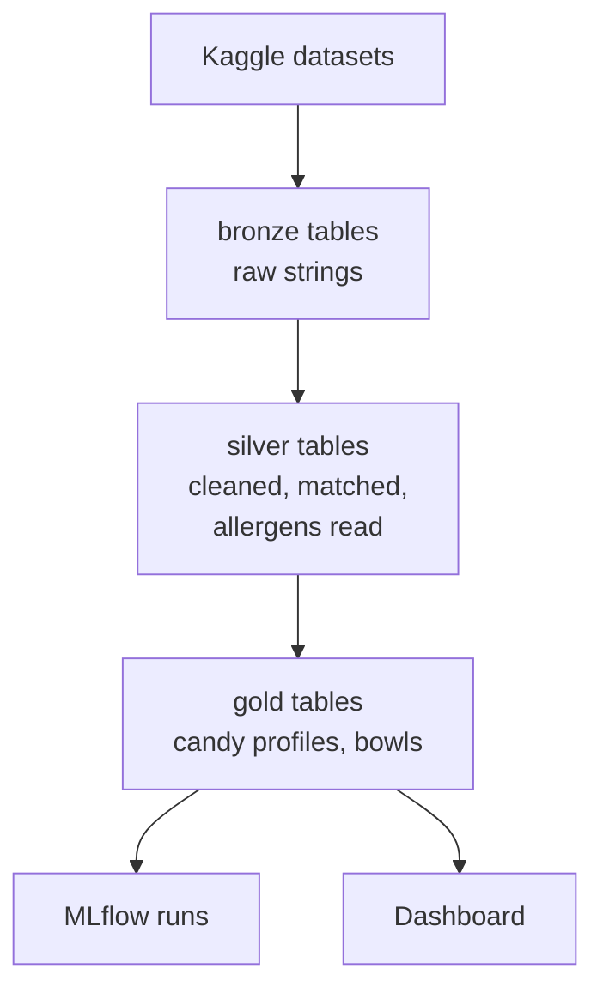

A kid at the door is allergic to peanuts.

The five most popular candies in America's favorite-candy vote all list peanuts, sometimes list them, or warn they may contain them.

So what goes in the bowl?

I built [CandyOps](https://github.com/kidskoding/candyops) to answer that question with public data. It takes a popularity ranking of Halloween candy, matches each candy to real ingredient labels, and builds the best bowl a host can hand out for each common allergy. I expected the hard part to be the pipeline, **but the hard part was deciding which product labels actually belong to which candy**, and one mistake there put a peanut candy into the peanut-free bowl.

## Why Halloween is hard for kids with food allergies

Halloween is one of the biggest candy seasons in the United States. The National Retail Federation, the largest US retail trade group, [forecast a record $13.1 billion in Halloween spending for 2025](https://nrf.com/media-center/press-releases/nrf-consumer-survey-finds-halloween-spending-to-reach-record-13-1-billion), with $3.9 billion of it on candy. At the same time, the CDC's National Center for Health Statistics found that [5.8% of US children had a diagnosed food allergy in 2021](https://www.cdc.gov/nchs/products/databriefs/db459.htm), which works out to roughly one kid in every seventeen.

Most of the candy in a trick-or-treat bowl comes from a few large confectioners. Hershey says it [captured 36.1% of US Halloween retail dollar sales in 2025](https://www.thehersheycompany.com/en_us/home/newsroom/blog/hersheyween-returns-how-hershey-defines-the-halloween-season.html), and its [brands](https://www.thehersheycompany.com/en_us/home/brands.html) include **Hershey's**, **Reese's**, **KitKat**, and **Jolly Rancher**. Mars makes [chocolate and candy brands](https://www.mars.com/our-brands/mars-snacking) including **M&M's**, **Snickers**, **Twix**, **Skittles**, and **Starburst**. Mondelez International is best known for **Oreo**, and its [candy brands](https://www.mondelezinternational.com/our-brands/) include **Cadbury**, **Milka**, **Toblerone**, and **Sour Patch Kids**.

**Many of those best sellers are built on common allergens:** peanuts, tree nuts, milk, and wheat. A host who wants every kid to leave with something good has to know which candies are safe, and the package in the bowl is the only label they get to read.

## The two datasets

No single public dataset answers the question, so CandyOps joins two from Kaggle that were never meant to meet.

| Dataset | What it gives | Size and mess |
|---|---|---|
| [FiveThirtyEight's Ultimate Halloween Candy Power Ranking](https://www.kaggle.com/datasets/fivethirtyeight/the-ultimate-halloween-candy-power-ranking) (MIT) | How often each of 85 candies won about 269,000 head-to-head votes | Tiny, but its apostrophes are garbled (`HersheyÕs`) and two of the "candies" are coins |
| [Open Food Facts](https://www.kaggle.com/datasets/openfoodfacts/world-food-facts) (ODbL) | Ingredients, allergens, sugar, and serving size of packaged foods | About 1 GB, 356,001 products by 163 columns, crowdsourced, in many languages |

FiveThirtyEight, the data journalism site, ran its candy vote by showing people two candies at a time and asking which they would rather get. Each row is one candy, a few yes-or-no traits, and its win rate:

```csv
competitorname,chocolate,fruity,caramel,peanutyalmondy,nougat,crispedricewafer,hard,bar,pluribus,sugarpercent,pricepercent,winpercent
ReeseÕs Peanut Butter cup,1,0,0,1,0,0,0,0,0,.72000003,.65100002,84.18029
One dime,0,0,0,0,0,0,0,0,0,.011,.116,32.261086
```

Open Food Facts is a crowdsourced database of packaged food, where volunteers type in labels from the products in front of them. **Its size is useful, but its mess is the real story:** 26 rows contain a stray carriage return that most CSV readers treat as a line break, which turns 356,001 products into 356,027.

Only 37,177 products fill in the allergen field at all, which is why CandyOps reads allergens from the ingredient list itself, which 283,859 products have.

## What the bowls look like

For each restriction, CandyOps builds a bowl of the 10 most popular candies whose labels list none of the restricted allergens, then compares the bowl's average win rate with the unrestricted bowl's. Removing two coins leaves 83 ranked candies.

| Restriction | Candies allowed | Popularity kept | Top of the bowl |
|---|---|---|---|
| None | 83 | 100.0% | Reese's Peanut Butter Cup, Reese's Miniatures, Twix |
| Gluten-free | 37 | 88.2% | Reese's Peanut Butter Cup, Reese's Miniatures, Reese's Pieces |
| Peanut-free | 43 | 78.0% | Starburst, Rolo, Skittles |
| Nut-free | 41 | 77.1% | Starburst, Rolo, Skittles |
| Milk-free | 30 | 74.6% | Starburst, Skittles, Sour Patch Kids |
| Free of all six | 18 | 68.7% | Skittles, Sour Patch Kids, Haribo Gold Bears |

**A peanut-free bowl keeps 78% of the popularity of the best possible bowl, and a bowl free of all six allergens on its labels (peanut, tree nut, milk, gluten, soy, and egg) still keeps 68.7%:** that surprised me, because the top of the ranking is almost all peanut butter and chocolate, yet fruity candy like Skittles and Starburst holds up well in the vote.

## Lesson 1: The join is the hard part

The ranking says "Snickers," and Open Food Facts has products like "snickers minis" from Mars, which is the same candy, and "snickers almond," which is a different one. My first attempt matched on the candy's name alone. **It linked 53 of the 83 candies, and it pulled in 80 products that were not candy at all:** coffee creamers, ice cream, and cereal that borrow a candy's name.

A record like this one, lowercased the way the matcher sees it, explains why:

```text
almond joy, gourmet coffee creamer, milk chocolate almond || international delight,  dean foods company
```

The fix was a set of hand-written matching rules kept as a dbt seed, an include and exclude pattern per candy, plus a list of words that mark a product as not candy (`creamer`, `ice cream`, `cereal`, `made with`). With those rules CandyOps links 68 candies to 1,234 products, and none of them is a creamer.

> Joining two datasets is not a technical step you do once. It is a set of decisions about what counts as the same thing.

## Lesson 2: A matching mistake becomes a safety mistake

In an earlier run, the peanut-free bowl started with Nestle Butterfinger, a bar made with peanut butter. The pipeline had not misread an ingredient list. Instead, the matching rules had linked Butterfinger to products like "crispy marshmallow squares made with Nestle Butterfinger" and a "gourmet Butterfinger caramel apple," whose labels describe the dessert rather than the bar, and none of them listed peanuts.

**A bad join did not produce a slightly wrong number, but rather a peanut candy recommended to a kid with a peanut allergy:** the fix now rejects derived products like these, and a unit test now pins both product names so the mistake cannot come back. With the lookalikes gone, Butterfinger has no matched product with an ingredient list in this snapshot, so it is marked unknown and stays out of every restricted bowl.

There is now a second guard that does not depend on matching at all. FiveThirtyEight's ranking already tags each candy as peanut or almond, so the peanut-free and nut-free bowls drop every tagged candy before they look at a single label.

## Lesson 3: Unknown has to mean excluded

Crowdsourced data has holes, and the safe way to handle a hole depends on what the answer is used for. **CandyOps allows a candy into a bowl only when every restricted allergen is missing from at least two matched products with an ingredient list:** only 59 of the 83 candies have that much evidence, so a candy like Reese's Stuffed with Pieces, which matched no products at all, never enters a restricted bowl.

The same caution applies to recipes. A bar sold in the US and in Europe can have different ingredients, so CandyOps uses US products whenever at least two have ingredient lists and only falls back to every country when it has to. **The pipeline gives up popularity to avoid guessing**, which is the right trade for a question about kids' health.

## How it runs on Databricks

The whole pipeline runs on Databricks Free Edition as one serverless job. A **Python** notebook downloads both pinned Kaggle versions and loads them unchanged into bronze tables, dbt cleans and matches them into silver and gold tables, and a second notebook logs every bowl to MLflow.



**The safety rule lives in the tests, not just in my head:** `dbt build` fails if any candy in a restricted bowl lists a restricted allergen, if a candy tagged as peanut or almond reaches a peanut-free or nut-free bowl, if any ranked candy is missing a matching rule, or if the raw row counts drift from 85 candies and 356,001 products.

## What this could mean for a host or a candy maker

For a host, the result is a short shopping list. Skittles, Sour Patch Kids, and Haribo Gold Bears show up in every restricted bowl, and Swedish Fish in four of the five, so a bowl built around them works for most kids without giving up much popularity.

For candy makers and retailers, the project shows how much depends on clean, structured labels. When allergen information is only in free text, or only on the package, anyone trying to answer "is this safe?" at scale has to rebuild it from the ingredient list, and the mistakes in that step land on the kids the data was meant to help.

## What this model does not tell you

Both datasets are 2017 snapshots, and recipes have changed since then. The allergen parser reads common English, French, and German ingredient terms, not every phrasing, and the popularity numbers come from an online vote rather than sales. **This is a data project, not medical advice: always read the package label before handing candy to a kid with a food allergy.**

## What I'm taking from this

- **Treat the join as the riskiest step:** matching records across datasets is where silent errors enter.
- **Write the safety rule down as a test:** a rule that only lives in your head stops protecting anyone after the next change.
- **Let unknown mean excluded when the stakes are high:** missing evidence is not evidence of safety.
- **Check individual matched rows, not only the totals:** a marshmallow square and a caramel apple were enough to put Butterfinger in the wrong bowl.

For the kid at the door with a peanut allergy, the answer is Starburst, Rolo, or Skittles, and a parent still reads the wrapper.

I started this project thinking the work would be in Spark and dbt, and it turned out to be in deciding what counts as the same candy.

A bowl for every kid starts with knowing what is in each wrapper.

And that starts with the join.
