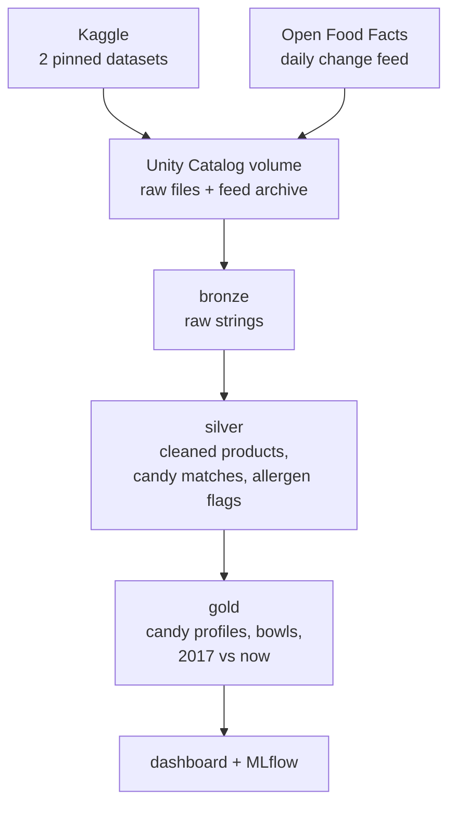

If you had gone trick-or-treating anytime during your youth, chances are you came home with a lot of **Reese's Peanut Butter Cups**. They are pretty much **everywhere**. An [Instacart report on its 2025 orders](https://www.chowhound.com/2299896/best-selling-halloween-candy-america-reeses/) found that Reese's was the No. 1 candy sold in 40 of the 50 states, plus Washington, D.C.

**That is a real problem for a kid with a peanut allergy, because the most popular candy in the bowl is the one they cannot eat.**

As Halloween was coming close during this time of the this year, I was curious to see what the best bowl looks like when it has to be safe, and how much a host gives up on buying certain candies to make it safe.

So I built **candyops**, a data pipeline on Databricks and dbt that answers one question: **for each common food allergy, which 10 popular candies can you still hand out, and how much less popular is that bowl than one with no restrictions?**

## Why this matters

Food allergies are common in children. **The CDC found that 5.8% of US children had a diagnosed food allergy in 2021**, about 1 in 17, according to its [National Health Interview Survey data brief](https://www.cdc.gov/nchs/products/databriefs/db459.htm). Halloween is the one night of the year when those kids collect food from strangers.

The labels do not make it easy. US law requires packaged food to name the major allergens it contains, but **"may contain" warnings are voluntary and vary from one manufacturer to the next**, as the [National Agricultural Law Center explains](https://nationalaglawcenter.org/food-labeling-the-regulation-of-food-allergen-labels/). The nonprofit Food Allergy Research & Education (FARE) runs the [Teal Pumpkin Project](https://www.foodallergy.org/media-room/bring-magic-halloween-teal-pumpkin-project) so families can signal that they offer non-food treats instead. That works, but plenty of hosts still want to hand out candy that every kid can eat.

Three companies make most of the candy in this story.

**The Hershey Company** makes **Reese's**, **Hershey's Kisses** and, in the US, **Kit Kat**. Reese's Peanut Butter Cups took first place in the vote this project uses, and they are built around peanut butter.

**Mars** makes **Snickers**, **M&M's**, **Twix**, **Milky Way**, **Skittles** and **Starburst**. Its chocolate bars sit near the top of the vote; its fruit candies show up again later in this post.

**Ferrara**, part of Ferrero, makes **Butterfinger**, **Baby Ruth**, **100 Grand** and **Nerds**, brands [Ferrero bought from Nestlé's US candy business in 2018](https://www.ferrero.com/news/ferrero-to-acquire-nestle-s-us-confectionary-business). Butterfinger plays a central role later, because the data nearly got it wrong.

## The data

candyops joins two public datasets from Kaggle that were never meant to meet, and a third live source that keeps the answer current.

| Source | What it holds | Size |
|---|---|---|
| [FiveThirtyEight's Ultimate Halloween Candy Power Ranking](https://www.kaggle.com/datasets/fivethirtyeight/the-ultimate-halloween-candy-power-ranking) | How often each candy won a head-to-head vote | 85 entries from about 269,000 matchups |
| [Open Food Facts (world-food-facts)](https://www.kaggle.com/datasets/openfoodfacts/world-food-facts) | Ingredients, allergens, sugar and serving size of packaged foods | 356,001 products x 163 columns, about 1 GB |
| [Open Food Facts daily change feed](https://static.openfoodfacts.org/data/delta/index.txt) | Every product edited each day | 98,694 edits in its first two weeks |

**FiveThirtyEight** was a data journalism site; its writer Walt Hickey built the ranking in 2017 by asking readers to pick between two random candies, again and again. **Open Food Facts** is a nonprofit, crowdsourced database of food labels that anyone can edit, a bit like Wikipedia for packaged food. Both Kaggle files are 2017 snapshots, and the pipeline pins their versions so every run reads the same bytes.

This is one real row from Open Food Facts, a US pack of Reese's Peanut Butter Cups:

```text
code             0768395475482
product_name     Peanut Butter Cups
brands           Reese's
countries_tags   en:united-states
ingredients      Milk chocolate (sugar; cocoa butter; chocolate; nonfat milk; milk fat; lactose;
                 soy lecithin; pgpr, emulsifier); peanuts; sugar; dextrose; salt; tbhq (preservative)
allergens        (empty)
traces           (empty)
serving_size     42 g (1 PACKAGE)
sugars_100g      50
```

**The allergen field is empty, even though the ingredients plainly list milk, soy and peanuts:** only 37,177 of the 356,001 products fill it in. Most of the allergen information lives in free text, so the pipeline has to read ingredient lists the way a parent reads a wrapper.

The raw files are messier than they look. The candy ranking stores apostrophes as `HersheyÕs` and includes two coins (a dime and a quarter) as joke entries. The Open Food Facts file has 26 rows with a stray carriage return inside a field; pandas and most CSV readers treat it as a line break and report 356,027 rows instead of 356,001. A test pins the correct count, so a reader that splits on the wrong character fails loudly instead of quietly inventing rows.

## How the pipeline works



A Databricks job runs every morning. A **Python** notebook downloads the Kaggle files into bronze tables unchanged, as strings. A second notebook archives each new change-feed file and loads it with Auto Loader, which remembers which files it has already read, so each day's edits land exactly once. Open Food Facts keeps only about two weeks of those files, so the archive is the only copy once they expire.

From there, **dbt** builds everything in **SQL**. The silver models clean types and whitespace, parse serving sizes like `1.55 oz` into grams, match products to candies, and turn ingredient text into allergen flags for peanut, tree nut, milk, gluten, soy and egg. The parser splits "may contain" warnings away from real ingredients and ignores lookalikes such as "cocoa butter" (not dairy) and "peanut-free". The gold models give each candy a status per allergen (`contains`, `varies`, `may_contain`, `not_listed` or `unknown`) and pick the bowls. **dbt runs 41 tests on every build**, including one that fails if any candy in a peanut-free bowl is not peanut-free.

## The results

Each bowl holds the 10 most popular candies whose matched labels list none of the restricted allergens. "Popularity kept" compares a bowl's average win rate with the unrestricted bowl's.

| Restriction | Candies allowed | Popularity kept | The bowl, most popular first |
|---|---|---|---|
| None | 83 | 100.0% | Reese's Peanut Butter Cup, Reese's Miniatures, Twix, Kit Kat, Snickers, Reese's Pieces, Milky Way, Reese's Stuffed with Pieces, Peanut Butter M&M's, Butterfinger |
| Gluten-free | 37 | 88.2% | Reese's Peanut Butter Cup, Reese's Miniatures, Reese's Pieces, Peanut Butter M&M's, Peanut M&M's, Skittles, Sour Patch Kids, Junior Mints, Haribo Gold-Bears, Nerds |
| Peanut-free | 43 | 78.0% | Starburst, Rolo, Skittles, Sour Patch Kids, Hershey's Special Dark, Junior Mints, Haribo Gold-Bears, Nerds, Skittles Wild Berry, Swedish Fish |
| Nut-free | 41 | 77.1% | Starburst, Rolo, Skittles, Sour Patch Kids, Junior Mints, Haribo Gold-Bears, Nerds, Skittles Wild Berry, Swedish Fish, Lifesavers Big Ring Gummies |
| Milk-free | 30 | 74.6% | Starburst, Skittles, Sour Patch Kids, Haribo Gold-Bears, Nerds, Skittles Wild Berry, Swedish Fish, Lifesavers Big Ring Gummies, Airheads, Haribo Sour Bears |
| Free of all six | 18 | 68.7% | Skittles, Sour Patch Kids, Haribo Gold-Bears, Skittles Wild Berry, Swedish Fish, Lifesavers Big Ring Gummies, Haribo Sour Bears, Welch's Fruit Snacks, Runts, Dots |

### Peanuts cost the most, gluten the least

**Every candy in the unrestricted top 10 is chocolate, and at least five of them list peanuts outright:** four Reese's products and Peanut Butter M&M's sit in that top 10, which is exactly why the peanut-free bowl loses so much. It keeps 78% of the popularity, and the whole top of the list changes.

**A gluten-free bowl barely suffers:** it keeps 88% and still leads with Reese's, because Reese's Peanut Butter Cups list no wheat. A milk-free bowl drops to 75%, since milk chocolate is off the table.

> The safest bowl is a bowl of gummies and fruit candy, and it still keeps about two-thirds of the popularity.

**Avoiding all six allergens leaves 18 candies and keeps 68.7%:** Skittles, Sour Patch Kids, Swedish Fish, Haribo Gold-Bears and friends. That bowl is not a sad compromise. Skittles and Sour Patch Kids rank in the top third of the vote on their own.

### What the top candies actually contain

| Candy | Win rate | Peanut | Tree nut | Milk | Gluten | Soy | Egg |
|---|---|---|---|---|---|---|---|
| Reese's Peanut Butter Cup | 84.2% | contains | not listed | contains | not listed | contains | not listed |
| Twix | 81.6% | varies | varies | contains | contains | contains | not listed |
| Kit Kat | 76.8% | may contain | varies | contains | contains | varies | not listed |
| Snickers | 76.7% | contains | varies | contains | varies | contains | varies |
| Milky Way | 73.1% | may contain | may contain | contains | contains | contains | varies |

`varies` means some matched products list the allergen and others do not, usually because the same bar is made with different recipes in different countries.

## Matching candy names was the hard part

The ranking says "Snickers". Open Food Facts has hundreds of products with "Snickers" in the name, including ice cream bars, protein bars and almond variants. **Joining the two datasets is the riskiest step in the whole pipeline, because a wrong match silently changes an allergy verdict.**

I compared two approaches. Matching on the candy's name alone found 53 of the 83 candies and pulled in **80 products that are not candy at all**, such as Almond Joy coffee creamer, Twix yogurt and Mounds ice cream bars. Hand-written matching rules, stored as a dbt seed so they are reviewed like code, found 68 candies with no non-candy matches. The rules handle spellings like "KitKat" and "Mike and Ike", and exclude variants like Snickers Almond.

## The data almost said Butterfinger was peanut-free

**Butterfinger is made with peanuts, yet the first version of the peanut-free bowl included it:** the 2017 data had only three Butterfinger products. One was the bar itself, with no ingredient list. The other two were a caramel apple and a box of marshmallow squares "made with" Butterfinger, and their ingredient lists never mention peanuts.

The fix came in two layers. **Products "made with" a candy no longer count as evidence for that candy**, and neither do caramel apples or other derived treats. And **the ranking itself flags candies made with peanuts or almonds**, so the pipeline now keeps every flagged candy out of peanut-free and nut-free bowls, no matter what the labels say. A dbt test enforces it on every run.

The change feed later confirmed the guard was right: this week's Butterfinger labels list peanuts, milk and soy.

### Two more traps

**Mixed packs leak one candy's allergens into another:** a "Reese's & Kit Kat Halloween Candy Assortment" made Kit Kat look like it contains peanuts. Assortments and variety packs are now excluded.

**A couple of junk records can outvote dozens of good ones:** the pipeline prefers US labels because US and European recipes differ. With the threshold at two products, Snickers' only two current US records (a popcorn listing named "Snickers" and a wrapper scan of customer-service text) outweighed 25 proper labels from other countries and made Snickers look peanut-free. US labels now decide only when there are at least three.

> Every one of these bugs made a candy look safer than it is. In an allergy dataset, that is the direction that matters.

## Is the 2017 answer still true?

Both Kaggle files are from 2017, so the obvious question is whether the labels on shelves today still agree. The daily change feed answers it. Its first two weeks held 98,694 product edits, 348 of them for ranked candies, and 21 candies had at least two current products with ingredient lists:

| Each candy, 2017 vs now | Candies |
|---|---|
| At least one allergen status changed | 12 |
| All compared allergens unchanged | 7 |
| Newly covered (too little 2017 data) | 2 |
| Not enough current data yet | 62 |

**Most changes tighten the warnings rather than loosen them:** Snickers and Milky Way moved from `varies` to `contains` for egg, which matches their egg-white nougat. Hershey's milk chocolate now carries a tree-nut "may contain" warning that the 2017 records did not show. Butterfinger, unknown in 2017, now has labels that list peanuts, milk and soy.

The bowls stay on the pinned 2017 data, so the results above are reproducible. The comparison grows every morning as the job archives another day of the feed, and a dbt test warns if a day is ever missed.

## What this could mean for a real candy maker

For a company like Hershey or Mars, the same pipeline shape could watch how their products appear in public food databases, flag listings that show the wrong allergens, and spot when a recipe change has not reached the crowdsourced data. For a host, it is simpler: **a peanut-free or nut-free bowl built from Starburst, Skittles, Sour Patch Kids and Swedish Fish gives up about a fifth of the popularity, not most of it.**

This is a demo, not a safety tool. The allergen parser reads English, French and German but not every phrasing, the 2017 data is old, and 62 candies do not yet have enough current labels to compare. **Always read the package label.**

## The bowl, revisited

Every Halloween bowl has a Reese's in it.

It does not have to.

The code, the dbt models and the results are on [GitHub](https://github.com/kidskoding/candyops).

## References
<a name="references"></a>

- [The Ultimate Halloween Candy Power Ranking, FiveThirtyEight, via Kaggle (MIT)](https://www.kaggle.com/datasets/fivethirtyeight/the-ultimate-halloween-candy-power-ranking)
- [Open Food Facts world-food-facts, Open Food Facts, via Kaggle (ODbL)](https://www.kaggle.com/datasets/openfoodfacts/world-food-facts)
- [Open Food Facts daily change feed index, Open Food Facts (ODbL)](https://static.openfoodfacts.org/data/delta/index.txt)
- [America's Bestselling Halloween Candy Is An Absolute Classic, Chowhound (citing Instacart's 2025 orders)](https://www.chowhound.com/2299896/best-selling-halloween-candy-america-reeses/)
- [Diagnosed Allergic Conditions in Children Aged 0-17 Years: United States, 2021, CDC National Center for Health Statistics, Data Brief No. 459](https://www.cdc.gov/nchs/products/databriefs/db459.htm)
- [Food Labeling: The Regulation of Food Allergen Labels, National Agricultural Law Center](https://nationalaglawcenter.org/food-labeling-the-regulation-of-food-allergen-labels/)
- [Teal Pumpkin Project, Food Allergy Research & Education (FARE)](https://www.foodallergy.org/media-room/bring-magic-halloween-teal-pumpkin-project)
- [Ferrero to acquire Nestlé's US confectionery business, Ferrero](https://www.ferrero.com/news/ferrero-to-acquire-nestle-s-us-confectionary-business)
- [candyops source code, dbt models and results, GitHub](https://github.com/kidskoding/candyops)
- [Cover photo: Candies and Chocolate Bars on Black Surface, Pexels](https://www.pexels.com/photo/candies-and-chocolate-bars-on-black-surface-14147300/)
