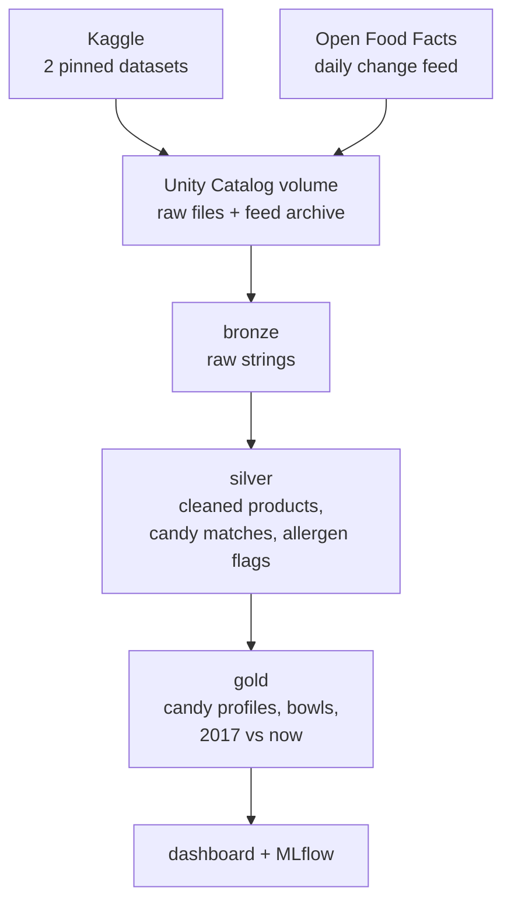

If you had gone trick-or-treating anytime during your youth, chances are you came home with a lot of **Reese's Peanut Butter Cups**. They are pretty much everywhere. An [Instacart report on its 2025 orders](https://www.chowhound.com/2299896/best-selling-halloween-candy-america-reeses/) found that Reese's was the No. 1 candy sold in 40 of the 50 states, plus Washington, D.C.

**This is a major issue for those kids who may have a peanut allergy, because the most popular candy in the bowl is the one they cannot eat.**

With Halloween coming up this year, I was curious to see what the best bowl looks like when it has to be safe, and how much a host gives up on buying certain candies to make it safe for all children.

So I built [**candyops**](https://github.com/kidskoding/candyops), a data pipeline on Databricks and dbt that answers one question: **for each common food allergy, which 10 popular candies can you still hand out, and how much less popular is that bowl than one with no allergy restrictions?**

## Why this matters

Food allergies are quite common in children. **The CDC found that 5.8% of US children had a diagnosed food allergy in 2021**, about 1 in 17, according to its [National Health Interview Survey data brief](https://www.cdc.gov/nchs/products/databriefs/db459.htm). And this is especially important, considering that Halloween is the one night of the year when those kids collect food from strangers.

The labels many of these manufacturers produce do not make it easy for kids who have such food allergies, like peanuts. The US law requires packaged food to name the major allergens it contains, but many **"may contain" warnings are voluntary and vary from one manufacturer to the next**, as the [National Agricultural Law Center explains](https://nationalaglawcenter.org/food-labeling-the-regulation-of-food-allergen-labels/). The nonprofit Food Allergy Research & Education (FARE) runs the [Teal Pumpkin Project](https://www.foodallergy.org/media-room/bring-magic-halloween-teal-pumpkin-project) so families can signal that they offer non-food treats instead. While this is a viable solution, plenty of hosts and houses would much rather want to hand out candy that every kid can eat.

A lot of the candy you eat comes from **three** major corporations:

**The Hershey Company** is known for their iconic chocolates and candies, including **Hershey's**, **Reese's**, **Hershey's Kisses**, **Jolly Rancher**, and **Kit Kat**. As previously discussed, Reese's Peanut Butter Cups are some of the most common type of candy kids receive during trick or treating, and they are built around peanut butter!

**Mars** is known for their iconic chocolates and candies, including **Snickers**, **M&M's**, **Twix**, **3 Musketeers**, **Milky Way**, **Skittles** and **Starburst**. Its lineup covers both kinds of candy in a Halloween bowl: chocolate bars like Snickers and Twix, made with milk chocolate, and fruit candies like Skittles and Starburst, made without chocolate or nuts. That difference matters later, because the fruit candies are what remain once the common allergens are removed.

**Ferrero** is known for their iconic chocolatey confections, including **Ferrero Rocher**, **Nutella**, and **Kinder Joy**. They also own many iconic chocolates and candies that are very common during the Halloween season, like **Butterfinger**, **Baby Ruth**, **100 Grand**, and **Nerds**, which came with [Nestlé's US candy business when Ferrero bought it in 2018](https://www.ferrero.com/news/ferrero-to-acquire-nestle-s-us-confectionary-business). Later on, we will see how Butterfinger exposed the biggest risk in this project, where the data nearly labeled it peanut-free, even though it is made with peanuts.

## The data

I combined two public datasets from Kaggle that were collected separately and share no common ID, plus a third live source that keeps the results up to date.

In **Table 1.1**, each of the three sources is listed with what it holds and its size.

| Source | What it holds | Size |
|---|---|---|
| [FiveThirtyEight's Ultimate Halloween Candy Power Ranking](https://www.kaggle.com/datasets/fivethirtyeight/the-ultimate-halloween-candy-power-ranking) | How often each candy won a head-to-head vote | 85 entries from about 269,000 matchups |
| [Open Food Facts (world-food-facts)](https://www.kaggle.com/datasets/openfoodfacts/world-food-facts) | Ingredients, allergens, sugar and serving size of packaged foods | 356,001 products x 163 columns, about 1 GB |
| [Open Food Facts daily change feed](https://static.openfoodfacts.org/data/delta/index.txt) | Every product edited each day | 98,694 edits in its first two weeks |

<p class="text-sm text-nvim-gray -mt-4 text-center">Table 1.1: The three data sources candyops combines, what each one holds, and its size.</p>

**FiveThirtyEight** was a data journalism site, where its writer Walt Hickey built the ranking in 2017 by asking readers to pick between two random candies, again and again.

**Open Food Facts** is a nonprofit, crowdsourced database of food labels that anyone can edit. Both Kaggle files are 2017 snapshots, and the pipeline pins their versions so every run reads exactly the same data.

This is one real row from Open Food Facts, a US pack of Reese's Peanut Butter Cups:

```text
code             0768395475482
product_name     Peanut Butter Cups
brands           Reese's
countries_tags   en:united-states
ingredients      Milk chocolate (sugar; cocoa butter; chocolate; nonfat milk; milk fat; lactose;
                 soy lecithin; pgpr, emulsifier); peanuts; sugar; dextrose; salt; tbhq (preservative)
allergens        (empty)
traces           (empty)
serving_size     42 g (1 PACKAGE)
sugars_100g      50
```

**The allergen field is empty, even though the ingredients list milk, soy and peanuts:** only 37,177 of the 356,001 products fill it in. Most of the allergen information is only in the ingredient text, so the pipeline has to read each ingredient list to find allergens.

The raw files are messier than they look. The candy ranking stores apostrophes as `HersheyÕs` and includes two coins (a dime and a quarter) as joke entries. The Open Food Facts file has 26 rows with a stray carriage return inside a field; pandas and most CSV readers treat it as a line break and report 356,027 rows instead of 356,001. A test pins the correct count, so a reader that splits on the wrong character fails with an error instead of producing extra rows.

## How the pipeline works



I set up a Databricks job that runs every day and stores the data in a **medallion architecture**, which organizes it into three layers: <span class="font-bold text-nvim-orange">bronze</span> pulls in the raw data from the sources unchanged, <span class="font-bold text-nvim-fg2">silver</span> cleans it and reads the allergens from each ingredient list, and <span class="font-bold text-nvim-yellow">gold</span> turns it into the results this post reports, such as each candy's allergen status and the allergy-safe bowls.

The job starts by downloading the Kaggle datasets into two bronze tables, with every value kept as text: `bronze_candy_ranking`, with one row for each of the 85 candies in the vote, and `bronze_off_products`, with all 356,001 Open Food Facts products and their 163 columns.

A second notebook then archives each new change-feed file and loads it with Auto Loader, which remembers which files it has already read, so each day's edits are loaded exactly once. Open Food Facts keeps only about two weeks of those files, so the archive is the only copy once they expire.

From there, **dbt** builds everything in **SQL**. The silver models will clean data types and whitespace within the data, parse serving sizes like `1.55 oz` into grams, match products to candies, and turn ingredient text into allergen flags for peanut, tree nut, milk, gluten, soy and egg. The parser splits "may contain" warnings away from real ingredients and ignores lookalikes such as "cocoa butter" (not dairy) and "peanut-free". The gold models give each candy a status per allergen (`contains`, `varies`, `may_contain`, `not_listed` or `unknown`) and pick the bowls. **dbt runs 51 tests on every build**, including one that fails if any candy in a peanut-free bowl is not peanut-free.

## The results

### How to read the results

Every allergy-safe bowl is compared with the same baseline, the **unrestricted bowl**: the 10 most popular candies overall, which is the bowl a host would put out without thinking about allergies. It starts with Reese's Peanut Butter Cups, Reese's Miniatures and Twix, so it is the opposite of allergen-free: almost every candy in it contains peanuts, milk or both.

In **Table 1.2**, each of the four measures the results use is defined, with a worked example from the data.

| Measure | Definition | Example |
|---|---|---|
| Win rate | The percentage of a candy's head-to-head matchups that voters picked it. In each matchup, FiveThirtyEight showed a voter two randomly chosen candies and asked which one they would rather receive. The value comes from the dataset's `winpercent` column, based on about 269,000 matchups in total. | Reese's Peanut Butter Cups won 84.2% of their matchups, the highest of the 83 candies. |
| Candies allowed | The number of the 83 ranked candies that pass a restriction. A candy passes when every restricted allergen has the status `not_listed`, based on at least two matched products with an ingredient list. Peanut-free and nut-free restrictions also exclude any candy FiveThirtyEight tags as containing peanuts or almonds. | 43 candies pass the peanut-free restriction. |
| Bowl | The 10 candies with the highest win rate among the candies allowed. The **unrestricted bowl** applies no restriction, so it is simply the 10 candies with the highest win rate overall; its average win rate is 76.3%. | The peanut-free bowl starts with Starburst, Rolo, and Skittles. |
| Popularity kept (popularity score) | A restricted bowl's average win rate divided by the unrestricted bowl's average win rate. | Peanut-free: 59.5% ÷ 76.3% = 78.0%. |

<p class="text-sm text-nvim-gray -mt-4 text-center">Table 1.2: Definitions of the four measures used in the results, each with a worked example from the data.</p>

**"Popularity kept" compares a bowl's average win rate with the unrestricted bowl's:** a popularity score of 78% means the candies in the peanut-free bowl win their matchups, on average, about 22% less often than the candies in the unrestricted bowl. A value of 100% would mean a restriction costs no popularity at all.

### The most popular candies carry the most allergens

The Reese's problem from the start of this post is not a one-off. In **Figure 1.1**, each of the 59 candies with at least two labeled products is plotted by how many of the six allergens its label lists and how often it won its matchups.


<p class="text-sm text-nvim-gray -mt-4 text-center">Figure 1.1: Win rate against the number of major allergens each candy's label lists, including may-contain warnings. Chocolate candies are orange; lines show the average win rate for each count.</p>

**Candies with none of the six allergens average a 45% win rate, while candies with five or more average 66%.** Most of that gap comes from chocolate, which almost always contains milk and soy, so the candies voters like best are also the hardest for allergic kids to eat.

In **Table 1.3**, five of the most popular candies are shown with their status for each allergen.

| Candy | Win rate | Peanut | Tree nut | Milk | Gluten | Soy | Egg |
|---|---|---|---|---|---|---|---|
| Reese's Peanut Butter Cup | 84.2% | contains | not listed | contains | not listed | contains | not listed |
| Twix | 81.6% | varies | varies | contains | contains | contains | not listed |
| Kit Kat | 76.8% | may contain | varies | contains | contains | varies | not listed |
| Snickers | 76.7% | contains | varies | contains | varies | contains | varies |
| Milky Way | 73.1% | may contain | may contain | contains | contains | contains | varies |

<p class="text-sm text-nvim-gray -mt-4 text-center">Table 1.3: Allergen status of five of the most popular candies, based on their matched Open Food Facts labels.</p>

`varies` means some matched products list the allergen and others do not, usually because the same bar is made with different recipes in different countries.

### What each allergy costs a bowl

In **Table 1.4**, each allergy restriction is shown with the number of candies allowed, the popularity kept, and the resulting bowl.

| Restriction | Candies allowed | Popularity kept | The bowl, most popular first |
|---|---|---|---|
| None | 83 | 100.0% | Reese's Peanut Butter Cup, Reese's Miniatures, Twix, Kit Kat, Snickers, Reese's Pieces, Milky Way, Reese's Stuffed with Pieces, Peanut Butter M&M's, Butterfinger |
| Gluten-free | 37 | 88.2% | Reese's Peanut Butter Cup, Reese's Miniatures, Reese's Pieces, Peanut Butter M&M's, Peanut M&M's, Skittles, Sour Patch Kids, Junior Mints, Haribo Gold-Bears, Nerds |
| Peanut-free | 43 | 78.0% | Starburst, Rolo, Skittles, Sour Patch Kids, Hershey's Special Dark, Junior Mints, Haribo Gold-Bears, Nerds, Skittles Wild Berry, Swedish Fish |
| Nut-free | 41 | 77.1% | Starburst, Rolo, Skittles, Sour Patch Kids, Junior Mints, Haribo Gold-Bears, Nerds, Skittles Wild Berry, Swedish Fish, Lifesavers Big Ring Gummies |
| Milk-free | 30 | 74.6% | Starburst, Skittles, Sour Patch Kids, Haribo Gold-Bears, Nerds, Skittles Wild Berry, Swedish Fish, Lifesavers Big Ring Gummies, Airheads, Haribo Sour Bears |
| Free of all six | 18 | 68.7% | Skittles, Sour Patch Kids, Haribo Gold-Bears, Skittles Wild Berry, Swedish Fish, Lifesavers Big Ring Gummies, Haribo Sour Bears, Welch's Fruit Snacks, Runts, Dots |

<p class="text-sm text-nvim-gray -mt-4 text-center">Table 1.4: The 10-candy bowl for each allergy restriction, with the number of candies allowed and the share of the unrestricted bowl's popularity it keeps.</p>

In **Figure 1.2**, the popularity each bowl keeps is shown side by side, from the unrestricted bowl down to a bowl free of all six allergens.


<p class="text-sm text-nvim-gray -mt-4 text-center">Figure 1.2: The share of the unrestricted bowl's popularity that each allergy-safe bowl keeps, with the number of candies each restriction allows.</p>

**Every candy in the unrestricted top 10 is chocolate, and at least five of them directly have peanuts in them:** four Reese's products and Peanut Butter M&M's sit in that top 10, which is exactly why the peanut-free bowl loses so much. It keeps a **78% popularity score**, meaning its candies average 78% of the unrestricted bowl's win rate, and none of the 10 candies in the unrestricted bowl make it in.

**A gluten-free bowl loses the least popularity:** it keeps an **88.2% popularity score** and still leads with Reese's, because Reese's Peanut Butter Cups list no wheat. A milk-free bowl drops to a **74.6% popularity score**, because it excludes every candy made with milk chocolate. In **Figure 1.3**, each bowl is split into chocolate and non-chocolate candies.


<p class="text-sm text-nvim-gray -mt-4 text-center">Figure 1.3: Chocolate and non-chocolate candies in each 10-candy bowl. The milk-free bowl and the bowl free of all six allergens contain no chocolate at all.</p>

> The safest bowl is a bowl of gummies and fruit candy, and it still keeps about two-thirds of the popularity.

**Avoiding all six allergens leaves 18 candies and a 68.7% popularity score:** Skittles, Sour Patch Kids, Swedish Fish, Haribo Gold-Bears and others. That bowl still holds popular candy: Skittles and Sour Patch Kids rank in the top third of the vote.

**Swapping chocolate for fruit candy also adds sugar:** the unrestricted bowl has a median of 51.7 g of sugar per 100 g, while the peanut-free and nut-free bowls reach about 69 g, as shown in **Figure 1.4**.


<p class="text-sm text-nvim-gray -mt-4 text-center">Figure 1.4: Median sugar per 100 g in each bowl. Allergy-safe bowls rely on fruit candy, which contains more sugar per gram than chocolate.</p>

### Part of that cost is a labeling choice

Some candies are not excluded for what they contain, but for what they *might* contain. "May contain" warnings are voluntary, which means that no US law requires them or sets rules for when to use them: each candy maker decides on its own whether to print one, so two candies made on similar production lines can carry different warnings. So I rebuilt every bowl a second time, accepting candies whose only problem is a precautionary warning, to see how much of each cost those warnings cause.


<p class="text-sm text-nvim-gray -mt-4 text-center">Figure 1.5: Popularity kept by each bowl when may-contain warnings exclude a candy, and when they are accepted.</p>

**"May contain" warnings cost the peanut-free bowl 7.9 points of popularity score**, as shown in **Figure 1.5**. Kit Kat, Milky Way, M&M's and Nestle Crunch list no peanuts, yet each carries a peanut warning on at least one label, which keeps all four out. Accepting the warnings would lift the peanut-free bowl's popularity score from 78.0% to 85.9%. The nut-free bowl loses 4.2 points of popularity score the same way, and the gluten-free bowl loses 1.4 points to a single warning on Rolo.

This is not an argument to ignore the warnings: for a kid with a severe allergy, a shared production line is a real risk. It shows that **a meaningful share of what allergic kids give up comes from how candy makers label, not from what is in the candy.**

### The closest safe swap for each favorite

A host who wants a peanut-free bowl still needs to know what to buy instead. For each candy in the unrestricted top 10, the pipeline finds the most similar peanut-free candy using FiveThirtyEight's candy traits (chocolate, caramel, nougat, crisped rice, bar and others), plus how sugary and how expensive each candy is.


<p class="text-sm text-nvim-gray -mt-4 text-center">Figure 1.6: The most similar peanut-free candy for each favorite in the unrestricted bowl, with the win rate of each.</p>

**The closest swaps are recognizable:** Twix and Butterfinger point to Hershey's Special Dark, Kit Kat to Mounds, Snickers and Milky Way to Charleston Chew, and Reese's Pieces to Junior Mints, as shown in **Figure 1.6**. The catch is popularity. The best swap, Hershey's Special Dark, has a 59.2% win rate, more than 20 points below Twix's 81.6%. And the Reese's cups have no close match at all: their nearest peanut-free candy is Tootsie Roll Juniors, with a 43.1% win rate.

For a bowl free of all six allergens, the same search finds nothing similar. Every favorite maps to an unrelated gummy, because no chocolate candy passes all six restrictions.

### One bowl for the whole street

Most hosts do not know which allergies are coming to the door. So the last question is: **which single bowl gives the most trick-or-treaters a favorite they can eat?**

The pipeline answers it with a small optimization. About 2.2% of US children are allergic to peanuts, 1.9% to milk and 1.2% to tree nuts, according to a [national survey of 38,408 children published in *Pediatrics*](https://pubmed.ncbi.nlm.nih.gov/30455345/). The pipeline weights each group of kids by those rates and picks, one candy at a time, the 10 candies that maximize the average win rate of the best candy each kid can eat, counting zero for a kid with nothing safe in the bowl.


<p class="text-sm text-nvim-gray -mt-4 text-center">Figure 1.7: The 10-candy bowl that gives the most kids a favorite they can eat, weighting peanut, milk and tree-nut allergies by how common they are in US children.</p>

**One swap is enough:** the best bowl for a whole street is the regular top 10 with Butterfinger replaced by Starburst, as shown in **Figure 1.7**. That single change gives every kid with a peanut, milk or tree-nut allergy something to eat, and it lowers the bowl's average win rate from 76.3% to 75.9%, a 99.5% popularity score.

The optimization stops at one safe candy because allergic kids are a small share of the street, so each extra safe candy adds less than the chocolate it replaces. It also treats each allergy separately, and the survey rates for egg, wheat and soy could not be confirmed, so those allergies are left out.

## Matching candy names was the hard part

The ranking says "Snickers". Open Food Facts has hundreds of products with "Snickers" in the name, including ice cream bars, protein bars and almond variants. **Joining the two datasets is the riskiest step in the whole pipeline, because a wrong match can change a candy's allergy status without causing any error.**

I compared two approaches: matching on the candy's name alone, and hand-written matching rules stored as a dbt seed so they are reviewed like code. Name matching found 53 of the 83 candies and pulled in **80 products that are not candy at all**, such as an Almond Joy coffee creamer and a Hershey's ice cream bar. The hand-written rules found 68 candies with no non-candy matches, because they handle spellings like "KitKat" and "Mike and Ike" and exclude variants like Snickers Almond.

In **Figure 1.8**, the two approaches are compared on how many candies they match and how many non-candy products they pull in.


<p class="text-sm text-nvim-gray -mt-4 text-center">Figure 1.8: Name-only matching compared with the curated matching rules, by candies matched and non-candy products matched.</p>

## How a matching bug put Butterfinger in the peanut-free bowl

**Butterfinger is made with peanuts, yet the first version of the peanut-free bowl included it:** the 2017 data had only three Butterfinger products. One was the bar itself, with no ingredient list. The other two were a caramel apple and a box of marshmallow squares "made with" Butterfinger, and their ingredient lists never mention peanuts.

The fix has two parts. **Products "made with" a candy no longer count as evidence for that candy**, and neither do caramel apples or other derived treats. And **the ranking itself flags candies made with peanuts or almonds**, so the pipeline now keeps every flagged candy out of peanut-free and nut-free bowls, no matter what the labels say. A dbt test enforces it on every run.

The change feed later confirmed that this rule was correct: this week's Butterfinger labels list peanuts, milk and soy.

### Two more matching bugs

**Mixed packs make one candy look like it contains another candy's allergens:** a "Reese's & Kit Kat Halloween Candy Assortment" made Kit Kat look like it contains peanuts. Assortments and variety packs are now excluded.

**A couple of bad records can override dozens of good ones:** the pipeline prefers US labels because US and European recipes differ. With the threshold at two products, Snickers' only two current US records (a popcorn listing named "Snickers" and a wrapper scan of customer-service text) decided the result over 25 complete labels from other countries and made Snickers look peanut-free. US labels now decide only when there are at least three.

> Every one of these bugs made a candy look safer than it is. In allergy data, that is the dangerous kind of error.

## Is the 2017 answer still true?

Both Kaggle files are from 2017, so the obvious question is whether the labels on shelves today still agree. The daily change feed answers it. Its first two weeks held 98,694 product edits, 348 of them for ranked candies, and 21 candies had at least two current products with ingredient lists:

In **Figure 1.9**, the 83 candies are grouped by how their allergen status in the 2017 data compares with their current labels.


<p class="text-sm text-nvim-gray -mt-4 text-center">Figure 1.9: How each candy's allergen status in the 2017 data compares with its current labels from the daily change feed.</p>

**Most changes add allergen warnings rather than remove them:** Snickers and Milky Way moved from `varies` to `contains` for egg, which matches their egg-white nougat. Hershey's milk chocolate now carries a tree-nut "may contain" warning that the 2017 records did not show. Butterfinger, unknown in 2017, now has labels that list peanuts, milk and soy.

The bowls stay on the pinned 2017 data, so the results above are reproducible. The comparison grows every morning as the job archives another day of the feed, and a dbt test warns if a day is ever missed.

## What this could mean for a real candy maker

For a company like Hershey or Mars, the same kind of pipeline could check how their products appear in public food databases, flag listings that show the wrong allergens, and spot when a recipe change has not reached the crowdsourced data. The warning analysis points at something they control directly: precautionary labels cost a peanut-free bowl almost 8 points of popularity. For a host, it is simpler: **keep the bowl you were going to buy and swap one candy for Starburst so that every kid with a peanut, milk or tree-nut allergy has something to eat.**

## References
<a name="references"></a>

- [The Ultimate Halloween Candy Power Ranking, FiveThirtyEight, via Kaggle (MIT)](https://www.kaggle.com/datasets/fivethirtyeight/the-ultimate-halloween-candy-power-ranking)
- [Open Food Facts world-food-facts, Open Food Facts, via Kaggle (ODbL)](https://www.kaggle.com/datasets/openfoodfacts/world-food-facts)
- [Open Food Facts daily change feed index, Open Food Facts (ODbL)](https://static.openfoodfacts.org/data/delta/index.txt)
- [America's Bestselling Halloween Candy Is An Absolute Classic, Chowhound (citing Instacart's 2025 orders)](https://www.chowhound.com/2299896/best-selling-halloween-candy-america-reeses/)
- [Diagnosed Allergic Conditions in Children Aged 0-17 Years: United States, 2021, CDC National Center for Health Statistics, Data Brief No. 459](https://www.cdc.gov/nchs/products/databriefs/db459.htm)
- [Food Labeling: The Regulation of Food Allergen Labels, National Agricultural Law Center](https://nationalaglawcenter.org/food-labeling-the-regulation-of-food-allergen-labels/)
- [The Public Health Impact of Parent-Reported Childhood Food Allergies in the United States, Gupta et al., Pediatrics 2018](https://pubmed.ncbi.nlm.nih.gov/30455345/)
- [Teal Pumpkin Project, Food Allergy Research & Education (FARE)](https://www.foodallergy.org/media-room/bring-magic-halloween-teal-pumpkin-project)
- [Ferrero to acquire Nestlé's US confectionery business, Ferrero](https://www.ferrero.com/news/ferrero-to-acquire-nestle-s-us-confectionary-business)
- [candyops source code, dbt models and results, GitHub](https://github.com/kidskoding/candyops)
- [Cover photo: Candies and Chocolate Bars on Black Surface, Pexels](https://www.pexels.com/photo/candies-and-chocolate-bars-on-black-surface-14147300/)
