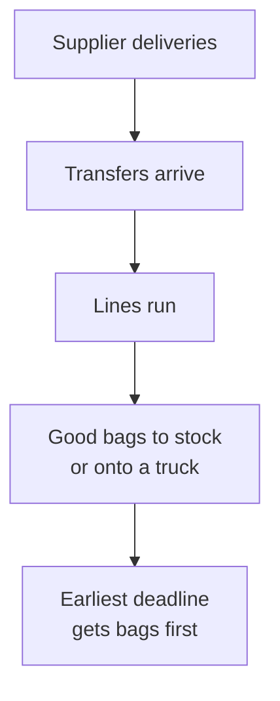
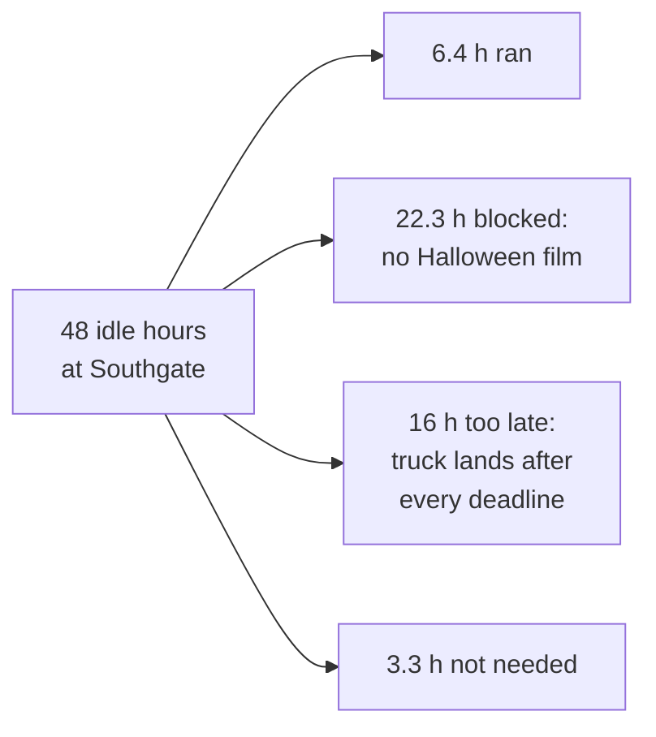

A packaging line breaks four days before Halloween.

A second factory has 48 idle line-hours.

So why does moving the work there barely help?

I built [CandyOps](https://github.com/kidskoding/candyops) to answer that question for a fictional candy maker. It is a small decision model that simulates a Halloween production week day by day and compares the ways a planner could recover from a breakdown. I expected the interesting answer to be about machines, overtime against transfer, **but the model kept pointing at a roll of bag film with pumpkins printed on it.**

## Why Halloween is a hard week for snack makers

Halloween is one of the biggest selling seasons in the United States. The National Retail Federation, the largest US retail trade group, [forecast a record $13.1 billion in Halloween spending for 2025](https://nrf.com/media-center/press-releases/nrf-consumer-survey-finds-halloween-spending-to-reach-record-13-1-billion), with $3.9 billion of it on candy.

The big snack companies sell products made only for the season. PepsiCo, which owns Lay's, Doritos, and Cheetos through its Frito-Lay division, has released items like [Cheetos Bag of Bones and Quaker Chewy Halloween Minis](https://snackandbakery.com/articles/112234-pepsico-brands-launch-spooky-season-snacks). Mondelez, the maker of Oreo, Cadbury, and Sour Patch Kids, put out a [2025 Halloween lineup in the UK](https://www.betterretailing.com/br/product-news/mondelez-unveils-halloween-2025-line-up/) that included Oreo Spooky and treat-size sharing packs of Cadbury and Sour Patch Kids.

**These products share two traits that make them hard to plan.** Each one ships in packaging printed for the season, so the wrapper can't be swapped for a regular one. And they all have to reach store shelves before a date that never moves. If a packaging line breaks in late October, the planner has days rather than weeks to decide how to recover, and a wrong call leaves orders short or leaves holiday stock unsold after October 31.

## Where the data comes from

No snack maker publishes its plant schedules, line rates, or inventory, so I generated the data myself. A seeded **Python** script in the repo writes the files a real plant's systems would export: customer orders and recipes from the planning system, line rates and downtime from the factory floor, stock and supplier deliveries from the warehouse, and good bags and rejects from quality checks. The same seed always produces the same files, so every number in this post can be reproduced.

**Everything here is synthetic.** The two factories, twelve retailers, orders, and costs are made up, and the costs are modeled rather than real savings. CandyOps is not affiliated with PepsiCo, Mondelez, or any other company, and it does not reflect any of their systems or data.

## The setup

It is October 27. A fictional confectioner packs Halloween assortment bags in two plants, Northfield and Southgate, and twelve retailer orders have to be ready to ship between October 27 and October 30. Ready to ship means bagged, counted, and sitting at Northfield, the plant that ships them, by the end of the deadline day.

At 06:00 the bag sealer on Northfield's main line fails, and maintenance says it will be back on October 29 at 14:00. **The planner can accept the shortfall, run overtime at Northfield, or make bags at Southgate and truck them over**, which takes a day.

| Number | Value |
|---|---|
| Bags ordered | 188,500 |
| Orders at risk after the breakdown | 4 of 12 |
| Bags short with no recovery | 34,261 |
| Southgate idle line-hours, Oct 27 to 30 | 48 |

## How the model decides what gets made

Every option starts from the same state on the morning of October 27, built from two days of simulated production on October 25 and 26. From there the simulation steps through each day in a fixed order, and at the end of the day each factory hands its finished bags to the open order with the earliest deadline.

The rules are what keep it honest. **A line uses up ingredients and film for every bag it makes, including the rejects**, and only good bags count toward an order. Material that arrives on October 30 cannot be used on October 29, a truck that leaves today lands tomorrow, and nothing handed over after a deadline counts as on time.

## What the obvious options do

Overtime at Northfield is the option everyone reaches for first, and it works reasonably well. Capped at four extra hours per line per day, it gets 90.4% of bags ready on time for $8,550.

Moving work to Southgate looks better on paper, because Southgate has 48 idle line-hours and running them costs less than overtime. **In the simulation it recovers only 5,491 bags and lands at 84.7%**, which is worse than overtime even though it has more spare time to offer.

| Option | Bags ready on time | Extra cost |
|---|---|---|
| No recovery | 81.8% | $0 |
| Overtime at Northfield | 90.4% | $8,550 |
| Transfer to Southgate | 84.7% | $2,072 |
| Overtime + transfer | 93.3% | $10,622 |

## Lesson 1: Idle capacity is not usable capacity

When I traced where Southgate's 48 hours went, very few of them turned into bags. Only 6.4 hours actually ran. Another 22.3 hours were planned but blocked because Southgate ran out of Halloween bag film, and 16 more fell on October 30, when anything made would reach Northfield after the last deadline.

**A free machine-hour only counts when there is film to run it and time for the bags to arrive.**

> Spare capacity is a number on a dashboard. Usable capacity is that number after materials and deadlines are taken into account.

## Lesson 2: A hard deadline turns time into a constraint

Halloween does not move, and that changes the math. In a normal week a bag made a day late is still a bag, **but here a bag that arrives after October 30 is worth nothing to the order it was meant for.** It becomes leftover seasonal stock, which the model assumes is marked down 50% after the holiday.

That is why the October 30 hours at Southgate were useless no matter what. The line was free and the film would have arrived that morning, but the truck adds a day, so the output would have landed on Halloween itself. Once the deadline is fixed, the planner stops asking how much the plants can make and starts asking **how much they can make that gets there in time.**

## Lesson 3: Seasonal inputs are the ones you cannot borrow

Most ingredients serve more than one product, so the same chocolate goes into both the Spooky Assortment and the Chocolate Monster bags. Bag film does not work that way, because each product needs its own film printed for Halloween, and spare Spooky film cannot wrap a Chocolate Monster bag.

Southgate started the week with 8,500 pieces of Chocolate Monster film and 25,000 of Spooky Assortment, and its next deliveries of both were due on October 30. **Custom-printed packaging is exactly the kind of input that looks too small to plan around**, because it costs about six cents per bag, yet in this model it decided the outcome more than any machine did.

## Lesson 4: Test the bottleneck before you believe it

It would be easy to look at the blocked hours and declare the film guilty. Instead, the model reruns the transfer option with one thing changed: Southgate's film deliveries arrive on October 27 instead of October 30.

Ready bags jump by 14,219, which confirms the film really was the binding constraint. **The rerun also shows the next limit behind it**, because with film in hand the transfer runs short of Southgate's caramel and still has to wait a day for the truck.

> A bottleneck you have not tested is a guess. A bottleneck you removed, and then watched the system improve, is a finding.

## Lesson 5: The cheapest fix might be a purchase order

This is the part that surprised me most. I swept the film delivery date from October 27 to October 30, and separately swept how many overtime hours Northfield could run.

| Film arrives at Southgate | Transfer only | Overtime + transfer |
|---|---|---|
| Oct 27 | 92.3% | 99.1% |
| Oct 28 | 92.3% | 99.1% |
| Oct 29 | 90.4% | 95.7% |
| Oct 30 (actual) | 84.7% | 93.3% |

**Getting the film by October 28 is just as good as getting it on the 27th**, and every day after that costs bags. With film by the 28th, overtime plus transfer gets 11 of 12 orders fully ready and 99.1% of bags on time, for $14,819 in modeled extra cost.

Overtime on its own behaves very differently, because **each extra hour costs about $0.53 per extra bag, and that never gets cheaper.** The rate holds from a two-hour cap all the way to an eight-hour cap, which means running Northfield around the clock. Even at eight hours, overtime alone reaches 97.6% and 10 of 12 orders for $15,638.

| Plan | Orders fully ready | Bags on time | Extra cost |
|---|---|---|---|
| Round-the-clock overtime | 10 of 12 | 97.6% | $15,638 |
| Four-hour overtime + transfer, film by Oct 28 | 11 of 12 | 99.1% | $14,819 |

**So the best plan I tested was not more machine time, but rather moving Southgate's film deliveries up by two days**, which let the ordinary four-hour overtime plus Southgate beat running Northfield around the clock, for less money.

## Why I trust these numbers

A result like that is only worth writing about if the model is not quietly cheating, so most of the work went into checking it. The simulation is plain **Python** and runs under `pytest` on my laptop, including a tiny world small enough to check by hand. **The local run also passes 284 integrity checks, with none failing**, confirming that stock never goes negative, no bag is promised twice, and every material balance adds up.

The same code then runs on Databricks Free Edition as a three-step serverless job that turns simulated factory exports into scenario results, and the scenario results there match the local run exactly. That match does not prove the model is right, but it does show that moving to Spark changed none of the numbers.

## What this could mean for a real snack maker

Large manufacturers already run planning software, and I don't know how any particular company handles a breakdown in late October. What a model like this adds is a way to ask the right question before committing hours: **how many of the spare hours can actually turn into bags on time, once film and trucks are counted?**

It also puts a price on a decision that is usually made by phone. The film sweep shows how much each day of an earlier delivery is worth in bags, which tells a planner whether paying a supplier to rush seasonal packaging beats paying a crew for overtime. **For a product that is worthless after one date, that comparison is the decision.**

## What this model does not tell you

The data is synthetic, and I deliberately gave Southgate a thin film supply so that packaging *could* become a bottleneck. Whether it actually did was up to the simulation. The planner is a simple earliest-deadline-first rule rather than an optimizer, lines run at their ideal rate, and the costs are illustrative. **The lessons are about how to reason through a constrained week, not a forecast for any real plant.**

## What I'm taking from this

- **Count usable capacity, not idle capacity.** Check materials and travel time before trusting a free line.
- **Treat a fixed deadline as a constraint of its own.** Output that misses the date is worth nothing to that order.
- **Plan the cheap, specific inputs early.** Seasonal packaging cannot be borrowed from another product.
- **Remove a suspected bottleneck and rerun.** Then look for the next limit behind it.
- **Look upstream before buying more hours.** A delivery date can beat round-the-clock overtime.

I started this project expecting the interesting question to be overtime against transfer, and it turned out to be a question about materials and time.

The scariest part of the Halloween rush was never the broken sealer.

It was a roll of printed plastic, and the day it showed up.
