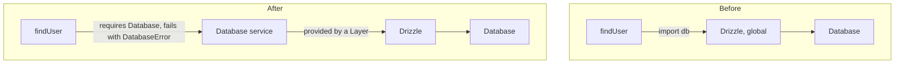
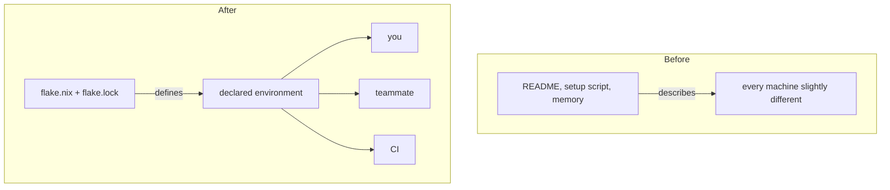
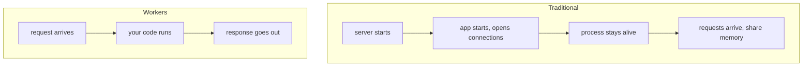
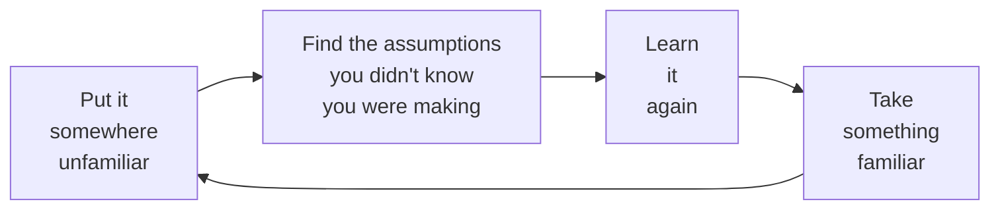

---

I had used Drizzle ORM before starting this internship.

Then I had to make it work alongside Effect.

And suddenly I wasn't sure I actually knew Drizzle.

That happened early in my fall 2026 internship as a Software Development Engineering Intern at [Brunswick's Boating Intelligence Design Lab](https://www.brunswick.com/our-company/bi-designlab), which I joined through the [University of Illinois Urbana-Champaign's Research Park](https://researchpark.illinois.edu/).

As I was wrapping up my summer internship with T-Mobile, I received an offer to join Brunswick, and it was hard to say no to a chance to keep building real software alongside my classes.

I'm now two months in, and the Drizzle moment turned out not to be a one-off. **The same thing has kept happening in different parts of the stack.**

---

## A familiar tool that felt new again

One of the full-stack apps I worked on needed an ORM (object-relational mapper), which is a library for writing database queries in code instead of raw SQL. My manager's request was simple: let's use [Drizzle ORM](https://orm.drizzle.team) for the database layer.

That made sense for a TypeScript app, and since I'd used Drizzle before, I figured that part was covered. **The challenge wasn't using Drizzle, but rather making Drizzle fit alongside [Effect](https://effect.website).**

The queries themselves were fine, because `select`, `from`, and `where` were the same API I'd used before. **What changed was everything around the query:**

- Where should the database actually live?
- What should the rest of the application know about Drizzle?
- When a query fails, what does that failure look like to the code that called it?
- How do I swap the database out in a test?
- Where does infrastructure stop and the application begin?

None of those are really Drizzle questions, but I couldn't answer them without understanding Drizzle better than I did.

> Using a library teaches you its API. Integrating it with something unfamiliar teaches you its model.

---

## The checklist in my head

I think a lot of developers keep a mental checklist like this:

<div class="my-4 grid w-fit grid-cols-[auto_auto] gap-x-8 gap-y-1 rounded-md bg-nvim-bg-hard px-4 py-3 font-mono text-sm text-text-primary">
  <span>TypeScript</span><span class="text-nvim-green">✓ learned</span>
  <span>Drizzle</span><span class="text-nvim-green">✓ learned</span>
  <span>Nix</span><span class="text-nvim-green">✓ learned</span>
  <span>Serverless</span><span class="text-nvim-green">✓ learned</span>
  <span>Effect</span><span class="text-nvim-red">✗ not learned</span>
</div>

**Once something gets a checkmark, it stops being interesting.** You already know it, so why not move on to the next thing?

Two months of this internship have made me doubt that checklist. Each time, I picked up something I thought I already knew, **put it under a constraint I hadn't worked with before**, and found out how much of my "knowing" was assumptions I'd never had to look at.

The first time was in the code, starting with a single import.

---

## What one import assumes

Here is roughly how I'd have written a database call in the past:

```ts
import { db } from "./db"

export async function findUser(id: string) {
  return db.select().from(users).where(eq(users.id, id))
}
```

There's nothing wrong with this code, and it works.

But the first line quietly assumes that there is exactly one database, that it was created when this module was imported, and that it's always available. Anyone reading `findUser` from the outside can't tell any of that, because the signature only says it returns a `Promise`. **The type doesn't tell you how it can fail, and it doesn't tell you what it needs.**

Effect makes you spell those things out. Its core type is `Effect<Success, Error, Requirements>`, which describes a computation that produces a value, can fail in specific ways, and needs specific things to run. So instead of `doSomething() → value`, every operation answers three questions:

```text
1. What can this return?
2. How can this fail?
3. What does it require?
```

Here's a simplified version of the same function written with Effect:

```ts
// How can this fail?: a named error, not a bare rejected promise
class DatabaseError extends Data.TaggedError("DatabaseError")<{ cause: unknown }> {}

// What does it require?: a Database service, provided by the caller
class Database extends Context.Tag("Database")<Database, DrizzleClient>() {}

const findUser = (id: string) =>
  Effect.gen(function* () {
    // ask for the database instead of importing it
    const db = yield* Database

    return yield* Effect.tryPromise({
      // same Drizzle query as the previous example
      try: () => db.select().from(users).where(eq(users.id, id)),
      catch: (cause) => new DatabaseError({ cause }),
    })
  })

// Effect.Effect<User[], DatabaseError, Database>
//               │       │              │
//               │       │              └─ what does it require?
//               │       └─ how can this fail?
//               └─ what can this return?
```

The Drizzle part is identical, with the same query and the same builder. What changed is that **the database stopped being something the function grabs from a module and became something it asks for**. The failure stopped being a rejected promise somebody might remember to catch, and became a named error in the type.

And because `Database` is a requirement rather than an import, a test can hand it a different implementation with `Effect.provideService` and never touch a real database.



That's when Drizzle started to look different to me. Before, it was the thing I talked to the database through. Now it was an implementation detail behind a service boundary, and I had to decide what that boundary promised: which errors cross it, who creates the client, and who closes the connection when the program shuts down. Effect has answers for those (layers and scoped resources), but it doesn't let you skip the question.

**Writing the query was never the hard part, and deciding where the query belonged was.**

---

## Where the development environment lives

The second time was one level down, in the environment the code runs in.

I already liked **Nix** before this job. My personal machine runs NixOS, and this site has a `flake.nix`. I could have told you why Nix is nice: **declarative configuration**, **pinned dependencies**, **isolated packages**, and **environments as code**. What I hadn't felt was why any of that matters to anyone besides me.

That changed when I made my entire computer setup at work reproducible with Nix. We develop on Ubuntu under WSL, where setting up a machine is usually imperative: you run `apt install` for one tool, an install script for another, and a few more commands from a setup guide, and the result depends on the order you ran them in and on whatever was already installed.

I declared everything I need for the job in Nix instead, so **a new employee can install Nix on the same Ubuntu WSL machine, run one command, and have the same working setup from day one**. Instead of spending their first days piecing a machine together, they can start on the actual work right away.

Building that showed me why it matters, because "it works on my machine" is almost never about the code. **It's about everything the code silently depends on:**

```text
your app
├── Node version
├── package manager (and its version)
├── CLI tools
├── system libraries
├── environment variables
└── whatever happens to be on your PATH
```

On most projects, that list doesn't live in one place. Part of it lives in the README, part in a setup script, part in someone's shell config, and part in a Slack thread from eight months ago, and the rest is "ask the person who set it up." Each piece is an assumption about your machine that nobody wrote down where a computer can check it.

A stripped-down development shell looks something like this:

```nix
devShells.default = pkgs.mkShell {
  packages = [
    pkgs.nodejs
    pkgs.pnpm
    pkgs.git
  ];
};
```

Next to it sits `flake.lock`, which pins the exact versions of everything that shell pulls in. Getting a working environment goes from a page of setup steps to roughly:

```bash
nix develop
```

The command itself isn't the point, though. What matters is where the environment lives now.



**A README can describe an environment, but Nix can define one.** Once the environment is in the repository, it gets the same treatment as the code: it's versioned, reviewed, and the same for everyone who checks it out.

That's what made me start thinking of **reproducibility as a team feature** instead of a Linux hobbyist feature. CI runs the same toolchain you ran locally, so a failure in CI means something. And coming back to a project after a few months doesn't start with an hour of figuring out which Node version it wanted.

That said, I don't think every team needs Nix. Docker solves a lot of the same problems from a different direction, language package managers already pin a lot, and CI systems have their own ways of describing environments, and Nix sits fine alongside all of them. The more useful takeaway is the question it made me ask:

> Which parts of your development environment currently depend on undocumented machine state?

---

## A runtime without a long-lived process

The third time was one more level down, in the runtime itself. Most of my work has been on Cloudflare Workers, and this is where the pattern got bigger than any one codebase.

I knew what serverless meant: functions, no servers to manage, and paying per request. In my head, it already had a checkmark. What I didn't have was the mental model the runtime is built around, which is different from the one I'd absorbed from years of traditional backends:



On the left, a lot comes for free without anyone deciding it should. The process lives a long time, so you can keep a connection pool in a global, cache things in memory, and set something up at boot and assume it's still there. **Those are assumptions too, just ones built into the shape of the server.**

Workers run in lightweight isolates that Cloudflare can start and stop whenever it wants. A global variable might still be there on the next request, or it might not, and Cloudflare's own docs tell you not to rely on it. So **the question changes from "what server is running this?" to "what does this request need?"**

The runtime makes you answer that explicitly. A Worker's entry point looks like this:

```ts
export default {
  async fetch(request: Request, env: Env): Promise<Response> {
    // env holds this Worker's bindings: databases, storage,
    // other services, secrets. They're declared in config,
    // not discovered from whatever machine this runs on.
    return handle(request, env)
  },
}
```

That `env` parameter is what made it click for me. **The dependencies are handed to your code, declared ahead of time, instead of reached for.** It's the same move Effect makes with its `Requirements` type, one level down: Effect does it inside the type system, and Workers do it in the runtime, but both refuse to let a dependency stay implicit.

That's the part I've come to appreciate most. **The constraint isn't just a restriction you work around, but something that changes how you structure things.** If you can't assume a long-lived process, you end up thinking about request boundaries, about where state actually lives, and about small units of computation with clear inputs. The runtime makes some bad assumptions harder to make.

I can also see why this model fits a company like Brunswick, which talks publicly about connected boats: a lot of that software sits between systems, and small, well-bounded units are a natural fit for that kind of work.

---

## Same question, three levels up

Looking back, the three tools weren't three separate topics, but **the same question asked at three levels of the stack:**

```text
APPLICATION     Effect     What does this code need? How can it fail?
     ↓
ENVIRONMENT     Nix        What does this project need from my machine?
     ↓
RUNTIME         Workers    What does this request need? Where does state live?
                    ↓
         Make the assumptions explicit.
```

Each one took something that's usually implicit (a module-level import, a machine's installed tools, a long-running process) and made it something you have to declare. **A lot of what makes systems hard to work on is assumptions nobody wrote down**, so I think that's a good engineering lesson to take away.

But there's a second lesson underneath it, and it's the one I keep coming back to. **Every time a tool forced a system's assumptions into the open, it exposed some of mine too.**

I assumed I knew Drizzle, I assumed I knew why Nix mattered, and I assumed "serverless" was a complete description of Workers. None of those were exactly wrong, but **they were incomplete in ways I couldn't see until something familiar ended up somewhere unfamiliar**.

---

## Relearning with a knowledge graph

Relearning this many tools at once meant I needed somewhere to put what I was learning, so I started keeping it in [**Obsidian**](https://obsidian.md). Each part of the stack, like the Cloudflare developer platform, Drizzle ORM, and Postgres, got its own notes, and the notes link to each other wherever one tool touches another. Over time, those links turned the notes into a knowledge graph of the stack I was working in.

{/* TODO: Obsidian graph view screenshot. Show only public tools and concepts, nothing internal to Brunswick. */}

The part that made it useful was pairing it with AI. While I was developing, I built a custom agent skill that has an AI assistant explain things by referencing that graph. When I ask about something I don't understand yet, the explanation starts from notes I've already written, so **instead of a generic answer, I get one that connects the new idea to the tools I already know**.

That fits the rest of this post, because **the interesting part of the graph is the links between notes rather than the notes themselves**. A note on Drizzle by itself is a summary of an API, but a link from Drizzle to Effect, or from Effect to Workers, records a place where two tools had to meet, and that's where most of my relearning happened.

I think that's what people mean when they say **learning happens at the seams**: not inside one tool, but where two things that each make sense on their own have to fit together. The graph is where I can actually see those seams.

---

## Another kind of learning

I used to think learning mostly meant encountering something new, like a new language, a new framework, or a new tool.

These first two months showed me another kind that's just as useful, and **easier to miss because it doesn't feel like learning at first**.



Drizzle is the same library it was before this internship, with the same `select`, `from`, and `where` I started with. What changed is what I see when I use it: a client that something has to create and close, queries that can fail in ways the caller should know about, and a boundary that I get to decide on. **I didn't pick up a new tool there, but rather learned an old one again.**

I expect a few more of the checkmarks in my head to turn out to be incomplete. **I'd rather find that out than keep the checkmark.**

I had used Drizzle before this internship.

Two months in, I'm learning it again.
