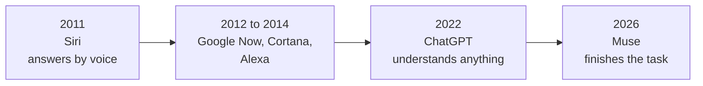
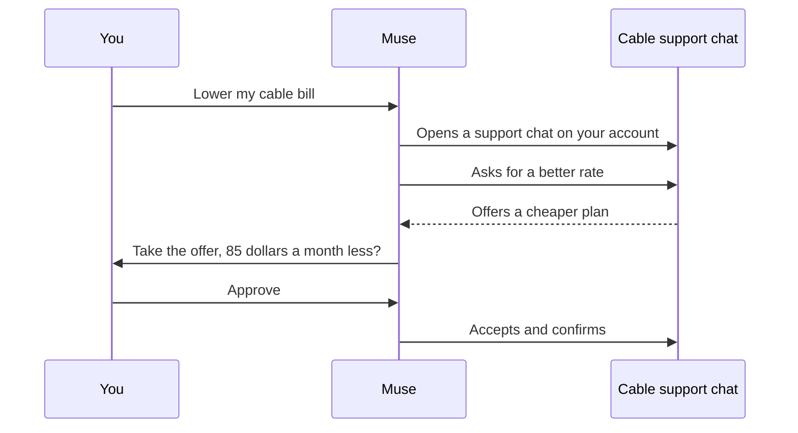
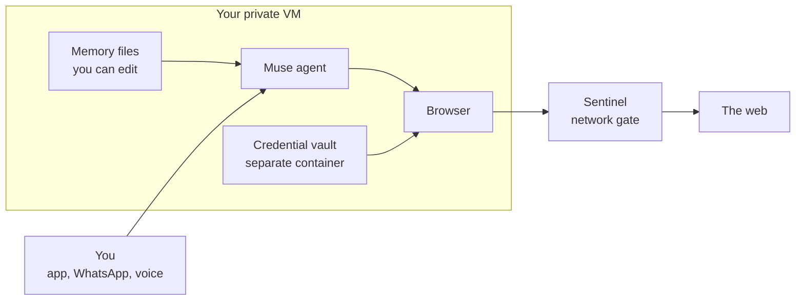
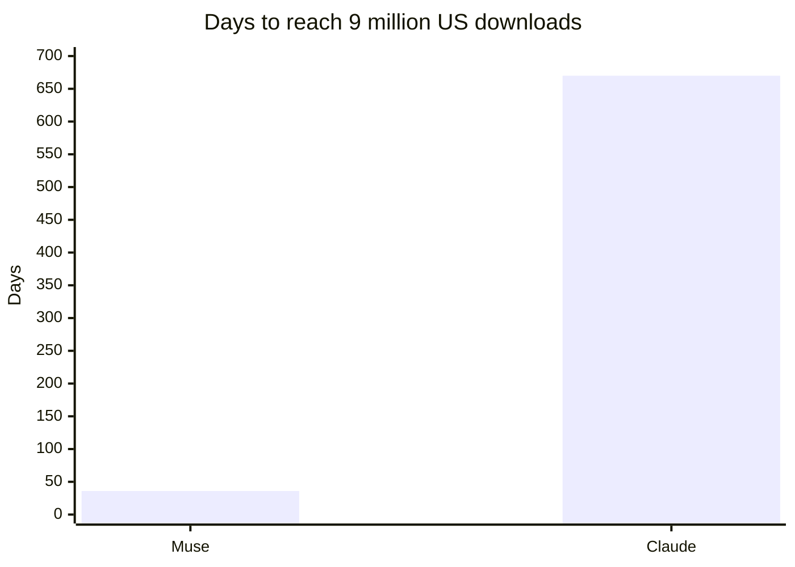
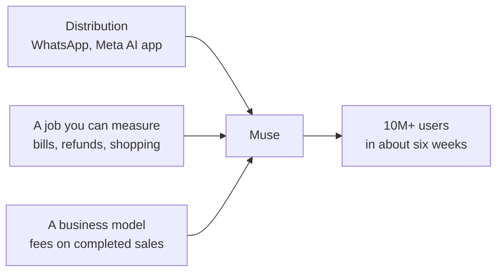
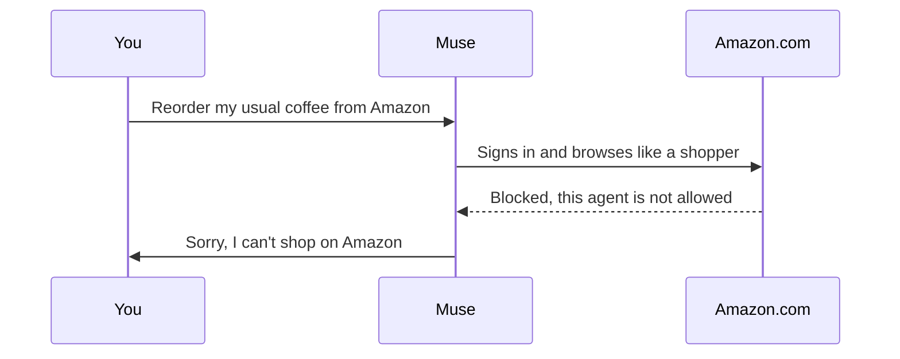
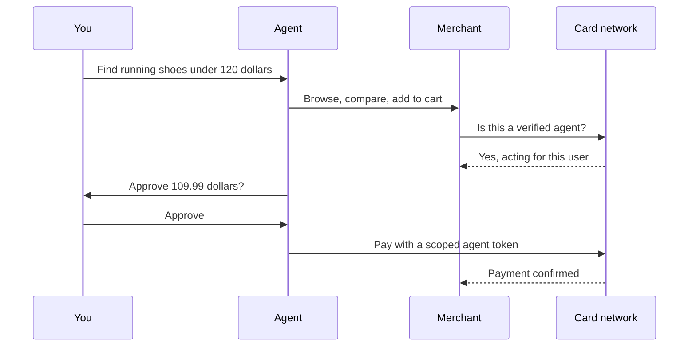

import TweetEmbed from '../../../components/TweetEmbed.astro';

On September 8, Mark Zuckerberg posted a short announcement on X:

<TweetEmbed url="https://x.com/finkd/status/2097402101332590646" />

The launch even started with a mix-up. Meta took the `@muse` handle on Instagram from the rock band of the same name, and Zuckerberg reportedly pasted his Threads announcement onto X, where it tagged the band instead of the agent.<sup>[2](#references)</sup>

Six weeks later, nobody was confusing the two. On Meta's Q3 earnings call, Zuckerberg said Muse had passed **10 million users**, with shopping as its top activity.<sup>[1](#references)</sup> For a product that asks you to hand over your email, your calendar and your card, that's an absurd pace.

The interesting question isn't whether Muse is popular, but rather why this agent took off when so many before it stayed a demo. The answer involves a computer you never see, a job people can measure in dollars, and a company that already had billions of users waiting.

> Muse is the first AI agent that regular people use without thinking of it as AI.

---

## It Started With Siri

To see why Muse feels different, it helps to go back fifteen years.

In February 2010, a small startup released an iPhone app called **Siri**. It grew out of CALO, a DARPA-funded AI research project at SRI International, and its pitch was ambitious for the time: you'd say what you wanted in plain language, and it would get it done by working with the web services it connected to.<sup>[33](#references)</sup> Apple bought the company two months later, and in October 2011 Siri relaunched as the headline feature of the iPhone 4S.<sup>[32](#references)</sup>

It's hard to overstate how big that moment felt. Before Siri, talking to a phone meant memorizing stiff voice commands. Siri let you just ask: "Do I need an umbrella today?", "Remind me to call Mom when I get home", "Text Sarah that I'm running late." It understood ordinary phrasing, it answered out loud, and it had a personality, with jokes people screenshotted and passed around. For a lot of people, it was the first time software felt like something you talk to rather than something you operate, and within a few years Google Now, Cortana and Alexa had all followed it.

**Siri made the idea of a personal assistant mainstream, but it could only keep part of the promise.** Under the hood, it matched what you said against a fixed list of things it knew how to do: set a timer, check the weather, send a message, open an app. Anything outside that list ended with "Here's what I found on the web." It couldn't chain steps together, it couldn't operate a website for you, and it stopped the moment you put the phone down. When Apple finally opened Siri to outside apps in 2016, it was only for a handful of categories like messaging and ride booking.



Fifteen years later, Muse is the step Siri pointed at. ChatGPT gave assistants the ability to understand nearly anything you ask; Muse gives them the ability to actually finish it.

|  | Siri (2011) | Muse (2026) |
| --- | --- | --- |
| How you ask | A voice command | A goal, by text, voice or video |
| What it understands | A fixed list of intents | Open-ended tasks it plans itself |
| How it acts | Opens an app or reads an answer | Drives a browser and your accounts |
| Multi-step tasks | One request, one action | Plans and chains the steps |
| When you look away | Stops | Keeps working on its own computer |
| What you get back | An answer | A finished task: a lower bill, a booking, a checkout |

**Siri taught a generation to talk to their phones. Muse is teaching them to hand things off.** There's also an irony in it: Apple is back in the race with a new Siri that works across Messages, Mail, Calendar and Photos,<sup>[27](#references)</sup> which means the company that started the assistant era is now chasing the one that took the next step.

---

## What Muse Actually Does

Most AI products wait for a question and then answer it. Muse works the other way around: you give it a goal, and it plans the steps, uses a browser and your connected accounts to carry them out, keeps going after you close the app, and comes back when it's done or when it needs your approval.<sup>[8](#references)</sup>

That sounds abstract until you look at what people are actually using it for:

<div class="grid grid-cols-1 sm:grid-cols-2 gap-3 my-6">
  <div class="rounded-lg border border-nvim-bg3 bg-nvim-bg-hard p-4">
    <div class="text-sm text-nvim-gray">negotiate</div>
    <div class="text-2xl font-bold text-nvim-orange">-$85 a month</div>
    <div class="text-sm text-nvim-fg2 mt-1">Talked a cable company down through its support chat</div>
    <div class="text-xs text-nvim-gray mt-2">Example shared by Alexandr Wang<sup><a href="#references">3</a></sup></div>
  </div>
  <div class="rounded-lg border border-nvim-bg3 bg-nvim-bg-hard p-4">
    <div class="text-sm text-nvim-gray">recover</div>
    <div class="text-2xl font-bold text-nvim-green">Hidden refunds</div>
    <div class="text-sm text-nvim-fg2 mt-1">Found refunds users didn't know they were owed</div>
    <div class="text-xs text-nvim-gray mt-2">Example shared by Alexandr Wang<sup><a href="#references">3</a></sup></div>
  </div>
  <div class="rounded-lg border border-nvim-bg3 bg-nvim-bg-hard p-4">
    <div class="text-sm text-nvim-gray">save</div>
    <div class="text-2xl font-bold text-nvim-yellow">Insurance</div>
    <div class="text-sm text-nvim-fg2 mt-1">Shopped car and home insurance for a lower rate</div>
    <div class="text-xs text-nvim-gray mt-2">Example shared by Alexandr Wang<sup><a href="#references">3</a></sup></div>
  </div>
  <div class="rounded-lg border border-nvim-bg3 bg-nvim-bg-hard p-4">
    <div class="text-sm text-nvim-gray">clean up</div>
    <div class="text-2xl font-bold text-nvim-aqua">Subscriptions</div>
    <div class="text-sm text-nvim-fg2 mt-1">Tracked down and cancelled forgotten subscriptions</div>
    <div class="text-xs text-nvim-gray mt-2">User story via ABC News<sup><a href="#references">4</a></sup></div>
  </div>
  <div class="rounded-lg border border-nvim-bg3 bg-nvim-bg-hard p-4">
    <div class="text-sm text-nvim-gray">shop</div>
    <div class="text-2xl font-bold text-nvim-purple">#1 use case</div>
    <div class="text-sm text-nvim-fg2 mt-1">Browses, compares and checks out for you</div>
    <div class="text-xs text-nvim-gray mt-2">Per Zuckerberg on the Q3 call<sup><a href="#references">1</a></sup></div>
  </div>
  <div class="rounded-lg border border-nvim-bg3 bg-nvim-bg-hard p-4">
    <div class="text-sm text-nvim-gray">book</div>
    <div class="text-2xl font-bold text-nvim-blue">Travel</div>
    <div class="text-sm text-nvim-fg2 mt-1">Fills out forms and books trips end to end</div>
    <div class="text-xs text-nvim-gray mt-2">From Meta's launch<sup><a href="#references">31</a></sup></div>
  </div>
</div>

The cable bill is the example that explains the whole product. Negotiating with a support chat is tedious, slow and slightly confrontational, which is exactly the kind of task people put off for months. Here's roughly what Muse does instead, simplified from the example Wang described:



**That's the moment Muse stops being a chatbot: the output isn't text you have to act on, but rather money back in your account.** It's also why Muse spread the way it did. "My AI got my bill lowered while I slept" is a far easier story to tell a friend than "my AI wrote a good summary," and ABC News found users telling exactly those stories about internet bills and forgotten subscriptions.<sup>[4](#references)</sup>

Muse is also leaving the phone. At Connect on September 24, Meta gave it real-time voice and video, said it's coming to Meta's AI glasses, and announced shopping partnerships with Walmart, GameStop, Gap and Wayfair, along with an email address of its own and computer control on the Mac.<sup>[5](#references)</sup> <sup>[6](#references)</sup>

<TweetEmbed url="https://x.com/finkd/status/2102913005730271579" />

---

## The Secret Is a Computer You Never See

The part of Muse I find most interesting as an engineer is the part users never see. Every Muse user gets their own **isolated Linux virtual machine** in Meta's cloud, with a browser and enough CPU, memory and storage to do real work.<sup>[7](#references)</sup> Muse isn't a model calling a few APIs, but rather a model operating a computer on your behalf.



Three design choices in that diagram explain why Muse can do what earlier agents couldn't.

The first is that **the VM keeps running when you don't**. Because the agent has its own machine, a task like "watch this flight and rebook me if it drops" doesn't need your phone to stay open. That's what Zuckerberg meant by an agent that "works 24/7."

The second is that **the agent can use your logins without seeing them**. Credentials live in a separate isolated container inside your VM, and the browser uses them to sign in, so the model driving the browser never reads your password.<sup>[7](#references)</sup> A separate process Meta calls Sentinel sits between the VM and the internet and decides what the agent is allowed to reach.

The third is that **Muse's memory about you is a set of files you can open**. Meta says you can inspect, edit and download them,<sup>[7](#references)</sup> which is a much more honest model than a black-box "personalization" setting.

Zuckerberg admitted on the earnings call that Meta wasn't sure the architecture would land with users:

<TweetEmbed url="https://x.com/firesidealpha/status/2103924932434702508" />

There are limits worth stating plainly. Meta's own safety post says the current design doesn't stop Meta from accessing your data when it needs to support, secure or operate the service, and a "confidential VM" where you'd hold the encryption key is planned but not available yet.<sup>[7](#references)</sup> The most careful hands-on review I found suggests starting read-only, letting Muse read your email before it sends any, and watching its audit trail.<sup>[8](#references)</sup>

---

## Why It Became a Sensation

The growth numbers are hard to overstate. Sensor Tower found that Muse took **36 days to reach 9 million US downloads**, a milestone that took Claude 670 days,<sup>[9](#references)</sup> and 73% of new users came back the day after installing it.<sup>[10](#references)</sup> Purchase demand got high enough that Meta had to ask Stripe to raise its credit limits.<sup>[11](#references)</sup>



Plenty of AI products have good models. Muse had three things that a better model can't buy.



**Distribution.** Billions of people already use WhatsApp, so trying Muse didn't mean downloading an unfamiliar app, making an account or learning a new interface. It showed up where people already message friends and businesses, which is the only reason a 36-day ramp was possible.

**A job you can measure.** Most assistants leave you to figure out what to ask. Muse leaned into errands with a visible result: a lower bill, a refund, a finished checkout. People can feel that value on the first try, and that's what a 73% next-day return rate reflects.

**A business model that fits.** Meta plans to charge businesses a fee when Muse completes a sale.<sup>[9](#references)</sup> <sup>[30](#references)</sup> For a company that already makes its money connecting people to merchants, an agent that shops isn't a new business, but rather the old one with the middle steps removed.

It also helps that Muse found an audience the AI industry rarely designs for. *Time* reports that older adults are among its most enthusiastic users,<sup>[12](#references)</sup> people who never wanted to learn prompting but are very happy to say "cancel the subscriptions I don't use."

> Muse didn't win by being the smartest agent. It won by being the easiest one to say yes to.

---

## How Meta Got Here

None of this looked likely eighteen months ago. In April 2025, **Llama 4** launched under a cloud: Meta promoted a leaderboard result from a specially tuned "experimental" version of Maverick, and the public release ranked **32nd** on LMArena when it was tested on its own.<sup>[13](#references)</sup> <sup>[14](#references)</sup> Open weights had been Meta's whole identity in AI, and suddenly it looked like Meta was giving away models that weren't even competitive.

So Meta started over:

```text
Apr 2025   Llama 4 stumbles on benchmarks
Jun 2025   $14.3B into Scale AI; Alexandr Wang leads Meta Superintelligence Labs
Jul 2025   "Hundreds of billions" committed to compute (Prometheus, Hyperion)
Apr 2026   Muse Spark: MSL's first model, and Meta's first without open weights
Sep 2026   Muse launches as a personal agent; Amazon blocks it 12 days later
Oct 2026   Muse Wonder, Meta's first frontier model; 10M users
```

The Scale AI deal brought in Wang to run the new lab,<sup>[15](#references)</sup> and Zuckerberg committed "hundreds of billions of dollars" to data centers like Prometheus in Ohio and Hyperion in Louisiana.<sup>[16](#references)</sup> The first model out of that lab, Muse Spark, shipped closed in April 2026,<sup>[17](#references)</sup> a clear sign that Meta now cared more about owning a product than about being the open-source favorite.

The order of what came next is the most telling part. Muse launched on Muse Spark, a capable model but not the strongest one available. **Meta got the users first and the frontier model second**: on October 12 it released **Muse Wonder**, the first model it places at the frontier, and said it would power the Muse agent, starting with subscribers.<sup>[18](#references)</sup> Most AI labs build the best model and then go looking for a product. Meta did it the other way around.

---

## Then Amazon Slammed the Door

Muse's biggest setback came only twelve days after launch. On September 20, **Amazon began blocking Muse from its US store**.<sup>[19](#references)</sup> <sup>[20](#references)</sup> Anyone who asks Muse to shop on Amazon now gets a message saying the agent isn't allowed.



Amazon's complaints are specific, and they're worth reading carefully. It says Meta never asked permission, that **Muse doesn't identify itself as an AI agent** when it browses, and that it can reach customer account pages and order history when a user prompts it to. Amazon says it first asked Meta to leave Amazon.com out of Muse voluntarily.<sup>[19](#references)</sup> <sup>[21](#references)</sup> Meta disputes the security concern, saying Muse "has no visibility into people's passwords or payment methods" because logins sit in separate storage the agent uses without reading.<sup>[19](#references)</sup>

This isn't Amazon's first fight with an agent. It sued Perplexity over Comet, a browser whose built-in agent shopped Amazon for its users, and a federal judge reportedly sided with Amazon in March, barring that agent from password-protected parts of the site.<sup>[21](#references)</sup> Andy Jassy has since argued that few people shop through outside agents because the experience isn't good enough yet, and that Amazon's own Alexa for Shopping should be the agent people use to buy from its store.<sup>[22](#references)</sup>

It's easy to read this as Amazon protecting its turf, and partly it is. Amazon makes a lot of money from search ads and from people browsing its pages, and an agent that goes straight to checkout skips all of it. But I think the more important part is the complaint about identification. **Amazon's problem isn't that an agent shopped there, but rather that it couldn't tell an agent from a person.**

That's a solvable problem, and the payment industry is already building the fix. Visa's **Trusted Agent Protocol** exists so a merchant can recognize a verified agent before checkout, Mastercard has **Agent Pay**, Google has **AP2**, and OpenAI and Stripe published the **Agentic Commerce Protocol**.<sup>[28](#references)</sup> They differ in details but converge on the same flow:



The key piece is the **scoped token**: instead of the agent using your saved card, the network issues a token limited to one merchant, one amount or one time window. That answers both of Amazon's objections at once, because the agent announces itself and never touches your real credentials.

So the Amazon block points to where agent shopping is heading. The web is splitting into stores that partner with agents, like Walmart, Gap and Wayfair with Muse,<sup>[5](#references)</sup> and stores that keep agents out until they play by the store's rules. **I expect this to look less like a model race and more like the early days of app stores**, with merchants deciding which agents get in and fees deciding the terms.

> An agent that shops for you is only as useful as the stores that let it through the door.

---

## What the 10 Million Doesn't Tell You

The headline number deserves context, because it's company-reported and Meta hasn't said what counts as a "user." Third-party data tells a smaller story: Sensor Tower counted about **1.8 million daily active users** in early October, and Similarweb put daily users near 2.2 million.<sup>[23](#references)</sup> One analysis estimates only about a quarter of people who set Muse up use it every day,<sup>[24](#references)</sup> and while its next-day retention beats ChatGPT's, ChatGPT pulls ahead around days eight and nine.<sup>[10](#references)</sup>

That gap between installing Muse and relying on it is mostly a trust gap. Muse asks for access to email, calendars and payments, and privacy experts are uneasy that older adults are among its fastest adopters.<sup>[12](#references)</sup> Meta itself says Muse "will sometimes make mistakes," which is an honest disclaimer that lands differently when the agent has your card on file.

---

## What's Next in the Personal Agent Space

Muse proved that people will hand errands to an agent. The next year decides who owns that habit, and Meta no longer has the space to itself.

At DevDay on September 29, OpenAI introduced **Dots**, its own personal agent, starting on the $100-a-month Pro plan.<sup>[25](#references)</sup> On October 8, Google launched a Gemini agent that works across Gmail, Drive, Docs and Calendar,<sup>[26](#references)</sup> and Apple's new Siri works inside Messages, Mail, Calendar and Photos with on-device processing.<sup>[27](#references)</sup>

| Agent | Company | Where it lives | Its edge |
| --- | --- | --- | --- |
| Muse | Meta | WhatsApp, Meta AI app, web, soon glasses | Billions of people already in the app |
| Dots | OpenAI | ChatGPT | ChatGPT's users and models |
| Gemini agent | Google | Gmail, Drive, Docs, Calendar | Your work data is already there |
| Siri | Apple | Messages, Mail, Calendar, Photos | On-device privacy |

What stands out is that every company is playing the card Meta played. **None of them is pitching the smartest agent, but rather the agent that already sits next to your data.**

### Why Muse looks more promising than Dots

Dots is the closest thing Muse has to a direct rival, and on paper the two are built alike. Dots is an always-on agent with its own cloud computer and browser, it connects to thousands of apps, and it can run scheduled and recurring tasks.<sup>[34](#references)</sup> <sup>[35](#references)</sup> The difference is who each one is built for, and what each one is allowed to finish.

|  | Muse | Dots |
| --- | --- | --- |
| Price to start | Free, then $20 or $100 a month | Pro plan, $100 a month and up |
| Availability | US at launch, Singapore since October<sup>[36](#references)</sup> | Pro, Business and Enterprise; not in the EU, UK or Switzerland at launch |
| Where you use it | WhatsApp, Meta AI app, web, glasses soon | ChatGPT |
| Best at | Errands: bills, refunds, shopping, travel | Research and work across connected apps |
| Logins and payments | Credential vault; checks out after your approval | Hands passwords and payments back to you |
| Its own email address | Yes | No |
| Memory | Files you can inspect, edit and download | Reviewers say you can't inspect or delete individual memories |

Dots is a strong work tool, and for someone who already lives in ChatGPT and wants an agent to keep research or Slack threads moving, it may be the better pick. But as a *personal* agent, Muse has the stronger position on almost every axis that decides adoption. It's free to try, while Dots starts at $100 a month. It's inside an app billions of people already open every day, while Dots asks you to come to ChatGPT. And it can complete the task, because Muse can log in and check out on its own after you approve, while Dots stops and hands passwords and payments back to you.<sup>[34](#references)</sup>

The memory difference matters more than it looks. Muse lets you open and edit what it knows about you,<sup>[7](#references)</sup> while reviewers of Dots say you can't inspect or delete individual memories.<sup>[34](#references)</sup> For an agent you're trusting with your life admin, being able to see what it remembers is a real advantage.

**If Dots is a power tool for people who already pay for AI, Muse is an appliance for everyone else, and appliances are what reach billions.** Dots has a head start in work tools and OpenAI ships fast, so this isn't settled. But a personal agent wins by being trusted with the boring, everyday tasks, and Muse is much closer to that than Dots.

Beyond that matchup, three things will decide how the whole space plays out.

**Where the agent lives.** Muse is moving into glasses, voice and your Mac. Once an agent can see what you see and act while you do something else, it stops being an app you open and becomes something closer to a person working for you, which is where Meta's hardware bet finally connects to its AI bet.

**Who lets it in.** Amazon's block shows that a shopping agent is only as good as its access. The agents that sign merchant partnerships, and adopt the identity and payment protocols merchants trust, will be able to do more than the ones that only drive a browser.

**Whether people stop double-checking.** One 2026 survey found that only 4% of consumers would let an AI agent complete a purchase on its own,<sup>[27](#references)</sup> and BCG argues that personal agents will compete on trust rather than capability.<sup>[29](#references)</sup> Muse's install numbers show curiosity; its daily-use numbers show how much trust is still missing.

---

## What I'm Taking Away as Someone Who Builds Agents

Developers tend to judge agents the way we judge models, by benchmarks, reasoning and how well they plug into our tools. By that measure, Muse launched as a good agent, but not obviously the best one.

That's what makes it worth studying. I've built agents like [personal-finance-agent](/projects/personal-finance-agent), and the hard part was never getting the model to reason. The hard part is getting someone to trust it with something real and come back tomorrow. Muse's answer was mostly architecture, not intelligence: a private machine per user, credentials the model can't read, memory you can edit, and an approval step before anything irreversible.

**Pick one job people can measure, put the agent where they already are, and make the scary parts boring.**

Meta was the AI lab people had written off.

It didn't come back by building the best model first.

It came back by building the agent people actually used, and then giving it the best model.

---

## References
<a name="references"></a>

1. [Meta says Muse has over 10M users, with shopping a top activity (TechCrunch)](https://techcrunch.com/2026/10/21/meta-says-muse-has-over-10m-users-with-shopping-a-top-activity/)
2. [Wait, did Zuckerberg just steal Muse the band's Instagram handle for his new AI? (Futurism)](https://futurism.com/artificial-intelligence/zuckerberg-meta-muse-handle)
3. [Meta says its Muse AI agent can manage your money. Should you let it? (Yahoo Finance)](https://finance.yahoo.com/technology/ai/articles/meta-says-muse-ai-agent-120000470.html)
4. [What to know about Meta's Muse AI agent (ABC News)](https://abcnews.com/Business/metas-muse-ai-agent/story?id=136680507)
5. [Everything we announced at Meta Connect 2026 (Meta)](https://www.meta.com/blog/meta-connect-2026-everything-we-announced/)
6. [Meta wants Muse to be part of your everyday life (CNN)](https://www.cnn.com/2026/09/24/tech/meta-muse-ai-glasses-connect)
7. [How we built safety into Muse (Meta Research)](https://research.meta.ai/blog/security-and-safety-for-ai-agents-our-approach-with-muse)
8. [Meta Muse review: what the personal AI agent can and can't do (eesel AI)](https://www.eesel.ai/blog/meta-muse-agent-review)
9. [Meta Muse AI agent challenges Amazon and Apple (CNBC)](https://www.cnbc.com/2026/10/22/meta-muse-personal-ai-agents.html)
10. [Meta's Muse AI agent brings back 73% of new users (Yahoo Finance)](https://finance.yahoo.com/technology/article/metas-muse-ai-agent-brings-back-73-of-new-users--nearly-double-chatgpts-rate-164557360.html)
11. [Zuckerberg said demand for Muse was so high he had to get Stripe to raise credit limits (Fortune)](https://fortune.com/2026/10/22/mark-zuckerberg-meta-muse-stripe-credit-limit-shopping/)
12. [Meta's Muse AI is winning over older adults. Privacy experts are worried (Time)](https://time.com/article/2026/10/22/ai-meta-muse-agent-older-users/)
13. [Meta scrambling to defend its AI after Llama 4 benchmark bungle (Sherwood News)](https://sherwood.news/tech/meta-scrambling-to-defend-its-ai-after-llama-4-benchmark-bungle)
14. [Unmodified Llama 4 Maverick ranks below rivals following Meta cheating allegations (Neowin)](https://www.neowin.net/news/unmodified-llama-4-maverick-ranks-below-rivals-following-meta-cheating-allegations/)
15. [Meta invests $14.3B in Scale AI, taps Alexandr Wang for superintelligence team (Fortune)](https://fortune.com/2025/06/13/meta-scale-ai-alexandr-wang-superintelligence-team)
16. [Meta's building two massive data centres to achieve superintelligence (TechRepublic)](https://www.techrepublic.com/article/news-meta-data-centres-ai-superintelligence/)
17. [Meta unveils Muse Spark, MSL's first model (The Next Web)](https://thenextweb.com/news/meta-muse-spark-msl-first-model)
18. [Meta releases its first frontier model, Muse Wonder (TechCrunch)](https://techcrunch.com/2026/10/12/meta-releases-its-first-frontier-model-muse-wonder)
19. [Amazon blocks Meta's Muse AI agent from its retail site (Bloomberg)](https://www.bloomberg.com/news/articles/2026-09-21/amazon-blocks-meta-s-muse-ai-agent-from-its-retail-site)
20. [Amazon blocks Meta's Muse agent from shopping on its platform (Forbes)](https://www.forbes.com/sites/jonmarkman/2026/09/21/amazon-blocks-metas-new-muse-ai-agent-from-shopping-on-amazoncom/)
21. [Amazon blocks Meta's Muse AI agent from shopping on its site (PPC Land)](https://ppc.land/amazon-blocks-metas-muse-ai-agent-from-shopping-on-its-site/)
22. [Alexa for Shopping hits 400M users after Amazon blocked Meta's Muse (The Next Web)](https://thenextweb.com/news/alexa-for-shopping-jassy-ai-shopping-agents-meta-muse)
23. [Meta's Muse AI agent posts strong early numbers as investors demand proof (Crypto Briefing)](https://cryptobriefing.com/meta-muse-ai-agent-early-data/)
24. [Muse passes 10 million users: Meta agentic shopping trends (ALM Corp)](https://almcorp.com/news/muse-passes-10-million-users-meta-agentic-shopping/)
25. [OpenAI follows Meta into the red-hot market for personal agents. But will users pay? (CNBC)](https://www.cnbc.com/2026/09/30/openai-follows-meta-into-the-red-hot-market-for-personal-agents.html)
26. [Google launches workplace AI agent that acts like a colleague (Bloomberg)](https://www.bloomberg.com/news/articles/2026-10-08/google-launches-universal-gemini-ai-agent-for-workplace)
27. [The consumer AI agent race: five platforms, three pricing models, one winner (Yahoo Finance)](https://finance.yahoo.com/technology/ai/articles/consumer-ai-agent-race-five-115316091.html)
28. [2026 comparative analysis: agentic commerce payment protocols (Applied Technology Index)](https://appliedtechnologyindex.com/research/2026-comparative-analysis-agentic-commerce-payment-protocols/)
29. [Personal AI agents compete on trust, not capability (BCG)](https://www.bcg.com/x/the-multiplier/personal-ai-agents-compete-on-trust)
30. [Meta put out an ambitious roadmap to Muse monetization (CNBC)](https://www.cnbc.com/investingclub/2026/10/21/meta-put-out-an-ambitious-roadmap-to-muse-monetization-after-strong-quarter-and-guide.html)
31. [Meta debuts its Muse AI agent. Will consumers trust it? (TechCrunch)](https://techcrunch.com/2026/09/08/meta-debuts-its-muse-ai-agent-will-consumers-trust-it/)
32. [10 years of Siri: the history of Apple's voice assistant (TechRadar)](https://www.techradar.com/news/siri-10-year-anniversary)
33. [The story of Siri, from birth at SRI to acquisition by Apple (Xconomy)](https://legacy.xconomy.com/2010/06/14/the-story-of-siri-from-birth-at-sri-to-acquisition-by-apple-virtual-personal-assistants-go-mobile/5)
34. [OpenAI Dots explained: always-on agents, pricing, and limits (eesel AI)](https://www.eesel.ai/blog/openai-dots)
35. [What is ChatGPT Dots? OpenAI's always-on AI agent explained (MindStudio)](https://www.mindstudio.ai/blog/chatgpt-dots-explained)
36. [Meta launches personal AI agent Muse in Singapore (Mothership/MustShareNews)](https://mustsharenews.com/meta-personal-ai-agent-muse/)
