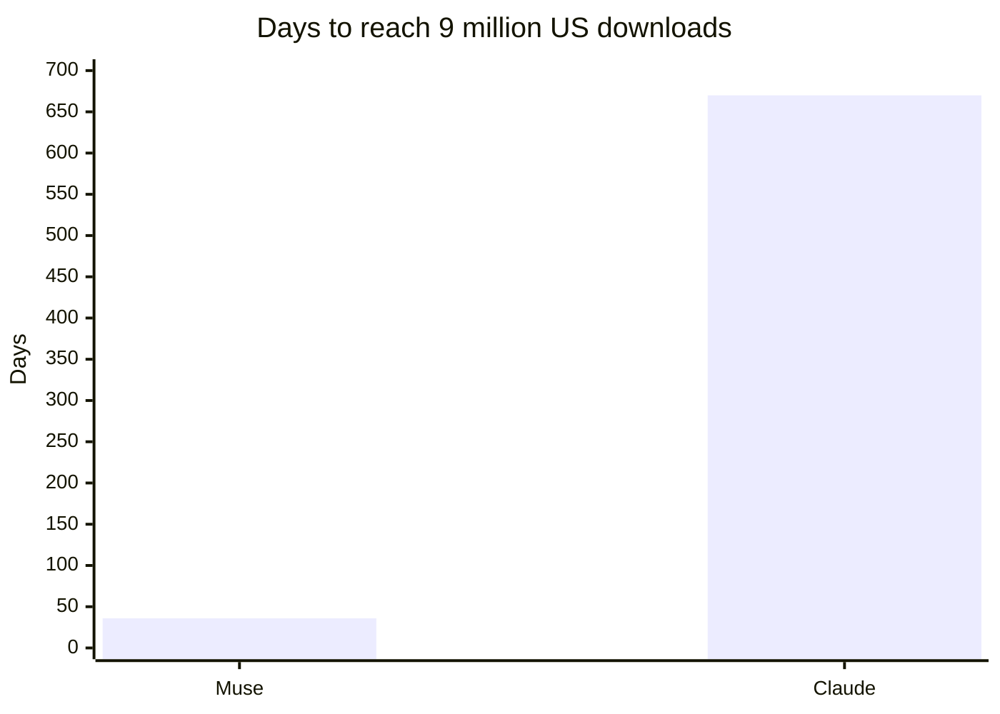
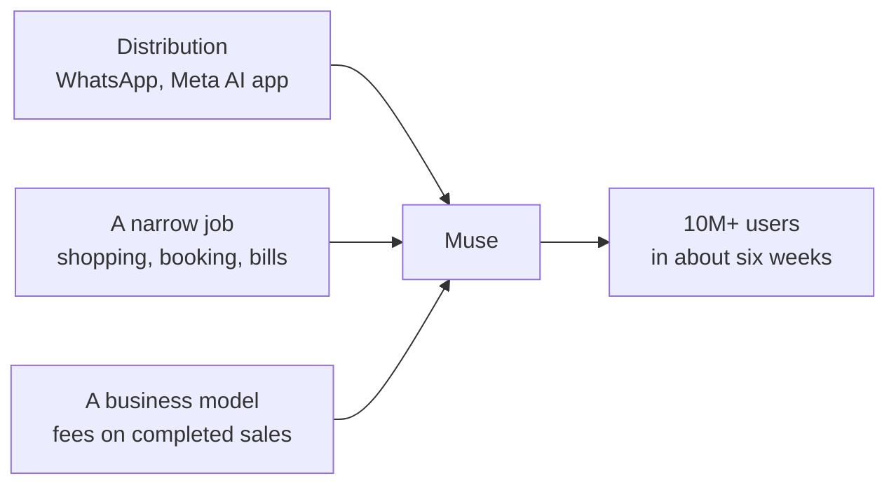
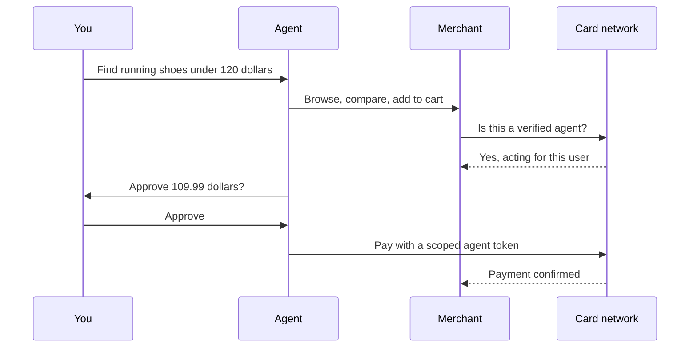

Eighteen months ago, Meta was the AI lab people had stopped taking seriously.

Last week, Mark Zuckerberg told investors that **Muse**, Meta's personal agent, has passed **10 million users**.<sup>[13](#references)</sup>

Muse didn't get there by having the smartest model. It got there by being in the right place, doing one job people actually wanted done, and making money in a way Meta already understands.

> The AI race has more than one finish line, and Meta just crossed the one most developers weren't watching.

---

## Where Meta Started

In April 2025, **Llama 4** launched under a cloud. Meta promoted a leaderboard result from a specially tuned "experimental" version of Maverick that ranked second on LMArena, and when the public release was tested on its own, it landed in **32nd place**.<sup>[1](#references)</sup> <sup>[2](#references)</sup> LMArena said Meta's reading of its policy "did not match what we expect from model providers," and independent coding benchmarks were even less kind.

That mattered more than one bad launch usually would. Open weights were Meta's whole identity in AI, the thing that made developers root for it, and Llama 4 made it look like Meta was falling behind OpenAI, Google and Anthropic while giving its work away.

**So Meta stopped trying to fix Llama and started over.**

---

## The Rebuild

The turnaround happened in a sequence, and each step set up the next one:

```text
Apr 2025   Llama 4 stumbles on benchmarks
Jun 2025   $14.3B into Scale AI, Alexandr Wang leads Meta Superintelligence Labs
Jul 2025   "Hundreds of billions" committed to compute (Prometheus, Hyperion)
Apr 2026   Muse Spark: MSL's first model, and Meta's first without open weights
Jul 2026   Meta Model API and Muse Code open to developers
Sep 2026   Muse launches as a personal agent
Oct 2026   Muse Spark Open and an Apple partnership; 10M users
```

In June 2025, Meta put **$14.3 billion** into Scale AI for a 49% stake and brought in its CEO, Alexandr Wang, to lead the new **Meta Superintelligence Labs**.<sup>[3](#references)</sup> A month later, Zuckerberg said Meta would spend "hundreds of billions of dollars" on data centers, including Prometheus in Ohio and Hyperion in Louisiana, which can scale to five gigawatts.<sup>[4](#references)</sup> The message was simple: Meta had the cash from its ad business, and it would use it to buy back into the race.

The first result was **Muse Spark** in April 2026, MSL's first model. Unlike Llama, it shipped without public weights.<sup>[5](#references)</sup> <sup>[6](#references)</sup> That was a real break from Meta's past, and it signaled that Meta now cared more about owning a product than about being the open-source favorite.

In July, Meta opened the model to developers through the **Meta Model API**, which is OpenAI SDK–compatible and priced at $1.25 per million input tokens and $4.25 per million output tokens, with a coding tool, Muse Code, alongside it.<sup>[7](#references)</sup> <sup>[8](#references)</sup> That part of the strategy got a polite reception. The part that took off came two months later.

---

## The Agent That Actually Shipped

On September 8, Meta launched **Muse** as a personal agent.<sup>[9](#references)</sup> It isn't a chatbot that answers questions, but rather an agent that does things: it browses the web, fills out forms, books travel, sends email and checks out for you. It lives in the Meta AI app, on the web and inside WhatsApp, with a free tier and paid plans at $20 and $100 a month.

What's interesting from an engineering point of view is how Meta handled the scary part of letting an agent act for you. Each user gets an isolated virtual machine, and Muse asks for approval before sensitive actions like sending an email or paying for something.<sup>[10](#references)</sup> Meta says conversations stay away from its ad systems and that users can opt out of training. Those are the same guardrails I'd reach for when building an agent that touches someone's money: sandbox the execution and put a human in front of anything irreversible.

Then the numbers came in. Sensor Tower found that Muse took **36 days to reach 9 million US downloads**, a milestone that took Claude 670 days.<sup>[15](#references)</sup> 73% of new users came back the day after installing it.<sup>[16](#references)</sup> On the Q3 earnings call on October 21, Zuckerberg put the total above 10 million and said shopping was the top activity.<sup>[13](#references)</sup> Purchase demand was high enough that Meta had to ask Stripe to raise its credit limits.<sup>[14](#references)</sup>



---

## Why Meta Pulled Ahead Here

None of this happened because Muse Spark beats every frontier model. It happened because Meta had three advantages that a better model can't buy.

The first is **distribution**. Billions of people already use WhatsApp, so Muse didn't need anyone to download a new app, create an account or learn a new interface. The agent shows up where people already talk to friends and businesses, which is why a 36-day ramp was possible at all.

The second is **a narrow job**. Most AI products try to be good at everything and leave the user to work out what to ask. Muse leaned into errands: shopping, booking and bills. That's a smaller ambition than "general assistant," but it's one where people can feel the value the first time they use it, which is exactly what that next-day retention number reflects.

The third is **a business model that fits**. Meta plans to charge businesses a fee when Muse completes a sale.<sup>[15](#references)</sup> For a company that already makes its money connecting people to merchants, an agent that shops is a natural next step rather than a new business.

**Put together, Meta didn't win the model race, but rather turned a capable model into the fastest-growing agent by putting it where people already were.**



---

## What the 10 Million Doesn't Tell You

The headline number deserves some context, because it's company-reported and Meta hasn't said what counts as a "user." Third-party data tells a smaller story: Sensor Tower counted 6.6 million downloads and about **1.8 million daily active users** in early October, and Similarweb put daily users near 2.2 million.<sup>[19](#references)</sup> One analysis estimates only about a quarter of people who set up Muse use it every day,<sup>[17](#references)</sup> and while day-one retention beats ChatGPT, ChatGPT pulls ahead around days eight and nine.<sup>[16](#references)</sup>

The merchant side isn't settled either. Some sites, Amazon among them, reportedly block AI agents from browsing or checking out,<sup>[15](#references)</sup> and an agent built for shopping is only as useful as the stores that let it in.

Then there's trust. Muse asks for access to email, calendars, payments and more, and *Time* reports that older adults are among its most enthusiastic users, which worries privacy experts.<sup>[18](#references)</sup> Meta itself says Muse "will sometimes make mistakes." That's an honest disclaimer, but it lands differently when the agent has your card on file.

> Ten million people let an agent spend their money. The open question is whether they'll still trust it after the first wrong order.

---

## Meta Is Also Winning Developers Back

Meta hasn't given up on the developers it lost after Llama. In October it released **Muse Spark Open**, which it calls the most capable US open-weight model to date, available on Hugging Face and through hosts like Groq, Together AI and OpenRouter.<sup>[11](#references)</sup> It also announced a partnership with Apple so developers can run the model locally on high-end Macs.<sup>[12](#references)</sup>

That's the part I find most interesting as someone who builds agents. Meta kept the consumer product closed and monetized, then released an open model to rebuild goodwill with developers. It's the reverse of the Llama era, where openness was the strategy, and it suggests Meta now sees open weights as a way to support a product rather than as the product itself.

---

## What's Next in the Personal Agent Space

Muse proved that people will hand errands to an agent. The next year decides who owns that habit, and from everything that's shipped since September, I think the fight plays out on four fronts.

### Everyone now has a personal agent

Meta had the space mostly to itself for about three weeks. At DevDay on September 29, OpenAI introduced **Dots**, its own personal agent, starting on the $100-a-month Pro plan.<sup>[20](#references)</sup> On October 8, Google launched a Gemini agent that works across Gmail, Drive, Docs and Calendar,<sup>[21](#references)</sup> and Apple's new Siri works inside Messages, Mail, Calendar and Photos with on-device processing.<sup>[22](#references)</sup>

| Agent | Company | Where it lives | Its edge |
| --- | --- | --- | --- |
| Muse | Meta | WhatsApp, Meta AI app, web | Billions of people already in the app |
| Dots | OpenAI | ChatGPT | ChatGPT's users and models |
| Gemini agent | Google | Gmail, Drive, Docs, Calendar | Your work data is already there |
| Siri | Apple | Messages, Mail, Calendar, Photos | On-device privacy |

What stands out to me is that every company is playing the same card Meta played. **None of them is pitching the smartest agent, but rather the agent that already sits next to your data.** OpenAI is the interesting exception: it has the strongest consumer AI brand, but it's starting at $100 a month while Muse starts at free, which means Dots is competing for power users while Muse goes after everyone else.

### The agent leaves the phone

At Connect in September, Meta said Muse is coming to its AI glasses "in the coming months," without a firm date or price yet.<sup>[23](#references)</sup> <sup>[24](#references)</sup> It's also getting real-time voice, connectors to more services, its own email address and computer control on the Mac, along with shopping through Walmart, GameStop, Gap and Wayfair.<sup>[23](#references)</sup>

Put those together and the agent stops being an app you open. It becomes something that sees what you see through your glasses, answers by voice, sends email as itself and drives your computer while you do something else. That's a much bigger surface than a chat window, and it's where Meta's hardware bet finally connects to its AI bet.

### Payments get their own rails

Today, most agents shop by doing what a person would do: open a browser, fill in a form and type in a card. That works, but it's fragile, and merchants can't tell a trusted agent from a scraper. So the payment industry is building rails made for agents. OpenAI and Stripe published the **Agentic Commerce Protocol**, Google has **AP2**, Visa has its **Trusted Agent Protocol** and Mastercard has **Agent Pay**.<sup>[27](#references)</sup>

The details differ, but they converge on the same flow:



The important piece is the **scoped token**. Instead of handing the agent your card number, the network issues a token limited to one merchant, one amount or one time window, so a mistake or a compromised agent can't drain your account. That's the payment version of the per-user VM and the approval step Muse already uses.

### Merchants decide who gets in

This is the front Meta can't win with distribution alone. Some stores, Amazon among them, reportedly block agents from browsing or checking out,<sup>[15](#references)</sup> while Walmart, Gap and Wayfair are partnering with Muse directly.<sup>[23](#references)</sup> If the biggest store on the internet keeps its doors closed, a shopping agent has a hole right where people shop most.

**I expect the next phase to look less like a model race and more like the early days of app stores**, with merchants choosing which agents to let in, agents competing for those partnerships, and fees deciding the terms. Meta's plan to charge businesses when Muse completes a sale is an early version of that deal.<sup>[25](#references)</sup>

### Trust becomes the product

Underneath all four fronts is the same problem. One 2026 survey found that only 4% of consumers would let an AI agent complete a purchase on its own,<sup>[22](#references)</sup> and BCG argues that personal agents will compete on trust rather than capability.<sup>[26](#references)</sup>

That matches what Muse's numbers already show. People installed it in record time, but only some of them use it every day, and the gap between those two numbers is mostly a trust gap. **The agent that wins the next year will be the one people stop double-checking.**

---

## The Lesson for Anyone Building Agents

Developers tend to judge agents the way we judge models, by benchmarks, reasoning and how well they fit our tools. By those measures, Muse is a good agent but not obviously the best one.

That's what makes its growth worth paying attention to. The product that reached 10 million users first wasn't the one with the strongest model, but rather the one that removed every step between a person and a finished task.

I've built agents like [personal-finance-agent](/projects/personal-finance-agent), and the hard part was never getting the model to reason. The hard part is getting someone to trust it with something real and then come back tomorrow. Meta solved that with distribution most companies will never have, but the lesson still applies at a smaller scale: **pick one job, put the agent where people already are, and make the first task feel finished.**

Eighteen months ago, Meta was behind.

It didn't catch up by building the best model.

It caught up by building the agent people actually used.

---

## References
<a name="references"></a>

1. [Meta scrambling to defend its AI after Llama 4 benchmark bungle (Sherwood News)](https://sherwood.news/tech/meta-scrambling-to-defend-its-ai-after-llama-4-benchmark-bungle)
2. [Unmodified Llama 4 Maverick ranks below rivals following Meta cheating allegations (Neowin)](https://www.neowin.net/news/unmodified-llama-4-maverick-ranks-below-rivals-following-meta-cheating-allegations/)
3. [Meta invests $14.3B in Scale AI, taps Alexandr Wang for superintelligence team (Fortune)](https://fortune.com/2025/06/13/meta-scale-ai-alexandr-wang-superintelligence-team)
4. [Meta's building two massive data centres to achieve superintelligence (TechRepublic)](https://www.techrepublic.com/article/news-meta-data-centres-ai-superintelligence/)
5. [Meta unveils Muse Spark, MSL's first model (The Next Web)](https://thenextweb.com/news/meta-muse-spark-msl-first-model)
6. [Life After Llama: With Muse Spark, Meta pivots away from its open-weights strategy (DeepLearning.AI)](https://charonhub.deeplearning.ai/with-muse-spark-meta-pivots-away-from-its-open-weights-llama-strategy/)
7. [Introducing Muse Spark 1.1 and the Meta Model API (Meta AI)](https://ai.meta.com/blog/introducing-muse-spark-meta-model-api/)
8. [Meta updates its Spark model, releases developer version (Axios)](https://www.axios.com/2026/07/09/meta-ai-spark-model-update-developer)
9. [Meta debuts its Muse AI agent. Will consumers trust it? (TechCrunch)](https://techcrunch.com/2026/09/08/meta-debuts-its-muse-ai-agent-will-consumers-trust-it/)
10. [Meta pushes into personal AI agents in Muse Spark family (CNBC)](https://www.cnbc.com/2026/09/08/meta-personal-ai-agents-public-reckoning-privacy-safety.html)
11. [Introducing Muse Spark Open (Meta Research)](https://research.meta.ai/blog/muse-spark-open)
12. [Apple and Meta team up to make Muse AI model run on Mac computers (CNBC)](https://www.cnbc.com/2026/10/15/apple-meta-partner-ai.html)
13. [Meta says Muse has over 10M users, with shopping a top activity (TechCrunch)](https://techcrunch.com/2026/10/21/meta-says-muse-has-over-10m-users-with-shopping-a-top-activity/)
14. [Zuckerberg said demand for Muse was so high he had to get Stripe to raise credit limits (Fortune)](https://fortune.com/2026/10/22/mark-zuckerberg-meta-muse-stripe-credit-limit-shopping/)
15. [Meta Muse AI agent challenges Amazon and Apple (CNBC)](https://www.cnbc.com/2026/10/22/meta-muse-personal-ai-agents.html)
16. [Meta's Muse AI agent brings back 73% of new users (Yahoo Finance)](https://finance.yahoo.com/technology/article/metas-muse-ai-agent-brings-back-73-of-new-users--nearly-double-chatgpts-rate-164557360.html)
17. [Muse passes 10 million users: Meta agentic shopping trends (ALM Corp)](https://almcorp.com/news/muse-passes-10-million-users-meta-agentic-shopping/)
18. [Meta's Muse AI is winning over older adults. Privacy experts are worried (Time)](https://time.com/article/2026/10/22/ai-meta-muse-agent-older-users/)
19. [Meta's Muse AI agent posts strong early numbers as investors demand proof (Crypto Briefing)](https://cryptobriefing.com/meta-muse-ai-agent-early-data/)
20. [OpenAI follows Meta into the red-hot market for personal agents. But will users pay? (CNBC)](https://www.cnbc.com/2026/09/30/openai-follows-meta-into-the-red-hot-market-for-personal-agents.html)
21. [Google launches workplace AI agent that acts like a colleague (Bloomberg)](https://www.bloomberg.com/news/articles/2026-10-08/google-launches-universal-gemini-ai-agent-for-workplace)
22. [The consumer AI agent race: five platforms, three pricing models, one winner (Yahoo Finance)](https://finance.yahoo.com/technology/ai/articles/consumer-ai-agent-race-five-115316091.html)
23. [Everything we announced at Meta Connect 2026 (Meta)](https://www.meta.com/blog/meta-connect-2026-everything-we-announced/)
24. [Meta wants Muse to be part of your everyday life (CNN)](https://www.cnn.com/2026/09/24/tech/meta-muse-ai-glasses-connect)
25. [Meta put out an ambitious roadmap to Muse monetization (CNBC)](https://www.cnbc.com/investingclub/2026/10/21/meta-put-out-an-ambitious-roadmap-to-muse-monetization-after-strong-quarter-and-guide.html)
26. [Personal AI agents compete on trust, not capability (BCG)](https://www.bcg.com/x/the-multiplier/personal-ai-agents-compete-on-trust)
27. [2026 comparative analysis: agentic commerce payment protocols (Applied Technology Index)](https://appliedtechnologyindex.com/research/2026-comparative-analysis-agentic-commerce-payment-protocols/)
