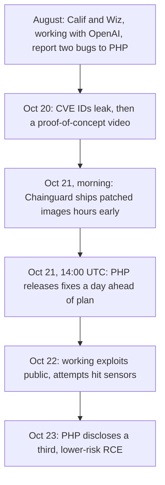

The fix shipped on Wednesday.

A working exploit was public by Thursday.

And at least one attacker may have been probing servers days before either.

That's the week PHP just had. On **October 21**, the PHP project pushed an emergency release for **PHP2Shell**, two bugs in the PHP runtime itself (**CVE-2026-109618** and **CVE-2026-109619**) that let anyone who can send an HTTP request to a PHP server run code on it, without logging in<sup>[1](#references)</sup>. The usual story for a bug like this goes in order: someone finds it, the maintainers fix it, and attackers catch up weeks later. **This week the order ran backwards, and that's the part worth paying attention to.**

---

## What broke

Most web security news is about an application, like a WordPress plugin or somebody's admin panel, so you check whether you use it and usually you don't. PHP2Shell sits a layer below that, in the code that turns a raw HTTP request into `$_POST`, `$_FILES` and session data before your application runs a single line. **That means there's no plugin to remove and no setting that makes you safe: if PHP serves web requests on your machine, you're affected.**

The first bug, CVE-2026-109618, starts with PHP's memory limit. When a request goes over `memory_limit`, PHP doesn't unwind carefully, but rather jumps straight out of whatever it was doing (a C `longjmp`) and runs request cleanup. Researchers found this can happen while PHP is halfway through building request data<sup>[4](#references)</sup><sup>[5](#references)</sup>. An attacker sends a multi-megabyte POST with an oversized form field name, PHP runs out of memory mid-parse, and cleanup then walks a structure that was never finished, trusting attacker-shaped bytes as a pointer to code it should call<sup>[6](#references)</sup>.

The second bug, CVE-2026-109619, is about state that outlives its request. A PHP-FPM or Apache worker serves many requests in a row and is supposed to reset its global state between them, but this bug leaves request-owned state pointing at memory that's already been freed, so the next request on the same worker can use it<sup>[5](#references)</sup>. **Besides running code, that can leak pieces of earlier requests, along with whatever passwords, session cookies or API tokens were in them**<sup>[8](#references)</sup>.

Neither mistake is exotic. Error paths that skip initialization and state that survives a reset are classic **C** bugs, and early write-ups still disagree on some of the details. What makes them critical is where they sit: in code every request passes through, reachable before authentication, in every PHP version from **5.4 to 8.5** and every way of running it, from mod_php and PHP-FPM to php-cgi, FrankenPHP and LiteSpeed<sup>[1](#references)</sup>.

---

## The week it leaked



The bugs were found in August by the security firms **Calif and Wiz, working with OpenAI**, and reported privately to the PHP security team<sup>[10](#references)</sup>. That started an **embargo**, the usual arrangement where everyone who knows about a bug stays quiet while a fix is built, and then everyone publishes together so defenders hear about it at the same moment attackers do. The coordinated release was set for Thursday, October 22.

It didn't hold. On Tuesday the 20th, the CVE IDs started circulating online, followed by an accidentally published proof-of-concept video<sup>[2](#references)</sup>. Then on Wednesday morning **Chainguard**, a company that had been briefed to help test the fixes, published patched container images more than six hours before the official release<sup>[3](#references)</sup>. Anyone could diff those images against the previous ones and see exactly which code changed, which is why the PHP Foundation said Chainguard had **"unilaterally broke[n] the embargo."**

PHP moved its release up a day, to Wednesday at 14:00 UTC, and shipped **8.5.12, 8.4.27, 8.3.36 and 8.2.35**. Within about a day, VulnCheck had an exploit working against PHP 8.4.10 through 8.4.26 with ASLR on<sup>[7](#references)</sup>, a public proof of concept on GitHub had passed 900 stars, and security firms were logging exploitation attempts. Amazon's threat intelligence team says it saw one attempt dated **October 17**, before the leak, which would mean someone outside the embargo already knew.

**Embargoes assume that turning a fix back into an exploit takes days, and this week it took hours.** Once a patched binary exists anywhere, the bug is effectively public.

---

## AI found it first

The detail that put PHP2Shell on CNN wasn't the bug class, but rather that **the researchers who found it were using AI models to read PHP's C source**<sup>[11](#references)</sup>.

PHP's request parser has been read by humans for over twenty years, and the memory-limit bailout and the per-request reset are old, well-traveled code. I don't think finding two critical bugs there says much about PHP's maintainers. It says more about what got cheaper: going through every error path in a large C codebase and asking "what happens if this fails halfway?" at each one used to be too slow and too tedious for anyone to do exhaustively, and **now a model can do that reading for the cost of an API bill.**

The same speed works for the other side, though. A leaked CVE ID plus a diff of patched images is exactly the kind of input that tools now turn into a working exploit quickly, and the timeline above shows it happening. So the model that clicked for me looks like this:

```text
time to find the bug         ↓  (AI reads the code)
time to build the exploit    ↓  (AI reads the diff)
time to patch every server   →  (unchanged)
```

> When finding and exploiting both get faster and patching doesn't, the bottleneck in security moves to distribution.

---

## Where the patch actually has to go

Releasing a fix and having it running everywhere are very different things. Qualys counted **167 million** PHP installations in its data, **73%** of them on internet-facing machines<sup>[8](#references)</sup>, and each one gets patched on its own schedule by whoever happens to own it.

For WordPress sites that owner is usually a host, which is why updating WordPress does nothing here. WordPress's security team said no release is coming because there's nothing in WordPress to fix<sup>[9](#references)</sup>, so WordPress.com, SiteGround and WP Engine spent the week filtering traffic in front of customer sites while they rolled out new PHP builds. **Most site owners are waiting on someone else to patch for them.**

Then there's everything that isn't on a managed host. PHP 8.1 and older are past end of life and won't get an official release, only source backports and third-party builds from vendors like TuxCare<sup>[12](#references)</sup>, and CISA's advice for those servers is to take them offline<sup>[1](#references)</sup>. Docker images pinned to an old tag don't update themselves, and even a patched server keeps running the vulnerable code until someone restarts PHP-FPM or Apache.

That last group includes things like my own [Woogent](/projects/woogent-hackillinois-2026) project from HackIllinois, which ran its demo store on the official `wordpress` Docker image, Apache with mod_php, the exact setup where researchers confirmed full code execution<sup>[6](#references)</sup>. Mine only ever ran on `localhost`, but plenty of hackathon projects get pushed to a cheap VPS on demo day and never get touched again. **Those forgotten servers are where this will actually play out.**

If you run PHP yourself, this is the short version of what to do:

- Upgrade to one of the fixed releases, then restart PHP-FPM or Apache, and check the version a web request sees (not just `php -v`, since the CLI can be a different binary).
- If you can't upgrade today, several advisories list `session.upload_progress.enabled = Off` as a stopgap<sup>[13](#references)</sup>. It reduces the risk without removing it, and so does a WAF rule.
- If the server was exposed since October 17, look for unknown admin accounts, modified files and new cron jobs, and rotate any secret the server could see, because the second bug can leak them from memory.
- Skip any "PHP2Shell fix" plugin. Patchstack warns that several of them are malware riding the news<sup>[14](#references)</sup>.

---

PHP2Shell will probably be remembered as the bug AI found, and that part is real. **But the more lasting lesson is that a machine found the bug and a machine helped build the exploit, while the patch still has to be applied by a person who remembers the server exists.**

The fix shipped on Wednesday.

The exploit was public by Thursday.

Somewhere there's still a server nobody has thought about since demo day.

---

## References
<a name="references"></a>

1. [CISA: Critical Vulnerabilities in PHP Require Immediate Patching](https://www.cisa.gov/news-events/alerts/2026/10/21/critical-vulnerabilities-php-require-immediate-patching)
2. [Huntress: php2shell, Leaked Critical PHP Vulnerabilities](https://www.huntress.com/blog/php2shell-leaked-critical-php-vulnerabilities)
3. [The New Stack: AI found a critical PHP flaw. The bigger failure began in 2024.](https://thenewstack.io/php2shell-chainguard-embargo-dispute/)
4. [Zscaler: CVE-2026-109618 and CVE-2026-109619](https://www.zscaler.com/blogs/security-research/cve-2026-109618-and-cve-2026-109619-php-vulnerable-unauthenticated-rce)
5. [Black Kite: Two Critical Remote Code Execution Vulnerabilities in the PHP Core](https://blackkite.com/blog/php2shell-two-critical-remote-code-execution-vulnerabilities-in-the-php-core-)
6. [Abstract Security: PHP2Shell Critical PHP RCE Vulnerabilities](https://www.abstract.security/blog/php2shell-critical-php-rce-vulnerabilities-cve-2026-109618-and-cve-2026-109619)
7. [VulnCheck: PHP2Shell Vulnerabilities](https://www.vulncheck.com/blog/php2shell-vulnerabilities)
8. [Qualys: Two Critical PHP Flaws Could Hand Attackers Your Web Servers](https://blog.qualys.com/vulnerabilities-threat-research/2026/10/20/php-announces-critical-security-release-for-two-vulnerabilities)
9. [The Repository: Hosts Across the WordPress Ecosystem Race to Protect Customers](https://www.therepository.email/php-patches-critical-php2shell-vulnerabilities-as-hosts-across-the-wordpress-ecosystem-race-to-protect-customers)
10. [The Next Web: PHP rushes out emergency patches for two critical bugs AI found first](https://thenextweb.com/news/php2shell-php-rce-ai-openai-wiz)
11. [CNN: Websites shut down globally after AI finds cybersecurity flaw](https://www.cnn.com/2026/10/21/tech/php2shell-vulnerability-ai-intl)
12. [TuxCare: Patches php2shell for the PHP Versions Upstream Left Behind](https://tuxcare.com/blog/php2shell-cve/)
13. [SOCRadar: PHP2Shell Affected Versions and Fix](https://socradar.io/blog/php2shell-cve-2026-109618-cve-2026-109619/)
14. [Digidop: PHP2Shell critical PHP flaw, what to do about WordPress](https://www.digidop.com/blog/php2shell-php-vulnerability-wordpress-webflow)
