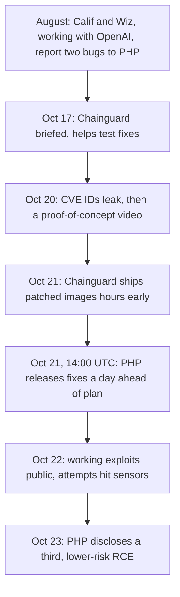

On Wednesday, October 21, the PHP project shipped an emergency release on a day nobody had planned to ship it. Two bugs in the PHP runtime itself, together called **PHP2Shell** ([CVE-2026-109618](https://www.cve.org/CVERecord?id=CVE-2026-109618) and [CVE-2026-109619](https://www.cve.org/CVERecord?id=CVE-2026-109619)), let anyone who can send an HTTP request to a PHP server run code on it. No login, no vulnerable plugin, no misconfiguration. Just a POST request.

That same afternoon [CISA told organizations](https://www.cisa.gov/news-events/alerts/2026/10/21/critical-vulnerabilities-php-require-immediate-patching) to patch immediately, and to take any PHP system they couldn't patch offline. Some hosts did exactly that, which is why a chunk of the web [went dark for maintenance](https://www.malwarebytes.com/blog/bugs/2026/10/php2shell-why-websites-are-going-offline-for-emergency-security-updates) this week.

If you run anything on PHP, start here:

```sh
php -v                                          # need 8.5.12, 8.4.27, 8.3.36 or 8.2.35 or newer
php -i | grep session.upload_progress.enabled   # stopgap: set it to Off until you can upgrade
sudo systemctl restart php8.4-fpm               # or apache2: a running worker keeps the old binary
```

The rest of this post is what happened, why this one is different, and what it says about where bug hunting is going.

---

## Why "it's in PHP" is the scary part

Most web security news is about an application: a WordPress plugin, a Laravel package, somebody's admin panel. You check whether you use it, and usually you don't.

PHP2Shell sits a layer below that, in the code that turns an HTTP request into `$_POST`, `$_FILES` and session data before your application runs a single line. That means **every PHP install that serves web requests is affected**, from PHP 5.4 through 8.5, whether it runs under Apache's mod_php, PHP-FPM behind nginx, php-cgi, FrankenPHP or LiteSpeed. PHP runs roughly [70% of the websites](https://www.cnn.com/2026/10/21/tech/php2shell-vulnerability-ai-intl) whose server-side language is known, and Qualys counted [167 million PHP installations](https://blog.qualys.com/vulnerabilities-threat-research/2026/10/20/php-announces-critical-security-release-for-two-vulnerabilities) in its data, 73% of them on internet-facing machines.

It also means **updating WordPress does nothing**. WordPress's security team [said](https://www.therepository.email/php-patches-critical-php2shell-vulnerabilities-as-hosts-across-the-wordpress-ecosystem-race-to-protect-customers) no WordPress release is coming because there's nothing in WordPress to fix. The fix is a new PHP binary, and on shared hosting that's your host's job, which is why WordPress.com, SiteGround and WP Engine spent the week putting filters in front of customer sites while they rolled out patched PHP.

This one felt close to home for me. [Woogent](/projects/woogent-hackillinois-2026), my HackIllinois project, ran its demo store on the official `wordpress` Docker image, which is Apache with mod_php, the exact setup where researchers confirmed full code execution. It was only ever on `localhost`, but plenty of hackathon projects get deployed to a $5 VPS on demo day and never get touched again. **Those are the servers that don't get patched.**

---

## How the bugs work

The full technical write-ups aren't all public yet, and early reports disagree on details, so here's the part that's consistent across [Zscaler](https://www.zscaler.com/blogs/security-research/cve-2026-109618-and-cve-2026-109619-php-vulnerable-unauthenticated-rce), [Black Kite](https://blackkite.com/blog/php2shell-two-critical-remote-code-execution-vulnerabilities-in-the-php-core-) and [Abstract Security](https://www.abstract.security/blog/php2shell-critical-php-rce-vulnerabilities-cve-2026-109618-and-cve-2026-109619).

**CVE-2026-109618** starts with PHP's memory limit. When a request goes over `memory_limit`, PHP doesn't unwind carefully; it jumps straight out of whatever it was doing (a C `longjmp`) and runs request cleanup. The bug is that this can happen while PHP is halfway through building request data. An attacker sends a multi-megabyte POST with an oversized form field name, PHP runs out of memory mid-parse, and cleanup then walks a structure that was never finished, treating attacker-shaped bytes as valid data, including a pointer to code it should call. Control that pointer and you control what the server runs next.

**CVE-2026-109619** is about state that outlives its request. A PHP-FPM or Apache worker serves many requests one after another, and PHP is supposed to reset its global state between them. The bug leaves request-owned state pointing at memory that's already been freed, and the next request on the same worker can use it before it's reinitialized. Researchers say this one can also [leak worker memory](https://blog.qualys.com/vulnerabilities-threat-research/2026/10/20/php-announces-critical-security-release-for-two-vulnerabilities): fragments of earlier requests, with whatever passwords, session cookies or API tokens were in them.

Neither bug is exotic on its own. Error paths that skip initialization and state that survives a reset are classic C mistakes. What makes PHP2Shell critical is where they sit: in code every request goes through, reachable before authentication, in a runtime most of the web shares.

**The part that makes it hard to spot** is that a successful exploit doesn't crash the worker. The attacker's commands run as the web server user and the site keeps serving pages. The best hint so far is in your error logs: PHP fatal errors that say `in Unknown on line 0`, especially around large POST requests.

---

## What happened, day by day



The bugs were found in August by the security firms [Calif and Wiz, working with OpenAI](https://thenextweb.com/news/php2shell-php-rce-ai-openai-wiz), and reported privately to the PHP security team. That started an **embargo**: the usual arrangement where the people who know about a bug keep quiet while a fix is built, then everyone publishes together so defenders and attackers learn about it at the same moment.

The coordinated release was set for Thursday, October 22. It didn't hold. On Tuesday the 20th, the CVE IDs started circulating online, followed by an [accidentally published proof-of-concept video](https://www.huntress.com/blog/php2shell-leaked-critical-php-vulnerabilities). watchTowr confirmed the leak was real by reproducing both bugs. Then, on the morning of the 21st, [Chainguard](https://thenewstack.io/php2shell-chainguard-embargo-dispute/), a company that had been briefed to help test the fixes, published patched container images more than six hours before the official release. Anyone could diff those images against the previous ones and see exactly what changed. The PHP Foundation's response was blunt: Chainguard **"unilaterally broke the embargo."**

PHP moved its release up a day to Wednesday at 14:00 UTC and shipped 8.5.12, 8.4.27, 8.3.36 and 8.2.35. Within about a day, VulnCheck had an exploit working against PHP 8.4.10 through 8.4.26 with ASLR on, a public proof of concept had passed 900 stars on GitHub, and Cloudflare, watchTowr and others were seeing exploitation attempts. Amazon's threat intelligence team says it spotted one attempt dated October 17, before the leak, which, if it holds up, means someone outside the embargo already knew.

On the 23rd, PHP disclosed a third code execution bug. This one only affects apps configured in an unusual way, so PHP isn't doing an emergency release for it and is publishing a mitigation instead.

---

## AI found it first

The detail that got PHP2Shell onto [CNN](https://www.cnn.com/2026/10/21/tech/php2shell-vulnerability-ai-intl) and [Al Jazeera](https://www.aljazeera.com/news/2026/10/22/world-leaders-warn-against-security-flaw-found-in-php-computer-programming) isn't the bug class. It's that **the researchers who found it were using AI models to read PHP's C source**.

PHP's request parser has been read by humans for over twenty years. The memory-limit bailout and the per-request reset are old, well-traveled code. That a model-assisted search turned up two critical bugs there says less about PHP's maintainers and more about the economics of finding bugs: reading every error path in a large C codebase, asking "what if this fails halfway?" at each one, used to be too slow and boring for anyone to do exhaustively. It's now cheap.

That cuts both ways, and the timeline above shows it. The same tools that let Calif and Wiz find these bugs let attackers turn a leaked CVE ID and a diff of patched binaries into an exploit in hours, not weeks. **The window between "a fix exists" and "an exploit exists" used to be measured in days. This week it was negative.**

If defenders and attackers both get faster, the thing that decides who wins is how quickly a fix can reach every server. For PHP that's the slow part: distro packages, hosting providers, Docker images pinned to a tag from 2023, and PHP 7.4 boxes nobody remembers owning.

---

## What to actually do

If you manage your own server, upgrade PHP (or install your distro's patched package), then **restart PHP-FPM or Apache**, since workers that are already running keep the old code in memory. Check the version a web request sees, not just the CLI, by loading a page that prints `PHP_VERSION`; they can be different binaries.

If you can't upgrade today, setting `session.upload_progress.enabled = Off` in `php.ini` is the stopgap [several advisories](https://socradar.io/blog/php2shell-cve-2026-109618-cve-2026-109619/) list, but treat it as a stopgap: it reduces the risk, it doesn't remove it, and neither does a WAF rule.

If you're on PHP 8.1 or older, there's no official release coming. The PHP security team published source backports for 7.4 through 8.1, and vendors like [TuxCare](https://tuxcare.com/blog/php2shell-cve/) are shipping builds, but the honest advice from CISA and from WordPress's own security lead is to take the server offline until it's upgraded.

If your server was exposed since October 17, check it the way you'd check a compromised one: unknown admin accounts, modified files, new cron jobs, unexpected outbound traffic. If you find anything, rotate every password and API key the server could see, since CVE-2026-109619 can leak them from memory, and grab logs and memory before restarting, because a restart wipes the evidence.

And if you're on shared hosting, the fix is your host's job, but it's worth a support ticket asking which PHP version you're on. Don't install a "PHP2Shell fix" plugin: [Patchstack warns](https://www.digidop.com/blog/php2shell-php-vulnerability-wordpress-webflow) that several of them are malware riding the news.

---

PHP2Shell will probably be remembered for the AI angle, but what I keep thinking about is the Woogent container on my laptop. Patching a runtime only works if someone remembers the runtime is there, and **the servers that get exploited are rarely the ones people are watching.** Go find yours.
