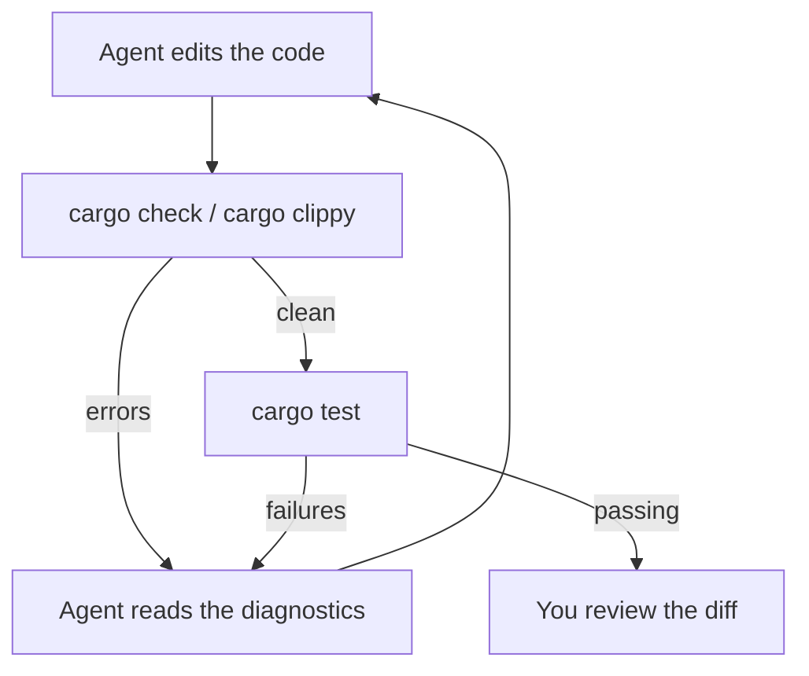

**"Rewrite it in Rust"** has been a running joke for years. Someone opens a GitHub issue on a project written in **C**, **Python** or **Go**, and the only suggestion is to throw it all away and start over in **Rust**. There's even a [satirical GitHub repo](https://github.com/ansuz/RIIR) dedicated to it.

It was funny because rewrites are expensive, and Rust made them even more expensive. You had to learn the borrow checker, fight lifetimes, and wait for the compiler to agree with you before anything ran.

Then AI agents started writing most of the code, and the joke started turning into a plan.

**When an agent writes the code, Rust's strict compiler stops being the thing that slows you down and becomes the first reviewer of everything the agent writes.**

---

## What Rust is and why developers like it

**Rust** is a programming language for the same kind of work as **C** and **C++**: operating systems, browsers, databases, command-line tools and anything else where speed and memory use matter. Graydon Hoare started it as a side project, Mozilla later sponsored it, and version 1.0 came out in May 2015.<sup>[1](#references)</sup>

What makes Rust different is how it handles memory. C and C++ make you free memory yourself, which leads to bugs like reading memory after it was already freed. **Python**, **Java** and **Go** use a garbage collector instead, a background process that frees memory for you but costs extra work while the program runs.

**Rust does neither: every value has exactly one owner, and the compiler frees the value as soon as its owner goes away.**

On top of that, Rust has a **borrow checker**, the part of the compiler that tracks references (pointers to a value that don't own it). It enforces one rule: at any moment, a value can have many references that only read it, or one reference that changes it, but never both. **Listing 1.2**, later in this post, shows it rejecting a real bug that breaks this rule.

Breaking that rule is a compile error rather than a crash in production, so **Rust runs about as fast as C++ while ruling out most memory bugs before the program ever runs.**

Rust also comes with `cargo`, its build tool and package manager, which downloads well-made **crates** (Rust's name for packages) like `tokio`, `axum` and `reqwest`. Its compiler is known for unusually helpful error messages, too. Both matter a lot once an AI agent is writing the code, so I'll come back to them.

Developers who try Rust tend to stay with it: it was the most admired language in Stack Overflow's 2025 Developer Survey, with **72% of developers who used it wanting to keep using it**.<sup>[2](#references)</sup> In December 2025, Linux kernel maintainers agreed that Rust in the kernel "is no longer experimental" and is now "a core part of the kernel."<sup>[3](#references)</sup>

## What changed

In July 2024, **DARPA**, the US military's research agency, launched a program called **TRACTOR** (Translating All C to Rust) that uses large language models alongside static and dynamic analysis to translate old C code into Rust.<sup>[4](#references)</sup>

A year and a half later, in December 2025, Galen Hunt, a Distinguished Engineer at Microsoft, posted a job listing on LinkedIn with a big goal: **"My goal is to eliminate every line of C and C++ from Microsoft by 2030,"** using a mix of AI and traditional program analysis to translate code into Rust. His team's target was "1 engineer, 1 month, 1 million lines of code."<sup>[5](#references)</sup>

After the post spread, he clarified that "Windows is *NOT* being rewritten in Rust with AI" and that "My team's project is a research project."<sup>[6](#references)</sup> Even as a research goal, a million lines per engineer per month only makes sense if writing code has become far cheaper than it used to be.

Two months after Hunt's post, two large AI-written Rust projects were published:

- **Ladybird**, an independent web browser built from scratch, ported the front half of its JavaScript engine (the lexer, parser, syntax tree and bytecode generator) to Rust. Its founder, Andreas Kling, used Claude Code and Codex, and the port came to **about 25,000 lines of Rust in about two weeks**, work he says "would have taken me multiple months to do by hand." It had **zero regressions across 52,898 test262 tests** (the official JavaScript conformance suite).<sup>[7](#references)</sup>
- **Anthropic** had 16 Claude agents write a C compiler in Rust from scratch. Over nearly 2,000 Claude Code sessions and about $20,000 in API costs, they produced **a 100,000-line compiler that can build Linux 6.9 on x86, ARM, and RISC-V**.<sup>[8](#references)</sup>

Kling says the port was "human-directed, not autonomous code generation," with "hundreds of small prompts" and a rule that both engines produce "byte-for-byte identical output."<sup>[7](#references)</sup> Nicholas Carlini, the Anthropic researcher behind the compiler, wrote that most of his effort "went into designing the environment around Claude": the tests, the environment and the feedback.<sup>[8](#references)</sup>

**Neither project trusted the AI to be right, so both built something that checks its work automatically:** in Rust, the language itself does a big piece of that checking for you.

In May 2026, the rewrites got bigger. Jarred Sumner, who created the JavaScript runtime **Bun**, ported its 535,496 lines of Zig to Rust over 11 days, with about 64 Claude agents running at once and around $165,000 in API costs.<sup>[9](#references)</sup>

Bun leaned on the same kind of check. The port counted as done once 100% of Bun's test suite passed on every platform, with "0 tests skipped or deleted," and Claude Code has run on the Rust version of Bun since June.<sup>[9](#references)</sup>

## Writing code got cheap, checking it didn't

If you've used an AI coding agent, you know the loop: you describe a change, the agent writes it, and then somebody has to check that the code actually does what you asked. The agent is fast at the first step, so **the speed of the whole loop depends on how quickly mistakes get caught**.

In a language like Python, a lot of mistakes only show up when the code runs, and only if a test or a user happens to hit that exact path. In Rust, a large group of mistakes can't make it past `cargo check`, the command that compiles your project without building the final program.

Say you ask an agent to add a `Cancelled` state to an order status type. The agent adds the new variant to the enum (a type that can be exactly one of a fixed list of options), but it forgets a function somewhere else that turns each status into a label, as shown in **Listing 1.1**:

```rust
enum OrderStatus {
    Pending,
    Shipped { tracking: String },
    Delivered,
    Cancelled { reason: String }, // the agent added this
}

fn label(status: &OrderStatus) -> String {
    match status {
        OrderStatus::Pending => "waiting to ship".to_string(),
        OrderStatus::Shipped { tracking } => format!("on the way ({tracking})"),
        OrderStatus::Delivered => "delivered".to_string(),
    }
}
```

<p class="text-sm text-nvim-gray -mt-2 text-center"><strong>Listing 1.1:</strong> the agent added `Cancelled` to the enum but missed the `match` in `label`</p>

Here's what `cargo build` gave me when I ran it:

```ansi
$ cargo build
   Compiling orders v0.1.0 (/home/you/orders)
error[E0004]: non-exhaustive patterns: `&OrderStatus::Cancelled { .. }` not covered
  --> src/main.rs:9:11
   |
 9 |     match status {
   |           ^^^^^^ pattern `&OrderStatus::Cancelled { .. }` not covered
   |
note: `OrderStatus` defined here
  --> src/main.rs:1:6
   |
 1 | enum OrderStatus {
   |      ^^^^^^^^^^^
...
 5 |     Cancelled { reason: String }, // the agent added this
   |     --------- not covered
   = note: the matched value is of type `&OrderStatus`
help: ensure that all possible cases are being handled by adding a match arm with a wildcard pattern or an explicit pattern as shown
   |
12 ~         OrderStatus::Delivered => "delivered".to_string(),
13 ~         &OrderStatus::Cancelled { .. } => todo!(),
   |

For more information about this error, try `rustc --explain E0004`.
error: could not compile `orders` (bin "orders") due to 1 previous error
```

**The compiler found the exact function the agent forgot, pointed at the variant that caused it, and suggested the fix.**

In a real project with fifty `match` statements over that enum, it would list every single one. The agent reads this, adds the missing arms, and runs `cargo check` again, all before you look at anything.

**Maddy Zhang** is a senior software engineer who used to work at Google, and she's also a popular tech content creator: her YouTube channel has over 100,000 subscribers and more than 500 videos about software engineering, AI and tech careers.

She makes the same point in her video ["I Spent 1000+ Hours Learning Rust. This Is What I Learned"](https://youtu.be/QRnfDHVSwZI): **"A coding agent, after all, is a loop. Write code, check it, fix it, repeat. And that loop is only as good as its checking condition."**<sup>[10](#references)</sup>

I'll call this **the compiler loop**, and it's shown in **Figure 1.1**:



<p class="text-sm text-nvim-gray -mt-4 text-center"><strong>Figure 1.1:</strong> the compiler loop, where the compiler and tests reject wrong code before a person reviews it</p>

**By the time a diff reaches you, a whole category of mistakes is already gone**, so your review can focus on whether the code does what you asked.

## Four reasons Rust works well with AI agents

Every typed language has a compiler loop to some degree. **Rust's compiler checks more than most and explains clearly what it found, and `cargo` makes the rest of the loop easy for an agent:** here are the four reasons I think matter most, in order.

### The errors are written for whoever tries next

Rust's error messages are this detailed on purpose. In 2016, the Rust team redesigned them around the idea that **"errors should focus on the code you wrote,"** and borrowed from Elm, a language famous for friendly errors, for the longer explanations that `rustc --explain` prints.<sup>[11](#references)</sup>

Look back at the E0004 error that `cargo build` gave for **Listing 1.1**: it names the missing case, shows where the type is defined, and prints a patch. If the agent still doesn't understand it, `rustc --explain E0004` prints a full explanation with examples. `cargo check --message-format=json` gives the same diagnostics as **JSON**, which tools can read without parsing text.

**Clear, specific errors are exactly what an AI agent needs, because the agent's next attempt is only as good as the feedback it gets.**

A GoDaddy engineering post on porting services to Rust with agents puts it this way: "the compiler's diagnostics are structured, precise, and closely tied to correctness guarantees."<sup>[12](#references)</sup>

In 2023, Microsoft Research built **RustAssistant**, a tool that feeds Rust compile errors to GPT-4 and asks it for a fix. On real compile errors taken from commits in popular open-source Rust crates, it fixed **73.63% of them**.<sup>[13](#references)</sup> That was with GPT-4, a model that is now more than three years old.

### The borrow checker catches what a reviewer misses

The code in **Listing 1.2** looks harmless: it takes a reference to the first item in a list, then adds another item, then uses the reference.

```rust
let mut queue = vec![String::from("first")];
let head = &queue[0];
queue.push(String::from("second"));
println!("{head}");
```

<p class="text-sm text-nvim-gray -mt-2 text-center"><strong>Listing 1.2:</strong> `head` points at the first item in `queue`, and `push` changes `queue` while `head` is still in use</p>

Here's the error:

```ansi
$ cargo build
   Compiling orders v0.1.0 (/home/you/orders)
error[E0502]: cannot borrow `queue` as mutable because it is also borrowed as immutable
 --> src/main.rs:4:5
  |
3 |     let head = &queue[0];
  |                 ----- immutable borrow occurs here
4 |     queue.push(String::from("second"));
  |     ^^^^^^^^^^^^^^^^^^^^^^^^^^^^^^^^^^ mutable borrow occurs here
5 |     println!("{head}");
  |                ---- immutable borrow later used here

For more information about this error, try `rustc --explain E0502`.
error: could not compile `orders` (bin "orders") due to 1 previous error
```

When a list grows past its capacity, it moves to a bigger block of memory, so `head` could end up pointing at memory that was freed. **In C++, the same code compiles without a single warning, and it might even work for a while before it crashes or corrupts data, while Rust refuses to build it at all.**

This is the kind of bug that is hardest to catch in review, because the code reads correctly. Google has measured what removing it is worth. In November 2025, the Android team reported these results from Rust code in Android<sup>[14](#references)</sup>, shown in **Table 1.1**:

| Measure | Rust vs. C and C++ |
|---|---|
| Memory safety vulnerability density | about 1000x lower |
| Rollback rate for medium and large changes | about 4x lower |
| Time spent in code review | about 25% less |

<p class="text-sm text-nvim-gray -mt-4 text-center"><strong>Table 1.1:</strong> Google's comparison of Rust and C/C++ changes in Android, from its November 2025 security blog</p>

The 1000x figure comes with a caveat that Google states itself: it's an estimate based on **one** potential memory safety vulnerability found in roughly 5 million lines of Rust, compared to about 1,000 per million lines in C and C++.<sup>[14](#references)</sup> **Still, fewer rollbacks and faster reviews are the two numbers I care about most when an agent is the one writing the changes.**

### Failure shows up in the function's signature

In most languages, a function can throw an exception that its signature never mentions. **Listing 1.3** shows this in **Python**: `parse_port` promises to return an `int`, and nothing in `def parse_port(raw: str) -> int` says it can fail:

```python
def parse_port(raw: str) -> int:
    return int(raw.strip())


port = parse_port("abc")
print(f"listening on {port}")
```

<p class="text-sm text-nvim-gray -mt-2 text-center"><strong>Listing 1.3:</strong> `parse_port` in Python, whose signature doesn't mention that it can raise a `ValueError`</p>

Here's what happens when it gets text that isn't a number:

```ansi
$ python3 main.py
Traceback (most recent call last):
  File "/home/you/orders/main.py", line 5, in <module>
    port = parse_port("abc")
  File "/home/you/orders/main.py", line 2, in parse_port
    return int(raw.strip())
ValueError: invalid literal for int() with base 10: 'abc'
```

**Python only finds out at runtime, when bad input actually reaches the function.**

In Rust, a function that can fail returns a `Result<T, E>`, which is either a **value** (on success) or an **error** (on failure), and the caller has to deal with both. In **Listing 1.4**, `parse_port` turns text like `"8080"` into a port number. Its signature says it returns a `Result`, because the text might not be a number, and `main` then tries to use that result as a plain `u16`:

```rust
fn parse_port(raw: &str) -> Result<u16, std::num::ParseIntError> {
    raw.trim().parse()
}

fn main() {
    let port: u16 = parse_port("8080");
    println!("listening on {port}");
}
```

<p class="text-sm text-nvim-gray -mt-2 text-center"><strong>Listing 1.4:</strong> `parse_port` in Rust returns a `Result`, and `main` tries to use it as a plain `u16`</p>

Here's the error:

```ansi
$ cargo build
   Compiling orders v0.1.0 (/home/you/orders)
error[E0308]: mismatched types
 --> src/main.rs:6:21
  |
6 |     let port: u16 = parse_port("8080");
  |               ---   ^^^^^^^^^^^^^^^^^^ expected `u16`, found `Result<u16, ParseIntError>`
  |               |
  |               expected due to this
  |
  = note: expected type `u16`
             found enum `Result<u16, ParseIntError>`
help: consider using `Result::expect` to unwrap the `Result<u16, ParseIntError>` value, panicking if the value is a `Result::Err`
  |
6 |     let port: u16 = parse_port("8080").expect("REASON");
  |                                       +++++++++++++++++

For more information about this error, try `rustc --explain E0308`.
error: could not compile `orders` (bin "orders") due to 1 previous error
```

**The compiler won't let the caller pretend the error case doesn't exist:** to get the `u16` out, the code has to handle the error with a `match`, pass it up to its own caller with `?`, or crash on purpose with `unwrap()` or `expect()`. Clippy can block `unwrap()`, which I'll set up later in this post.

That matters for agents more than I expected. Armin Ronacher, the creator of the **Python** web framework Flask, has been writing about how languages work with agents, and he noticed that "Agents struggle with exceptions, they are afraid of them."<sup>[15](#references)</sup> **When errors are ordinary return values, the agent can see every way a function can fail just by reading its type**, and the compiler complains when it ignores one.

### One toolchain that every agent already knows

`cargo` is one tool that builds your code, runs your tests, and downloads crates from crates.io, Rust's package registry. It also formats and lints your project, with the same commands in every repository: `cargo build`, `cargo test`, `cargo fmt` and `cargo clippy`.

You don't have to pick a build tool or work out which virtual environment is active. Ronacher put it plainly: "What makes agents fail or succeed in many languages is just how good the build tools are."<sup>[15](#references)</sup>

> Rust's compiler used to be the price you paid before your code ran. With an agent writing the code, it's the review you get before you read it.

## Why the tools around AI are moving to Rust

The models themselves run on GPUs in data centers. What's moving to Rust is the software around them: the CLI in your terminal, the agent loop that reads files and runs commands, and the runtime that streams answers back. **Tools like these get three practical wins from Rust: they start faster, use less memory, and install as a single file.**

GitHub's port of the runtime behind **Copilot** shows the first two. The old runtime ran on Node.js, so every app that used it paid for "a whole second language runtime per client, on the order of 100 MB of working set minimum." In GitHub's benchmark table, creating a client and session and finishing one turn took 5.25 seconds before the port and 292 milliseconds with the Rust runtime running in process.<sup>[16](#references)</sup>

Memory dropped too. With ten clients running at once, the old runtime peaked at 1,383 MB, and the Rust one running in process peaked at 126 MB.<sup>[16](#references)</sup> **That difference adds up fast when several agents share one laptop.**

GitHub moved about 430,000 lines of TypeScript to more than 832,000 lines of Rust in roughly fourteen and a half weeks, and "AI agents wrote most of the code." The post is careful not to oversell it, though: "This is in no way a claim that every large TypeScript program should become Rust."<sup>[16](#references)</sup>

The third win, installing as a single file, was one of OpenAI's reasons for rewriting Codex, and **many of the tools agents run on are already written in Rust**:

- OpenAI rewrote its Codex CLI agent from **TypeScript** to Rust in 2025, listing a "Zero-dependency Install," "Native Security Bindings" for sandboxing on Linux, and "no runtime garbage collection, resulting in lower memory consumption" as reasons.<sup>[17](#references)</sup>
- Claude Code's search is built on ripgrep, a fast search tool written in Rust, and ships with its own copy of it.<sup>[18](#references)</sup>
- In March 2026, OpenAI announced it would acquire Astral, the company behind uv, Ruff and ty, which are Python tools written in Rust, and bring the team into Codex.<sup>[19](#references)</sup>

## The downsides of Rust for AI-written code

**The evidence doesn't support calling Rust the perfect language for AI, and I think the weak spots are just as useful to understand as the strong ones.**

### AI writes more broken Rust than anything else

In August 2026, researchers at the University of Coimbra published a study of 86,726 code samples with compile or runtime errors, generated by seven language models in four compiled languages.<sup>[20](#references)</sup> In **Table 1.2**, I've listed how many samples failed to compile in each language:

| Language | Samples that failed to compile |
|---|---|
| **Rust** | 23,416 |
| **C** | 12,304 |
| **C++** | 9,953 |
| **Java** | 6,996 |

<p class="text-sm text-nvim-gray -mt-4 text-center"><strong>Table 1.2:</strong> compile failures by language across seven models, from "Unreliable in Practice? A Comprehensive Study of Errors in LLM-Generated Code"</p>

Rust had **almost twice as many compile failures as C**, and 16.7% of its compile errors were about ownership and lifetimes, a kind of error the other three languages can't have. The authors' explanation is that "Rust enforces stricter compile-time checks, resulting in more frequent compilation errors."<sup>[20](#references)</sup>

One way to read this is that Rust moves errors from runtime to compile time, which is the whole point of the compiler loop. But the models in the study fixed only **12.9% of ownership and lifetime errors** within two retries that included test feedback.<sup>[20](#references)</sup> **Catching a mistake is only useful if the agent can then fix it, and the borrow checker is still where agents struggle the most.**

### Translating old code is still hard

CRUST-Bench, a benchmark from UT Austin and NYU, asks models to translate 100 C repositories into safe Rust that passes the original tests. Models translated **13% to 22% of the projects in a single attempt**, and the best setup, OpenAI's o3 repairing its work using both compiler errors and test failures, reached **48%**.<sup>[21](#references)</sup>

**Ladybird and Anthropic got much better results because a person directed every step or a nearly perfect test suite checked every change:** both still say the resulting Rust code isn't great. Kling writes "We know the result isn't idiomatic Rust,"<sup>[7](#references)</sup> and Carlini says the compiler's code "is nowhere near the quality of what an expert Rust programmer might produce."<sup>[8](#references)</sup>

### The compiler can't check your logic

On November 18, 2025, Cloudflare had what it called its "worst outage since 2019." A database permissions change made a configuration file for its bot detection system double in size. Its new proxy, written in Rust, had a limit of 200 entries for that file (it normally used about 60), and when the bigger file arrived, the code panicked with this message:<sup>[22](#references)</sup>

```text
thread fl2_worker_thread panicked: called Result::unwrap() on an Err value
```

`unwrap()` means "give me the value, and crash if this is an error." **The compiler made the failure case visible, since the code had to say `unwrap()` out loud, but it can't decide for you whether crashing is acceptable.**

That's a judgment call, and an agent will make it wrong if nothing stops it. Later in this post, I'll show you how to make Clippy reject `unwrap()` in your own projects.

### Go might be simpler for agents

Ronacher, the same person I quoted earlier, recommends **Go** over Rust. In his June 2025 post on agentic coding, he wrote "I strongly recommend Go for new backend projects," noting that "In Rust, agents sometimes fail because they misunderstand `cargo test`'s invocation syntax," and that "Simple code significantly outperforms complex code in agentic contexts."<sup>[23](#references)</sup>

More recently, he argued that "LLMs make language choice much less consequential than it used to be," while also noticing people shipping Rust "who previously might not have chosen it."<sup>[24](#references)</sup>

I think he's right that an agent gets Go code to compile more easily. **But Go's compiler also accepts more wrong programs**, so more of the checking falls back to tests and to you.

### Rust is slow to compile and hard to learn

Rust's own community names these costs. The 2025 State of Rust Survey collected 7,156 responses, and the Rust team wrote that "concerns persist about the language becoming more and more complex" and that "resource usage (slow compile times and storage usage) is still up there" among the problems that limit productivity.<sup>[25](#references)</sup>

Slow compiles hit the compiler loop directly, because the agent waits on `cargo check` every round. Rust also has an escape hatch: code inside an `unsafe` block can do things the compiler can't verify, like calling C libraries, and the programmer has to follow the rules there by hand. **Even Bun's port keeps about 4% of its Rust code inside `unsafe` blocks**, where the compiler checks less.<sup>[9](#references)</sup>

### Why Rust is still worth it

**Most of these downsides cost you time before the code ships, while the bugs Rust rules out cost you after it ships.** The extra compile failures in the Coimbra study are mistakes the compiler caught before the code ever ran. Agents still struggle to fix ownership errors, but an agent stuck on a compile error is easier to deal with than a memory bug in production.

The other costs are easier to manage than they sound. `cargo check` skips building the final program, so each round of the loop is faster than a full build. Code inside `unsafe` is marked with that keyword, so a reviewer can search for every place the compiler checks less. For the logic the compiler can't check, Clippy and tests take over, and the next section sets both up.

**An agent needs more tries before its Rust code compiles, and that's a trade I'd honestly take every time.**

## Setting up a Rust project an agent can work in

**The compiler loop only works if the agent actually runs the checks and the checks are strict enough to matter:** here's the setup I'd start from.

### Make Clippy reject the risky shortcuts

Clippy is Rust's official linter, a tool that flags code that compiles but is probably a mistake or could be simpler. **For an agent, Clippy is the second reviewer in the loop**, after the compiler. If you installed Rust with [rustup](https://rustup.rs/), the official installer, add Clippy and the formatter with `rustup component add rustfmt clippy`.

Clippy's lints can be set right in `Cargo.toml`, so every agent and every teammate gets the same rules. This is the setting that would have flagged Cloudflare's `unwrap()`:

```toml
[lints.clippy]
unwrap_used = "deny"
```

With that in place, `cargo clippy` turns an `unwrap()` into an error instead of letting it through:

```ansi
$ cargo clippy
    Checking orders v0.1.0 (/home/you/orders)
error: used `unwrap()` on a `Result` value
 --> src/main.rs:2:5
  |
2 |     raw.trim().parse().unwrap()
  |     ^^^^^^^^^^^^^^^^^^^^^^^^^^^
  |
  = note: if this value is an `Err`, it will panic
  = help: consider using `expect()` to provide a better panic message
  = help: for further information visit https://rust-lang.github.io/rust-clippy/main/index.html#unwrap_used
  = note: requested on the command line with `-D clippy::unwrap-used`

error: could not compile `orders` (bin "orders") due to 1 previous error
```

**Now the agent has to handle the error or explain the crash with `expect()`**, and you'll see that choice in the diff.

### Tell the agent to run the loop

Agents read a project instructions file before they start (`CLAUDE.md` for Claude Code, `AGENTS.md` for Codex and others). **A few lines there make the compiler loop automatic:**

```markdown
## Checks
Run after every change, and fix every error and warning before finishing:
- cargo fmt
- cargo clippy --all-targets -- -D warnings
- cargo nextest run
```

`-D warnings` turns every Clippy warning into an error, so the agent can't leave them behind. [cargo-nextest](https://nexte.st/) is "a next-generation test runner for Rust" that runs tests faster than `cargo test` and gives clearer output. It doesn't run doctests (the examples inside your documentation comments), so add `cargo test --doc` if your project has them.

Two `cargo` add-ons fit in that checks list too, because they catch dependency problems the compiler is happy to accept.

[cargo-audit](https://github.com/rustsec/rustsec/tree/main/cargo-audit) checks your dependencies against the RustSec Advisory Database of crates with reported security vulnerabilities, and [cargo-machete](https://github.com/bnjbvr/cargo-machete) finds dependencies your code no longer uses, which can pile up after an agent refactors code. Install both with `cargo install cargo-audit cargo-machete`, then add `cargo audit` and `cargo machete` to the list.

## Wrapping up

People laughed at "Rewrite it in Rust" because rewrites cost months and Rust made them cost more. **AI made the writing cheap, and that left checking as the expensive part, which is exactly the part Rust's compiler is good at.**

It won't make an agent's code correct, and the research says agents still struggle with the borrow checker, but it rejects a whole category of mistakes before you spend any time reading.

**Rust is the language I want agents writing when the code has to keep running for a long time:** services, CLI tools, anything that handles untrusted input, and anything I'll have to maintain after the agent is gone.

For training models or exploring data in a notebook, Python's libraries are still where that work happens, and I'd use them. For a quick internal script or prototype, the compiler loop is more checking than the job needs.

So set up the loop: Clippy that denies `unwrap()`, and an instructions file that tells the agent to run every check before it hands you a diff.

The rewrite used to be the joke.

Now the agent writes it,
the compiler reviews it,
and you read what's left.

---

## References
<a name="references"></a>

1. [Announcing Rust 1.0, The Rust Blog](https://blog.rust-lang.org/2015/05/15/Rust-1.0.html)
2. [Stack Overflow Developer Survey 2025: Technology, Stack Overflow](https://survey.stackoverflow.co/2025/technology/)
3. [The (successful) end of the kernel Rust experiment, LWN](https://lwn.net/Articles/1049831/)
4. [Translating All C to Rust (TRACTOR), DARPA](https://www.darpa.mil/research/programs/translating-all-c-to-rust)
5. [Microsoft wants to replace its entire C and C++ codebase, perhaps by 2030, The Register](https://www.theregister.com/2025/12/24/microsoft_rust_codebase_migration)
6. [Microsoft is not rewriting Windows in Rust, InfoWorld](https://www.infoworld.com/article/4111553/microsoft-is-not-rewriting-windows-in-rust.html)
7. [Ladybird adopts Rust, with help from AI, Ladybird](https://ladybird.org/posts/adopting-rust/)
8. [Building a C compiler with a team of parallel Claudes, Anthropic](https://www.anthropic.com/engineering/building-c-compiler)
9. [Rewriting Bun in Rust, Bun](https://bun.com/blog/bun-in-rust)
10. [I Spent 1000+ Hours Learning Rust. This Is What I Learned, Maddy Zhang on YouTube](https://youtu.be/QRnfDHVSwZI)
11. [Shape of errors to come, The Rust Blog](https://blog.rust-lang.org/2016/08/10/Shape-of-errors-to-come/)
12. [Rust Is the Native Language of Agentic Development, GoDaddy](https://www.godaddy.com/resources/news/rust-is-the-native-language-of-agentic-development)
13. [Fixing Rust Compilation Errors using LLMs, Microsoft Research (arXiv)](https://arxiv.org/abs/2308.05177)
14. [Rust in Android: move fast and fix things, Google](https://blog.google/security/rust-in-android-move-fast-fix-things/)
15. [A Language For Agents, Armin Ronacher](https://lucumr.pocoo.org/2026/2/9/a-language-for-agents/)
16. [Migrating the GitHub Copilot runtime to Rust, using Copilot, The GitHub Blog](https://github.blog/ai-and-ml/generative-ai/migrating-the-github-copilot-runtime-to-rust-using-copilot/)
17. [Codex CLI is Going Native, OpenAI (GitHub)](https://github.com/openai/codex/discussions/1174)
18. [Troubleshooting: search and discovery issues, Claude Code docs](https://code.claude.com/docs/en/troubleshooting)
19. [OpenAI acquiring Astral, Simon Willison](https://simonwillison.net/2026/Mar/19/openai-acquiring-astral/)
20. [Unreliable in Practice? A Comprehensive Study of Errors in LLM-Generated Code, University of Coimbra (arXiv)](https://arxiv.org/abs/2608.00661)
21. [CRUST-Bench: A Comprehensive Benchmark for C-to-safe-Rust Transpilation, UT Austin and NYU (arXiv)](https://arxiv.org/abs/2504.15254)
22. [Cloudflare outage on November 18, 2025, Cloudflare](https://blog.cloudflare.com/18-november-2025-outage/)
23. [Agentic Coding Recommendations, Armin Ronacher](https://lucumr.pocoo.org/2025/6/12/agentic-coding/)
24. [Fast and Hard Code, Armin Ronacher](https://lucumr.pocoo.org/2026/8/22/fast-hard-code/)
25. [2025 State of Rust Survey Results, The Rust Blog](https://blog.rust-lang.org/2026/03/02/2025-State-Of-Rust-Survey-results)
