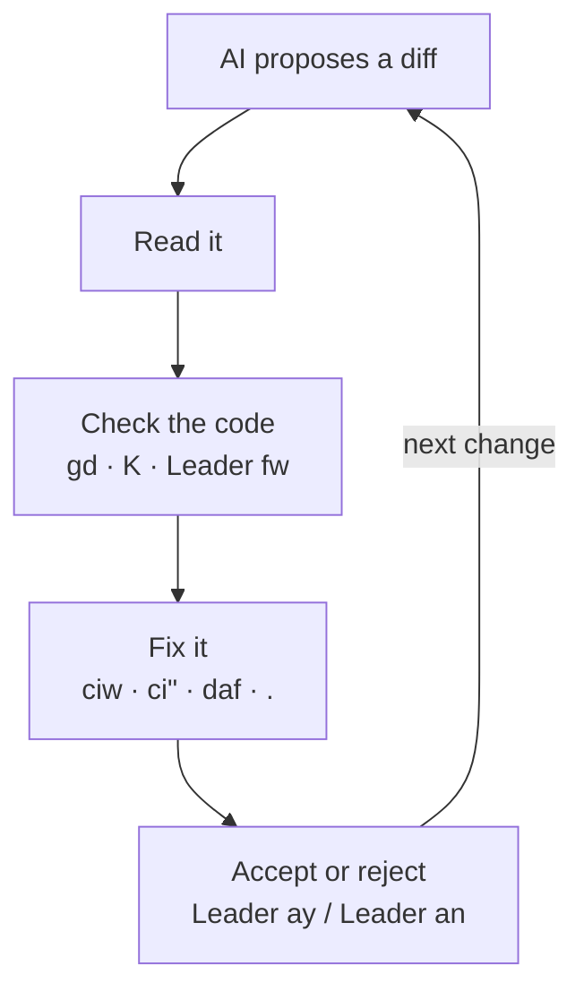
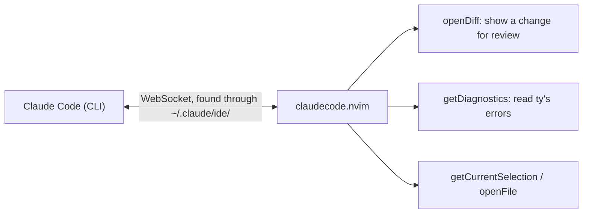
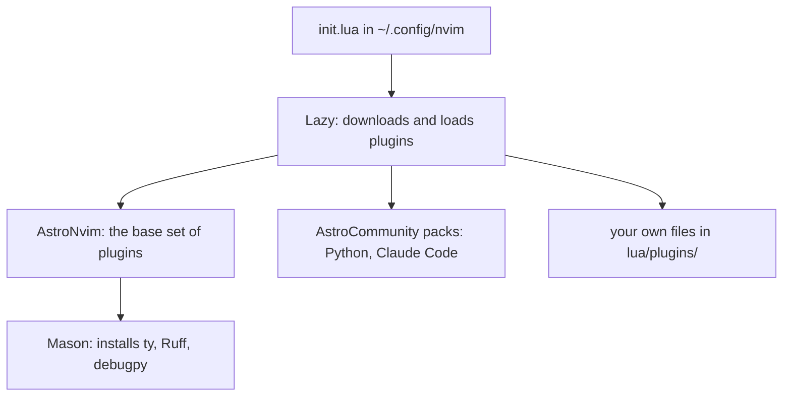

import VimMode from '../../../components/VimMode.astro';

> Vim is famous for one joke: nobody can figure out how to quit it

While this is still relevant to this day, it mostly stemmed from back when an editor's main job involved lots of typing. Today, AI agents running in the terminal (or CLI) write most of your code, so **your job is really to use the editor to read AI's code, check it, and then fix what's wrong**.

Many of y'all probably use VSCode or some AI Editor, like Cursor, as your code editor. While that sounds great, those are graphical code editors! But why not have your editor live in the same terminal as your agentic coding tools, so that you can check their work without ever having to even switch windows!

I've used [**Neovim**](https://neovim.io/) on and off since 2022, but for a long time it never really stuck to me, mostly because I didn't believe it could replace a real IDE, like **VSCode** or **JetBrains's IntelliJ**. Every few months I went back and forth between VSCode, IntelliJ, and Neovim sometimes using Vim keybindings for the former 2 whenever I felt like it.

During that time, I held back from Neovim for the same reason many people do: **making the UI and UX feel like a graphical editor such as VSCode, IntelliJ, or Zed took a lot of hands-on configuration**.

However, after a year or so, Neovim finally stuck for me when I stopped trying to build a configuration from scratch and started from a complete batteries included configuration that already included everything I needed. Later in this post, I will show you how you can get the exact same thing that kickstarted my Neovim journey: **a ready-made starter setup you can install, use right away, and change as you learn**. **Figure 1.1** shows the finished result, [nvimforge](https://github.com/kidskoding/nvimforge), in about half a minute:

<video
  src="/blog/why-i-use-neovim-with-ai/tour.mp4"
  width="1920"
  height="1200"
  autoplay
  loop
  muted
  playsinline
></video>

<p class="text-sm text-nvim-gray -mt-4 text-center"><strong>Figure 1.1:</strong> nvimforge from the start screen to the Claude panel, the file tree, the terminal, and lazygit, with every key shown at the bottom</p>

---

## The editor's job changed

If you've used an AI coding tool like [Claude Code](https://docs.anthropic.com/en/docs/claude-code) (Anthropic's coding agent) or GitHub Copilot (the AI assistant built into editors like VSCode), you know how this goes: you describe a change, and the agent writes it. What's left for you is everything around that: reading the diff (the list of lines it added and removed), opening the files it touched, checking that the code does what you asked, and fixing the parts it got wrong before you accept anything.

Some of that happens right in the agent's own terminal: Claude Code prints each diff and asks before it applies anything, so a plain yes or no never needs an editor. But an agent that writes a function in five seconds still isn't really that efficient if correcting one wrong line of it costs you a minute of selecting and clicking. **As soon as a change needs more than yes or no, such as fixing one line, reading the function it calls, or finding every place it renamed something, you're editing, and the editor decides how fast that goes.**

### An almost-right change

Consider asking an agent to rename the function `total_value` to `inventory_total`. Three files use that function, but the agent only renames it in two of them, and since the diff looks clean, you accept it. The third file still calls `total_value`, a name that no longer exists, so it crashes with an error the next time it runs.

**Searching the whole project for `total_value` finds that third file right away:** it's quick to fix before anything breaks, and your hands never leave the keyboard to click through a search panel like you might in a graphical editor such as VSCode.

In Neovim, that search is `<Leader>fw`. Meet the **leader key**, which you'll see a lot in this post: it's a key you press before a shortcut, and in this setup it's **Space**. So `<Leader>fw` means pressing Space, then `f`, then `w` (think **"find word"**).

The leader can be any key you like (Vim's own default is the backslash, `\`), but most Neovim setups, like AstroNvim, choose Space: it's the biggest key on the keyboard, your thumbs already rest on it, and in Normal mode it only moves the cursor one character to the right, which `l` already does.

The same thing happens inside a single function. Below is the kind of diff an agent hands back all the time, and **it's dangerous because it's almost right:**

```diff
 def total_value(items: list[Item]) -> float:
-    return sum(item.price * item.quantity for item in items)
+    total = 0.0
+    for item in items:
+        total += item.price * item.quantity * 1.08  # tax??
+    return round(total, 2)
```

Here, the agent turned a one-line sum into a loop and also added an 8% sales tax, which changes every total the function returns. In **Figure 1.2**, I asked Claude for that same rewrite on purpose, so you can see how a change like this shows up in Neovim. For this demonstration, I also asked it to make the whole change in one edit, since Claude can otherwise split a rewrite into several smaller diffs. Claude proposes the change as a diff right beside the code, `/for item` jumps to the new loop, and pressing `<Leader>an` (think **"AI: no"**) rejects it.

<video
  src="/blog/why-i-use-neovim-with-ai/review.mp4"
  width="1920"
  height="1200"
  autoplay
  loop
  muted
  playsinline
></video>

<p class="text-sm text-nvim-gray -mt-4 text-center"><strong>Figure 1.2:</strong> asked for a tax-rate rewrite, Claude proposes it as a diff in Neovim, and <code>&lt;Leader&gt;an</code> rejects it</p>

Every change an agent makes goes through the same steps: you read it, check it against the code around it, fix it or reject it, and then ask the agent for the next change. Because you repeat those steps for every change, I'll refer to them as **the review loop**, as shown in **Figure 1.3**, which draws it with the Neovim keys for each step:



<p class="text-sm text-nvim-gray -mt-4 text-center"><strong>Figure 1.3:</strong> the review loop when an agent writes the code, with the Neovim keys for each step (no need to learn them yet: the guide below introduces each key when you first use it)</p>

---

## AI coding moved into the terminal

If the editor's job is now reviewing an agent's work, it matters where that agent runs, and more and more it runs in a terminal. When your editor lives in that same terminal, the agent, the code, and the editor share one folder and one shell, **so going from the agent's answer to the line it changed is a keypress instead of a switch to another window.**

### Agents are command-line programs

Claude Code, OpenAI's Codex, Google's Gemini CLI, and OpenCode (an open-source agent that works with many AI models) all run in a terminal. Even the companies that build AI editors ship terminal agents now: the sidekick.nvim picker later in this post lists Cursor's and GitHub Copilot's command-line agents right beside Claude's.

**Because these agents are terminal programs, each one works like any other Unix tool:** `claude -p` (print mode) runs a single prompt and prints the answer, and it reads anything you pipe into it, so it combines with every other command you already use:

```sh
git diff | claude -p "review this diff for bugs and missing tests"
```

Since all it needs is text in and text out, the same agent you chat with in a panel can also run inside a script or a CI job (the checks that run automatically every time you push code).

### Agents work through the same tools you do

An agent doesn't need a graphical interface, because most of what it does is run commands and read what they print: `git diff`, `rg`, the test suite, the compiler. All of those already print plain text in a terminal.

While I recorded **Figure 1.2**, Claude read two files and then tested its own change from the shell before proposing anything. In one of the runs, this is the command it chose:

```sh
python3 report.py && python3 -c "from models import *; assert total_value([])==0; assert total_value([Item('a',10,1)])==10.8; print('ok')"
```

**I never asked for that check:** the agent reached for the same tools a developer would, running the script and then asserting on the result, because the terminal is where all of its tools already are.

### So your editor should live there too

An editor that runs in the same terminal as the agent shares everything with it: the folder, the files, the Git state, and the shell. In Neovim the agent sits in a split next to your code, so reading its change, opening a file it mentioned, and running its test are all keys in one window instead of trips between an IDE and a terminal.

That split is also a real Neovim **buffer**, which is Neovim's name for anything it has open, so the agent's output is text like any other file. Neovim has a few different **modes** (more on those soon), and while you're talking to the agent, it's in <VimMode mode="terminal" /> mode, where every key you type goes to the agent. Once you press `Ctrl+\` and then `Ctrl+N` to leave it, `/` searches what the agent wrote, `y` copies from it, and `gF` on a location it printed, like `models.py:11`, opens that file at line 11.

Neovim gets new features from **plugins**, which is Neovim's version of **extensions** you'd install in VSCode or Zed. One of them, [sidekick.nvim](https://github.com/folke/sidekick.nvim), was written by [folke](https://github.com/folke) (who also wrote Lazy, Snacks, and which-key, three more plugins you'll meet later in this setup!), and it opens twelve AI CLIs in splits like that and shows Copilot's next edit suggestions, where Copilot guesses the change you're about to make and shows it right in your code, ready to apply with `Tab`. **If an agent runs in a shell, it already runs in a Neovim split.**

This works the same way on machines with no desktop at all. Agents increasingly run on remote servers and in containers you reach over SSH, and Neovim runs there unchanged, right next to the agent in [tmux](https://github.com/tmux/tmux) or [Zellij](https://zellij.dev), two programs that split a single terminal into several panes.

Neovim stays fast with all of this installed: the start screen in **Figure 1.1** reports that Neovim loaded 10 of this setup's 52 plugins in about 88 ms, and the rest load only when you first need them.

> Wherever an agent comes from, it now ships as a program you run in a terminal, so the editor belongs in that terminal too.

---

## Why Neovim is the right terminal editor

Plenty of editors run in a terminal, but Neovim is the one I'd pick for this work because of three things: **how it edits, how it connects to Claude, and how much of it you can change.**

### Modal editing is built for fixing code

[Neovim](https://neovim.io) is a modern fork of Vim, and like Vim it's a **modal** editor. This means the editor switches between **modes**, and the same key does something different in each one: in one mode, pressing `d` starts a delete, while in another it just types the letter d.

Most of the time you're in <VimMode mode="normal" /> mode, where keys move around and change text, and you switch to <VimMode mode="insert" /> mode only when you want to type. **Most other editors are modeless:** you're always in typing mode, and the mouse, shortcuts, and multiple cursors handle everything else.

Those movement keys are known as Vim **motions** and they trace back to the idea behind **touch typing**, where your fingers rest on the home row (the middle row of letters - `asdf` and `jkl;`) and reach every key without haivng to look down on your keyboard or lift your hands.

In <VimMode mode="normal" /> mode, `h`, `j`, `k`, and `l` move left, down, up, and right respectively. All four sit on the home row, so your hands stay right there instead of reaching for the arrow keys or the mouse.

Having multiple modes sounds like extra work in a modal editor, but they actually end up removing steps. In a modeless editor (like VSCode or Zed), fixing one word means grabbing the mouse, selecting the word, typing, and clicking somewhere else. In Neovim you type `ciw` ("change inner word"), which deletes the word under the cursor, placing you in <VimMode mode="insert" /> mode where you can then type the new word and press `Esc` to go back.

This works because Neovim's commands combine: operators like `c` (change), `d` (delete), and `y` (yank, Vim's word for copy) pair with text objects like `iw` (inner word), `i(` (inside parentheses), `i"` (inside quotes), and `af` (a function). **You describe the edit you want instead of selecting the text by hand:** a handful of operators and objects covers the corrections AI output needs again and again, as **Table 1.1** shows:

| Fix to AI-written code | With the mouse | In Neovim |
|---|---|---|
| Replace a wrong argument | select inside the parentheses, then type | `ci(` with the cursor inside, then type |
| Fix a string | select inside the quotes, then type | `ci"`, then type |
| Delete a function the agent invented | select the whole function, then delete | `daf` |
| Make the same fix in several places | select each place again, or add cursors | fix it once, move to the next place, then `.` |
| Undo a change you accepted | `Ctrl/Cmd+Z` | `u` |

<p class="text-sm text-nvim-gray -mt-4 text-center"><strong>Table 1.1:</strong> common fixes to AI-written code, done each way</p>

In **Figure 1.4**, `ci(` rewrites an argument list, `ci"` replaces a string, and `ciw` changes a number before `.` repeats that change on the line above:

<video
  src="/blog/why-i-use-neovim-with-ai/modal.mp4"
  width="1920"
  height="1200"
  autoplay
  loop
  muted
  playsinline
></video>

<p class="text-sm text-nvim-gray -mt-4 text-center"><strong>Figure 1.4:</strong> <code>ci(</code>, <code>ci"</code>, <code>ciw</code>, and <code>.</code> fixing a list of items, with the keys shown at the bottom</p>

The `.` key repeats your last change, so once you've fixed one bad call, every other copy of it takes a move and a single `.`.

### Claude talks to Neovim the same way it talks to VS Code

[claudecode.nvim](https://github.com/coder/claudecode.nvim) is the plugin that connects Neovim to Claude Code. It uses the same WebSocket protocol (a live, two-way connection between two programs) that Anthropic's own **VS Code** and JetBrains extensions use. When it starts, it writes a small lock file to `~/.claude/ide/` that says where to connect, and Claude Code finds Neovim there exactly the way it finds VS Code. Over that connection, Claude can call the tools the editor exposes, as **Figure 1.5** shows:



<p class="text-sm text-nvim-gray -mt-4 text-center"><strong>Figure 1.5:</strong> how Claude Code connects to Neovim, and some of the editor tools it can call</p>

`openDiff` produced the diff in **Figure 1.2**, and `getDiagnostics` hands Claude the same type errors your language server shows you. A language server is a program that reads your code and tells the editor about its errors, types, and definitions; in this setup it's ty, a fast type checker for **Python** that you'll install in step 2. That means **when Claude fixes an error, it's working from exactly the diagnostics on your screen.**

### The editor is code you and the agent can change

Neovim's whole configuration is a folder of **Lua** files. When I added sidekick.nvim to this setup, I asked Claude to do it, and it read the plugin's source, noticed that the ready-made sidekick pack would fight Claude Code over the same `<Leader>A` keys, moved every AI key into one `<Leader>a` group, and tested the result in a headless Neovim (one running with no window) before I ever opened it. **Every one of those changes showed up as an ordinary Git diff in my config repo, so I could read all of it before committing anything.**

You can also drive Neovim itself from code: starting it with `nvim --listen` exposes its whole API on a socket, so another program can send it keys and read its state. That's how every clip in this post was recorded: a script started Neovim with `--listen`, typed the keystrokes with `nvim --server <socket> --remote-send`, and checked the editor's state with `--remote-expr` before each step.

Neovim still has real costs: you'll be slower for the first week, you have to maintain your own config, and big **Java** or **Kotlin** refactors (and design work) still go better in a full IDE. **Use an IDE on those days, and make Neovim the editor for the ordinary ones.**

---

## Build it around the review loop

For the rest of this post, I'll build the editor with you step by step: a theme first, so everything after it looks right, and then **the parts of the review loop from Figure 1.3, in order.**

Before we install anything, though, let's look at how the pieces of a Neovim setup fit together, so you know what each one does.

### How a Neovim setup fits together

Every time Neovim starts, it reads one folder: `~/.config/nvim` on Linux and macOS, or `%LOCALAPPDATA%\nvim` on Windows. It begins with a file called `init.lua`, and everything you add in this post is another file in that folder.

If you've used **VS Code** or **Zed**, you've configured an editor this way before. When you change a setting in VS Code's Settings screen, VS Code writes the change into a file called `settings.json` (in `~/.config/Code/User/` on Linux, `~/Library/Application Support/Code/User/` on macOS, or `%APPDATA%\Code\User\` on Windows), and Zed works the same way with its own `~/.config/zed/settings.json`. **The settings screen is only a front end for that file, so you can skip it and edit the JSON directly:**

```jsonc
// VS Code: ~/.config/Code/User/settings.json
{
  "workbench.colorTheme": "Catppuccin Macchiato",
  "editor.lineNumbers": "on",
  "editor.formatOnSave": true
}
```

Neovim works the same way, except that its settings files are **Lua** code instead of JSON. Here are the same three settings in this setup, each in the AstroNvim file where it lives:

```lua
-- lua/plugins/astroui.lua
opts = { colorscheme = "catppuccin-macchiato" },

-- lua/plugins/astrocore.lua
opts = { options = { opt = { relativenumber = false } } },

-- lua/plugins/astrolsp.lua
opts = { formatting = { format_on_save = { enabled = true } } },
```

**Because Lua is a programming language, a setting can compute its value instead of only storing it:** the status bar in step 6 reads its pink from the theme's palette by name, and the sidekick keys in step 3 are small functions that call the plugin when you press them.

On its own, Neovim is a fast editor without a file tree, a fuzzy finder, or an AI panel. Those all come from plugins, the Neovim version of extensions from earlier. Each one is a small **Lua** project that usually lives on GitHub and is named `owner/repo`, like `catppuccin/nvim`. Four more pieces sit around them:

- **A plugin manager downloads and loads them:** this setup uses [lazy.nvim](https://github.com/folke/lazy.nvim), or **Lazy**. It's named for how it works, since it loads each plugin only when you first need it, such as when you open a **Python** file or press a key, and that's how 52 plugins start in under a tenth of a second.
- **A distribution gives you a tested starting point:** choosing and configuring dozens of plugins yourself takes weeks, so this setup starts from [AstroNvim](https://astronvim.com), a set of plugins and defaults that you add your own files on top of.
- **Packs add whole features in one line:** [AstroCommunity](https://github.com/AstroNvim/astrocommunity) is AstroNvim's catalog of ready-made bundles, such as **Python** support or the Claude Code panel.
- **Mason installs the programs plugins call:** language servers like ty, formatters like Ruff, and debuggers like debugpy aren't Neovim plugins at all, so [mason.nvim](https://github.com/williamboman/mason.nvim), or **Mason**, downloads them for you.

**Figure 1.6** shows the order they load in: Neovim reads `init.lua`, `init.lua` starts Lazy, and Lazy loads everything else.



<p class="text-sm text-nvim-gray -mt-4 text-center"><strong>Figure 1.6:</strong> how the pieces of this setup load when Neovim starts</p>

Every file you add to `lua/plugins/` has the same shape, a **Lua** table that names one plugin and puts its settings in `opts`. **Once this shape makes sense, every config file in this post will too:**

```lua
-- lua/plugins/example.lua
return {
  "owner/repo",
  opts = {},
}
```

You don't have to configure anything from inside Neovim on day one, since you can edit these files in whatever editor you use today and restart `nvim` to see each change.

**You don't need to memorize keys first, either:** most shortcuts start with the leader key from earlier, Space in this setup, which config files write as `<Leader>`. Press Space and wait a moment, and [which-key](https://github.com/folke/which-key.nvim) lists every key that can come next.

**Table 1.2** maps each step of the review loop to the parts of the setup it uses:

| Step in the loop | What you need | In this setup |
|---|---|---|
| Ask the agent | an AI panel beside the code | claudecode.nvim and sidekick.nvim, on `<Leader>a` |
| Read what changed | find files, browse the tree, see the diff | Snacks picker `<Leader>ff`, Neo-tree `<Leader>e`, lazygit `<Leader>gg` |
| Check it | type errors, lint, running, debugging | ty and Ruff from `:Mason`, terminal `F7`, debugger `F9` / `F5` |
| Fix it | precise edits | Neovim's operators and text objects, built in |
| Accept and commit | accept / reject keys, Git | `<Leader>ay` / `<Leader>an`, lazygit |
| Stay comfortable | a theme, a status bar, key hints | Catppuccin, lualine, bufferline, which-key |

<p class="text-sm text-nvim-gray -mt-4 text-center"><strong>Table 1.2:</strong> what each step of the review loop needs, and where it lives in this setup</p>

### Start from AstroNvim

Before we install it, let's talk about AstroNvim. [AstroNvim](https://astronvim.com) is a **Neovim distribution**, a complete, batteries-included, community-maintained configuration that turns plain Neovim into a full editor as soon as you install it. It comes with a file tree (Neo-tree), a fuzzy finder and start screen (Snacks), key hints (which-key), a terminal (toggleterm), Git markers (gitsigns), a debugger (nvim-dap), and language server support that Mason installs for you, all set up to work together. If you've used VSCode, the closest comparison is installing VSCode along with a set of extensions someone has already configured for you. [LazyVim](https://www.lazyvim.org) and [NvChad](https://nvchad.com) are two other popular distributions that work the same way.

**What makes AstroNvim easy to customize is how it's installed:** AstroNvim itself loads as a plugin, and you start from its small *template*, which holds only your own files. Most of its settings live in three of them: `astrocore.lua` for options and keymaps, `astroui.lua` for the theme and icons, and `astrolsp.lua` for language servers. Because your files sit on top of AstroNvim instead of inside it, updating AstroNvim never overwrites your changes.

Now let's get Neovim running. If you already have an existing Neovim config, [move it aside](#if-you-already-have-a-neovim-config) and then clone AstroNvim's template into the config folder and start Neovim once so it can download everything the template lists:

```sh
git clone --depth 1 https://github.com/AstroNvim/template ~/.config/nvim
rm -rf ~/.config/nvim/.git
nvim   # wait for the download UI to finish
```

That first start is **Lazy** downloading AstroNvim's plugins, so you will give it a minute to let it finish while leaving the terminal open. When it finishes, you'll land on AstroNvim's **dashboard**, its start screen. Any file you open from there is called a **buffer**, the same idea as a file you open in a tab.


To quit, use a **colon command**: press `:`, type the command, and press Enter. `:qa` ("quit all") closes everything. Until the setup is finished, keep editing the config in the editor you already use, since the files live in `~/.config/nvim`.

Many of the template's files start with a **guard line**, `if true then return {} end`, which tells Neovim to skip the rest of the file. **Delete it from every file you edit, or Neovim will never load your changes.**

From here on, every step that needs configuring works the same way: **open or create a small file, write a few lines, and restart `nvim`.**

### 1. Pick a theme and a start screen

Let's start with the part of the editor that is the most conspicuous: the theme, since you'll be looking at this editor all day. This setup uses [catppuccin/nvim](https://github.com/catppuccin/nvim), the official Neovim port of the pastel [Catppuccin](https://catppuccin.com) color scheme, in its Macchiato flavour. **If those colors look familiar, that's because this blog and website are styled with the same theme!** Like any other theme, it takes two steps: **install the theme plugin, then select it.**

If you've ever switched themes in VSCode or Zed, this will feel familiar. In those editors, you'd open the Extensions page, install the Catppuccin extension, and then pick Catppuccin Macchiato from the theme picker (`Ctrl+K`, then `Ctrl+T`). **Neovim follows the same two steps:** the extension becomes a plugin you add via a small **Lua** file, and picking the theme becomes one line in another file.

Create `lua/plugins/catppuccin.lua` with the lines below: `"catppuccin/nvim"` is the plugin's `owner/repo` id, `name = "catppuccin"` gives it a readable name in Lazy, and `priority = 1000` loads it before every other plugin so everything draws in the right colors:

```lua
-- lua/plugins/catppuccin.lua
-- Catppuccin styles the gutters and which-key itself, so no overrides.
return {
  "catppuccin/nvim",
  name = "catppuccin",
  priority = 1000,
}
```

Installing a theme doesn't turn it on, so open `lua/plugins/astroui.lua`, delete the guard line, and set `colorscheme` to `"catppuccin-macchiato"`. Write out the flavour in full, because recent Neovim versions include a built-in colorscheme that's also called `catppuccin`, and plain `"catppuccin"` can load that one instead:

```lua
-- lua/plugins/astroui.lua (template, trimmed)
return {
  "AstroNvim/astroui",
  opts = {
    colorscheme = "catppuccin-macchiato",
  },
}
```

Restart, and the dashboard comes back in Catppuccin's colors:


Now let's make the start screen yours. The dashboard is drawn by [Snacks.nvim](https://github.com/folke/snacks.nvim) (`folke/snacks.nvim`), a plugin AstroNvim already installed that also provides the file picker and the terminal helpers, so this time you aren't installing anything. **To change a plugin you already have, you create a file that names it again, and Lazy merges your settings into its existing ones.**

By default, the menu has New File, Find File, Recents, Find Word, Bookmarks, and Last Session, but no Quit. We'll trim it to the rows you'll actually use and add a Quit row. Find Word can go, because `<Leader>fw` does the same search once a file is open, and Bookmarks can go too.

The rows live in `dashboard.preset.keys`, and each row has four fields: `key` is the letter you press, `action` is the command or leader mapping it runs, `icon` is the glyph, and `desc` is the label. Here `opts` is a function instead of a table, so it receives AstroNvim's existing Snacks settings and changes only the menu, rather than replacing everything. Create `lua/plugins/snacks.lua`:

```lua
-- lua/plugins/snacks.lua
-- Trim the dashboard to five rows and add Quit.
---@type LazySpec
return {
  "folke/snacks.nvim",
  opts = function(_, opts)
    local get_icon = require("astroui").get_icon

    opts.dashboard = opts.dashboard or {}
    opts.dashboard.preset = opts.dashboard.preset or {}

    opts.dashboard.preset.keys = {
      { key = "n", action = "<Leader>n", icon = get_icon("FileNew", 0, true), desc = "New File  " },
      { key = "f", action = "<Leader>ff", icon = get_icon("Search", 0, true), desc = "Find File  " },
      { key = "o", action = "<Leader>fo", icon = get_icon("DefaultFile", 0, true), desc = "Recents  " },
      { key = "s", action = "<Leader>Sl", icon = get_icon("Refresh", 0, true), desc = "Last Session  " },
      { key = "q", action = ":qa", icon = get_icon("BufferClose", 0, true), desc = "Quit  " },
    }

    -- Lazy can merge leftover stock rows onto the list, so clear anything past ours
    for i = #opts.dashboard.preset.keys + 1, 12 do
      opts.dashboard.preset.keys[i] = nil
    end
  end,
}
```

`get_icon(...)` borrows AstroNvim's Nerd Font glyphs, so the new rows match the rest of the editor, and the Quit row runs the same `:qa` from earlier. Restart, and the dashboard shows just your five rows, with Quit right on `q`, so nobody has to wonder how to quit this Vim!


### 2. Turn on the packs

Now that the editor looks right, let's turn on the features themselves. Most of the review loop comes from AstroCommunity packs, and each pack turns on with a single `{ import = "..." }` line. That means one file turns on the agent panel, the language tools, the status bar, the tabs, and session restore all at once.

The **Python** part is three packs: `python.base` adds syntax highlighting, debugger wiring, and a picker for your project's virtual environment, `python.ty` brings in ty for type checking, jump-to-definition, and hover docs, and `python.ruff` brings in Ruff for linting (catching style problems and likely bugs) and formatting on save. **These are the packs that check an agent's Python the moment it lands.**

Open `lua/community.lua`, delete the guard line, and paste in the whole file:

```lua
-- lua/community.lua
-- AstroCommunity: ready-made plugin packs, turned on with one `import` line each
-- browse everything available here: https://github.com/AstroNvim/astrocommunity

---@type LazySpec
return {
  "AstroNvim/astrocommunity",

  { import = "astrocommunity.pack.lua" }, -- helps when editing these config files

  { import = "astrocommunity.bars-and-lines.lualine-nvim" }, -- the status bar
  { import = "astrocommunity.bars-and-lines.bufferline-nvim" }, -- the tabs

  -- languages (uncomment the languages you use!)
  -- check out all available language extension packs here: https://github.com/AstroNvim/astrocommunity/tree/main/lua/astrocommunity/pack
  { import = "astrocommunity.pack.python.base" }, -- Python syntax, the debugger, and a virtualenv picker
  { import = "astrocommunity.pack.python.ty" }, -- ty: type checking, go-to-definition, and hover docs
  { import = "astrocommunity.pack.python.ruff" }, -- Ruff: linting and formatting for Python
  -- { import = "astrocommunity.pack.typescript" },
  -- { import = "astrocommunity.pack.rust" },

  { import = "astrocommunity.ai.claudecode-nvim" },

  { import = "astrocommunity.recipes.auto-session-restore" },
}
```

Don't add a plain `pack.python` import on top of these, or the two **Python** toolchains will conflict. Then quit with `:qa` and start `nvim` again so Lazy can download what the new imports added, and run `:Lazy` to see every plugin and whether it has loaded yet:


You won't find `ruff` or `ty` in that list, because Lazy only manages Neovim plugins, and **ty and Ruff are separate programs that Mason installs:** run `:Mason` and check that `ty`, `ruff`, `lua_ls`, and `debugpy` are marked installed. If one isn't, move to it with `j` and `k`, press the install key shown in the footer (usually `i`), and wait:


If jump-to-definition or format-on-save ever stops working, check `:Mason` before you touch the config, since Lazy can look perfectly fine while Mason never installed the program behind it.

### A small project to try things on

Before we go any further, let's make something to work on: a tiny two-file **Python** project. **It's the same code as the diff near the top of this post, so you can watch the whole loop happen to it:**

```python
# inventory/models.py
from dataclasses import dataclass

@dataclass
class Item:
    name: str
    price: float
    quantity: int

def total_value(items: list[Item]) -> float:
    return sum(item.price * item.quantity for item in items)
```

```python
# inventory/report.py
from models import Item, total_value

items = [
    Item("keyboard", 49.99, 3),
    Item("mouse", 19.99, 5),
]

print(f"Inventory value: {total_value(items):.2f}")
```

Commit it so lazygit, a terminal app for Git that you'll use in step 4, has some history to show, then open Neovim inside the folder (on a Mac, Neovim's shortcuts use Ctrl, not Cmd):

```sh
cd inventory && git init && git add . && git commit -m "Initial inventory" && nvim
```

### Your first five minutes with the motions

The motions are the part of Neovim that feels strangest at first, so before any AI shows up, let's take them one small step at a time on real code. Open `report.py` from the dashboard by pressing `f`, typing `rep`, and pressing Enter. You're in <VimMode mode="normal" /> mode now, so every key you press is a command instead of text, and you can't break anything here: `u` undoes your last change as many times as you need.

#### 1. Move with h, j, k, and l

Start with the four keys from earlier. Press `j` three times to move down to the `keyboard` row, `l` to move right, `h` to move back left, and `k` to go back up, just like in **Figure 1.7**:

<video
  src="/blog/why-i-use-neovim-with-ai/motions-hjkl.mp4"
  width="1920"
  height="1200"
  autoplay
  loop
  muted
  playsinline
></video>

<p class="text-sm text-nvim-gray -mt-4 text-center"><strong>Figure 1.7:</strong> <code>j</code>, <code>l</code>, <code>h</code>, and <code>k</code> moving the cursor one line or one character at a time</p>

#### 2. Jump instead of crawling

Once single steps feel natural, try bigger jumps. `w` hops forward a word and `b` hops back, `$` goes to the end of the line and `0` to the start, and `G` and `gg` go to the bottom and top of the file. Vim counts punctuation like `("` as its own word, so watch where `w` lands in **Figure 1.8**:

<video
  src="/blog/why-i-use-neovim-with-ai/motions-jump.mp4"
  width="1920"
  height="1200"
  autoplay
  loop
  muted
  playsinline
></video>

<p class="text-sm text-nvim-gray -mt-4 text-center"><strong>Figure 1.8:</strong> <code>w</code> and <code>b</code> jump by word, <code>$</code> and <code>0</code> jump to the end and start of the line, and <code>G</code> and <code>gg</code> jump to the bottom and top of the file</p>

#### 3. Type something, then take it back

To type, you switch to <VimMode mode="insert" /> mode. On the `mouse` row, press `o`: Neovim opens a new line below it and puts you in Insert mode, so you can type a comment like `# add a monitor here`. Press `Esc` to go back to Normal mode, then `u` to take the whole line back out, as in **Figure 1.9**:

<video
  src="/blog/why-i-use-neovim-with-ai/motions-insert.mp4"
  width="1920"
  height="1200"
  autoplay
  loop
  muted
  playsinline
></video>

<p class="text-sm text-nvim-gray -mt-4 text-center"><strong>Figure 1.9:</strong> <code>o</code> opens a new line in Insert mode, <code>Esc</code> returns to Normal mode, and <code>u</code> undoes the whole line</p>

#### 4. Change a word without selecting it

This is the step you'll use the most when fixing AI-written code. On the `keyboard` row, press `$` to jump to the end of the line and `h` twice to land on the `3`. Then type `ciw` ("change inner word"): the `3` disappears and you're in Insert mode, so type `4` and press `Esc`. **The same idea works inside quotes:** press `0` to go back to the start of the line and type `ci"`, and Neovim clears `keyboard` so you can type `laptop`. **Figure 1.10** shows both:

<video
  src="/blog/why-i-use-neovim-with-ai/motions-change.mp4"
  width="1920"
  height="1200"
  autoplay
  loop
  muted
  playsinline
></video>

<p class="text-sm text-nvim-gray -mt-4 text-center"><strong>Figure 1.10:</strong> <code>ciw</code> changes the quantity from 3 to 4, and <code>ci"</code> changes <code>keyboard</code> to <code>laptop</code></p>

#### 5. Delete a line and put it back

Last one. On the `mouse` row, `dd` deletes the whole line, and `P` puts it right back above the cursor. Neovim keeps whatever you delete, so `dd` and then `p` somewhere else is how you move a line, as in **Figure 1.11**:

<video
  src="/blog/why-i-use-neovim-with-ai/motions-delete.mp4"
  width="1920"
  height="1200"
  autoplay
  loop
  muted
  playsinline
></video>

<p class="text-sm text-nvim-gray -mt-4 text-center"><strong>Figure 1.11:</strong> <code>dd</code> deletes the <code>mouse</code> row, and <code>P</code> puts it back</p>

When you're done, press `u` until `report.py` looks the way it did when you opened it, or type `:e!` and press Enter to throw away every unsaved change at once.

**Those few keys already cover most of the fixes in this post:** the rest of this guide teaches each new key the first time you need it. When you want more practice, type `:Tutor` and press Enter. It's an interactive tutorial built into Neovim, where each lesson is a short exercise you do right inside the text, and it takes about half an hour.

### 3. Ask the agent

With the packs in place, let's bring in the agent. The `claudecode-nvim` import from step 2 already installed claudecode.nvim, which runs the Claude Code CLI in a side panel and opens Claude's proposed changes as diffs you accept or reject. It only hosts the CLI, so `claude` itself still has to be installed and on your PATH (see the appendix). sidekick.nvim, which you'll copy in below, does the same job for every other AI CLI.

**The ready-made packs for these two plugins both claim the same `<Leader>A` keys, so nvimforge moves every AI action into one lowercase `<Leader>a` group instead:** the actions you use most get the shortest keys, and accepting or rejecting a diff is `y` or `n`, as in yes or no. **Table 1.3** lists the whole group:

| Key | What it does | Plugin |
|---|---|---|
| `<Leader>aa` | Open or close the Claude panel | claudecode.nvim |
| `<Leader>as` | Send the selection to Claude (in <VimMode mode="visual" /> mode) | claudecode.nvim |
| `<Leader>ab` | Add the current file to Claude's context | claudecode.nvim |
| `<Leader>ay` / `<Leader>an` | Accept / reject Claude's diff | claudecode.nvim |
| `<Leader>af` · `<Leader>ar` · `<Leader>am` | Focus the panel · resume a session · pick a model | claudecode.nvim |
| `<Leader>ao` | Open another AI CLI (Codex, Gemini, OpenCode, …) | sidekick.nvim |
| `<Leader>ad` | Close that CLI's session (`Ctrl+.` only hides it) | sidekick.nvim |
| `<Leader>at` / `<Leader>ap` | Send the code under the cursor / pick a saved prompt | sidekick.nvim |
| `Ctrl+.` | Show or hide that CLI from any mode (it keeps running) | sidekick.nvim |
| `Tab` | Jump to or apply Copilot's next edit suggestion | sidekick.nvim |

<p class="text-sm text-nvim-gray -mt-4 text-center"><strong>Table 1.3:</strong> every AI key in nvimforge, grouped under <code>&lt;Leader&gt;a</code></p>

Copy [`claudecode.lua`](https://github.com/kidskoding/nvimforge/blob/master/nvim/lua/plugins/claudecode.lua) and [`sidekick.lua`](https://github.com/kidskoding/nvimforge/blob/master/nvim/lua/plugins/sidekick.lua) from nvimforge into your `lua/plugins/` folder. The sidekick file stays short, because each key is one line in its `keys` list:

```lua
-- lua/plugins/sidekick.lua (trimmed)
return {
  "folke/sidekick.nvim",
  event = "VeryLazy",
  opts = {},
  keys = {
    { "<Leader>ao", function() require("sidekick.cli").select() end, desc = "Open another AI CLI" },
    { "<Leader>ad", function() require("sidekick.cli").close() end, desc = "Close an AI CLI session" },
    { "<Leader>at", function() require("sidekick.cli").send { msg = "{this}" } end, mode = { "n", "x" }, desc = "Send this to AI CLI" },
    { "<Leader>ap", function() require("sidekick.cli").prompt() end, mode = { "n", "x" }, desc = "Pick an AI prompt" },
    -- Ctrl+. and Tab are in the full file
  },
}
```

One more small file stops the Claude panel from stacking a second title bar under the tabs. heirline (`rebelot/heirline.nvim`), the plugin AstroNvim uses for its status line, draws a title strip above every window, and this file turns it off:

```lua
-- lua/plugins/heirline.lua
-- No title bar above each window, so the Claude panel shows only one.
return {
  "rebelot/heirline.nvim",
  opts = function(_, opts)
    opts.winbar = nil
    return opts
  end,
}
```

Restart, and `<Leader>aa` opens Claude next to your code:


`<Leader>ao` lists every other AI CLI that sidekick can open and marks the ones already installed on your machine:


In **Figure 1.12**, `<Leader>ao` picks OpenCode from that list, `<Leader>at` sends the function under the cursor to it, and OpenCode answers a question about the code:

<video
  src="/blog/why-i-use-neovim-with-ai/sidekick-opencode.mp4"
  width="1920"
  height="1200"
  autoplay
  loop
  muted
  playsinline
></video>

<p class="text-sm text-nvim-gray -mt-4 text-center"><strong>Figure 1.12:</strong> sidekick.nvim opens OpenCode, sends it <code>total_value</code> with <code>&lt;Leader&gt;at</code>, and OpenCode explains the function</p>

### 4. Read what changed

Once the agent has changed something, our first job is finding everything it touched, including files we've never opened. AstroNvim already ships the three tools we need for that, so let's try each one on the project.

The first is a **picker** from Snacks, a plugin AstroNvim installs: a search box with a live preview of each result. `<Leader>ff` finds files by name and `<Leader>fo` reopens recent files, while `Ctrl+J` and `Ctrl+K` move through the results and `Esc` closes the picker.

**`<Leader>fw` searches the text of every file in the project (it needs [ripgrep](https://github.com/BurntSushi/ripgrep)), which is how you find every place an agent renamed something:**


The second is [Neo-tree](https://github.com/nvim-neo-tree/neo-tree.nvim), the file tree. `<Leader>e` (Space, then `e`) opens and closes it, and `<Leader>o` moves the cursor between the tree and your code. Inside the tree, Enter opens a file, `a` creates one (end the name with `/` to make a folder), `r` renames, `d` deletes, and `?` shows every other key:


The third covers Git: [gitsigns](https://github.com/lewis6991/gitsigns.nvim) marks changed lines in the column to the left of the line numbers, and `]g` and `[g` jump between those changes. **When an agent has edited several files, `<Leader>gg` opens [lazygit](https://github.com/jesseduffield/lazygit), where you can see every change before you commit any of them.**

lazygit is a separate program, so install it from the appendix. Inside it, Space stages a file, `c` commits, and `q` closes it:


While we're in the editor, let's also fix the line numbers, since agents and error messages refer to code by line number. By default, AstroNvim numbers each line by its distance from the cursor, which makes jumps like `5j` easy to count but makes "line 42" hard to find, and it also hides the command line, so whatever you type after `:` covers the status bar.

Both settings live in astrocore (`AstroNvim/astrocore`), the file for AstroNvim's options, keymaps, and autocommands, so open `lua/plugins/astrocore.lua`, delete the guard line, and set `cmdheight = 1` and `relativenumber = false` under `options.opt`:

```lua
-- lua/plugins/astrocore.lua (template, trimmed; delete the guard line)
return {
  "AstroNvim/astrocore",
  opts = {
    options = {
      opt = {
        cmdheight = 1,
        relativenumber = false,
      },
    },
  },
}
```

### 5. Check it

Next, let's make sure the change is correct. **The language packs from step 2 already check every file you open, so this step is mostly about knowing where to look:** in **Figure 1.13**, a number becomes a string, ty flags the type error as soon as the file is saved, `gl` shows the full message, `K` shows a function's signature, and `gd` jumps to where it's defined:

<video
  src="/blog/why-i-use-neovim-with-ai/check.mp4"
  width="1920"
  height="1200"
  autoplay
  loop
  muted
  playsinline
></video>

<p class="text-sm text-nvim-gray -mt-4 text-center"><strong>Figure 1.13:</strong> ty flags a type error on save, then <code>gl</code>, <code>K</code>, and <code>gd</code> check the code</p>

To run the code, AstroNvim ships [toggleterm](https://github.com/akinsho/toggleterm.nvim). **`F7` opens a terminal in a split along the bottom, and pressing `F7` again hides it** without stopping the shell, so a long command keeps running while you edit. `<Leader>tf` opens a floating terminal instead, and `<Leader>tv` opens one in a vertical split:


When running the code isn't enough, AstroNvim also ships [nvim-dap](https://github.com/mfussenegger/nvim-dap), Neovim's client for the Debug Adapter Protocol, and the **Python** packs connect it to `debugpy`. `F9` sets a breakpoint, `F5` starts the debugger, `F10` steps over a line, and `F11` steps into a function. Move to the `print` line in `report.py`, press `F9`, then press `F5` and choose `file` the first time it asks what to run:


Pressing `F5` again runs the program to the end, and the debugger's panels close by themselves when it finishes.

### 6. Finish the look

Finally, let's finish the look. The packs from step 2 also added lualine, the status bar along the bottom, and bufferline, which shows a tab for each open buffer along the top. nvimforge restyles both in [`lualine.lua`](https://github.com/kidskoding/nvimforge/blob/master/nvim/lua/plugins/lualine.lua) and [`bufferline.lua`](https://github.com/kidskoding/nvimforge/blob/master/nvim/lua/plugins/bufferline.lua), with one bar across the whole screen, a pink badge for <VimMode mode="terminal" /> mode so the AI panels stand out, and the active tab on a raised background. Copy those two files if you like the look:


Last, which-key, the menu that appears when you press Space, comes with AstroNvim, and Catppuccin colors it for you. Press Space and you'll see a readable list of keys, with the AI group on `a`:


If icons show up as empty boxes, install a [Nerd Font](#fonts-and-icons). **To get this exact editor on another machine, keep `~/.config/nvim` in Git**, including `lazy-lock.json`, which pins every plugin to the version you tested.

---

## The loop, start to finish

With everything installed, let's run the whole loop once on the `inventory` project: open `nvim`, press `<Leader>ff`, type `rep`, and choose `report.py`.

First, let's make the kind of mistake an agent makes. Put the cursor on the `5` in the mouse row and type `ciw`, which deletes the number and switches to <VimMode mode="insert" /> mode (a plain `i` switches without deleting anything). Type `"5"` in its place, press `Esc` to return to <VimMode mode="normal" /> mode, and save with `Ctrl+S`. **ty flags the type error immediately**, and `gl` shows the full message:


Press `u` to undo that. Then, to check code you didn't write, put the cursor on `total_value` and press `K` to see its signature, or `gd` to jump to its definition in `models.py` and `Ctrl+O` to jump back. To rename it everywhere, press `<Leader>lr`, type the new name, press Enter, and save the other files it changed with `:wa`.

Now let's bring in the agent: `<Leader>aa` opens the Claude panel, and `<Leader>as` sends whatever you've selected. **When Claude proposes something like the tax-rate diff from the top of this post, `<Leader>an` rejects it and `<Leader>ay` accepts it.**

If a bad change already got in, `daf` deletes the whole function and `u` brings the old one back. The rest of the loop uses keys from the build: `F7` runs the script, `F9` and `F5` step through it, and `<Leader>gg` shows the full diff so you can commit. Quit with `:qa`, and the next time you run a bare `nvim` in this folder, session restore reopens your files.

**Once that loop feels normal, combining commands is where Neovim pulls ahead:** `c`, `d`, and `y` work with `iw`, `i(`, `i"`, and `af` to change, delete, or copy exactly the text you mean, `dd` deletes a line and `p` pastes it, `]f` jumps to the next function, and `.` repeats your last change. **Table 1.4** collects every key from this section:

| Do | Keys |
|---|---|
| Find file / search the project | `<Leader>ff` / `<Leader>fw` |
| File tree | `<Leader>e` |
| <VimMode mode="insert" /> / <VimMode mode="normal" /> | `i` / `Esc` |
| Change a word, an argument, a string | `ciw`, `ci(`, `ci"` |
| Delete a function / undo / repeat | `daf` / `u` / `.` |
| Full diagnostic | `gl` |
| Hover / go to definition | `K` / `gd` (`Ctrl+O` back) |
| Rename symbol | `<Leader>lr`, then `:wa` |
| AI | `<Leader>aa` Claude · `<Leader>ay` / `<Leader>an` accept / reject · `<Leader>ao` / `<Leader>ad` open / close other CLIs |
| Terminal / debug / Git | `F7` · `F9`/`F5`/`F10` · `<Leader>gg` |
| Quit | `:qa` |

<p class="text-sm text-nvim-gray -mt-4 text-center"><strong>Table 1.4:</strong> the keys from the full loop, for quick reference</p>

It took me years of switching back and forth before I was as fast in Neovim as I was in my old editor. **What finally made it stick was starting from a setup that already worked:** once I stopped spending my time configuring Neovim, I could spend it writing code instead, and this guide gives you that same head start.

---

## Where to start

- **Keep your AI tools:** Claude Code works the same in the Neovim panel, and sidekick.nvim covers the other agents and Copilot, so switching editors doesn't cost you any of them.
- **Learn the fixing keys first:** `ciw`, `ci"`, `daf`, `u`, and `.` cover the corrections AI output needs most often, and they'll help you more than any plugin.
- **Check every claim in the editor:** read the diff, press the key, run the code, and let ty and Ruff flag mistakes the moment a change lands (that's if you are using Python!).
- **Start from a complete editor:** use AstroNvim or nvimforge, then change one part only when it slows you down, not because a plugin looks interesting.
- **Grow into it:** do one small, real task in Neovim each day until it becomes the editor you open first.

When you forget a key, `<Leader>fk` searches every keymap and `<Leader>fh` searches Neovim's help. If you'd rather build everything yourself, [kickstart.nvim](https://github.com/nvim-lua/kickstart.nvim) is a good starting point, but there's nothing wrong with staying on AstroNvim for years.

---

Vim is still famous for being hard to quit.

With an agent running in the terminal beside it, it's also the fastest place I know to read, check, and fix what that agent wrote.

**P.S.** Funnily enough, this whole website is built to look like Neovim, with a tab bar of open files along the top, a status bar along the bottom, and even a [`:checkhealth`](/checkhealth) page. Now that you know the motions, try them right here: `j` and `k` scroll this post, and `:q` closes it just like a buffer. If you'd rather not, your mouse works exactly like it does on any other website.

---

## Appendix: installing everything

### What you need

| Tool | Why | Check |
|---|---|---|
| Neovim 0.11+ | Editor (AstroNvim v6 min; written against 0.12) | `nvim --version` |
| Git | Config and plugins | `git --version` |
| Node.js | Most language servers | `node --version` |
| C compiler | Tree-sitter parsers | `gcc --version` or `clang --version` |
| tree-sitter CLI | Parsers | `tree-sitter --version` |
| ripgrep | Project search | `rg --version` |
| fd | File search | `fd --version` |
| Nerd Font | Icons | [Fonts](#fonts-and-icons) |
| lazygit | Git UI | `lazygit --version` |
| Claude Code | Agent | `claude --version` |
| Python 3 | Examples | `python3 --version` |
| Neovide | Optional GUI | `neovide --version` |

On Linux, also install `wl-clipboard` or `xclip` so Neovim can use the system clipboard. nvimforge's Nix flake already includes ripgrep, fd, tree-sitter, lazygit, Node, and a C compiler.

### Installing the tools

These steps follow Neovim's [install guide](https://github.com/neovim/neovim/blob/master/INSTALL.md), and Claude Code has [its own setup docs](https://docs.anthropic.com/en/docs/claude-code).

```sh
# macOS
xcode-select --install
brew install neovim git node ripgrep fd lazygit
brew install --cask font-jetbrains-mono-nerd-font

# Windows (PowerShell)
winget install Neovim.Neovim Git.Git OpenJS.NodeJS.LTS \
  BurntSushi.ripgrep.MSVC sharkdp.fd JesseDuffield.lazygit

# Arch
sudo pacman -S neovim git nodejs npm base-devel \
  ripgrep fd tree-sitter-cli lazygit

# Debian / Ubuntu (Neovim from tarball below)
sudo apt install git nodejs npm build-essential ripgrep fd-find unzip

# Other Linux x86_64
curl -LO \
  https://github.com/neovim/neovim/releases/latest/download/nvim-linux-x86_64.tar.gz
sudo tar -C /opt -xzf nvim-linux-x86_64.tar.gz
export PATH="$PATH:/opt/nvim-linux-x86_64/bin"
```

If `nvim --version` reports anything older than 0.11, install from the tarball and add the `export` line to your shell's startup file.

On Debian and Ubuntu, `fd` installs under the name `fdfind`, and on Windows you'll also need a C compiler, such as Visual Studio Build Tools. If the tree-sitter CLI is missing, delete the guard line in the template's `lua/plugins/mason.lua` and Mason will install it for you.

### Fonts and icons

Icons need a [Nerd Font](https://www.nerdfonts.com/font-downloads) set as your terminal font. If you'd rather not install one, set `icons_enabled = false` in `lua/lazy_setup.lua` to turn icons off.

### Neovide

[Neovide](https://neovide.dev/installation.html) is an optional graphical window for this same config. Set its font in `lua/polish.lua` with a line like `vim.o.guifont = "JetBrainsMono Nerd Font:h14"`, and on Nix you can launch it with `nix run .#neovide` from the nvimforge folder.

### Windows template path

On Windows the config lives under `%LOCALAPPDATA%`, but the steps don't change: clone the template, start Neovim once, quit, and then edit the files.

```powershell
git clone --depth 1 https://github.com/AstroNvim/template $env:LOCALAPPDATA\nvim
Remove-Item $env:LOCALAPPDATA\nvim\.git -Recurse -Force
nvim   # wait for plugins, then :qa
```

### When it doesn't work

Most problems come down to a missing program or a guard line you forgot to delete:

- If icons show up as boxes, install a Nerd Font or set `icons_enabled = false`.
- If there's no syntax highlighting, make sure a C compiler and the tree-sitter CLI are on your `PATH`.
- If language features don't work, check `:Mason` and the language's own toolchain.
- If `<Leader>fw` finds nothing, install ripgrep.
- If Neovim ignores your config, one of your files still has its `if true then return {} end` guard line.
- If errors stay red after you fix them, save with `:w` or run `:LspRestart`.
- If the Claude panel won't open, check that `claude` runs in a normal shell.
- If nothing else helps, run `:checkhealth`, or start `nvim --clean` to rule out your config.

### If you already have a Neovim config

Move your existing config and data folders out of the way so the template starts clean:

```sh
mv ~/.config/nvim ~/.config/nvim.bak
mv ~/.local/share/nvim ~/.local/share/nvim.bak
mv ~/.local/state/nvim ~/.local/state/nvim.bak
mv ~/.cache/nvim ~/.cache/nvim.bak
```

On Windows, move `%LOCALAPPDATA%\nvim` and `%LOCALAPPDATA%\nvim-data` instead.

### Undoing it

To go back to your old setup, delete the new folders and restore the backups:

```sh
rm -rf ~/.config/nvim \
  ~/.local/share/nvim \
  ~/.local/state/nvim \
  ~/.cache/nvim
mv ~/.config/nvim.bak ~/.config/nvim
mv ~/.local/share/nvim.bak ~/.local/share/nvim
mv ~/.local/state/nvim.bak ~/.local/state/nvim
mv ~/.cache/nvim.bak ~/.cache/nvim
```

### Nix

On Nix, you can try Neovim with `nix shell nixpkgs#neovim`, or on NixOS add the packages to `environment.systemPackages`.

The programs Mason downloads often won't run on NixOS as they are, so you'll usually need `programs.nix-ld` or the nixpkgs versions of those tools. nvimforge's `flake.nix` can also run this config alongside an existing Neovim install.
